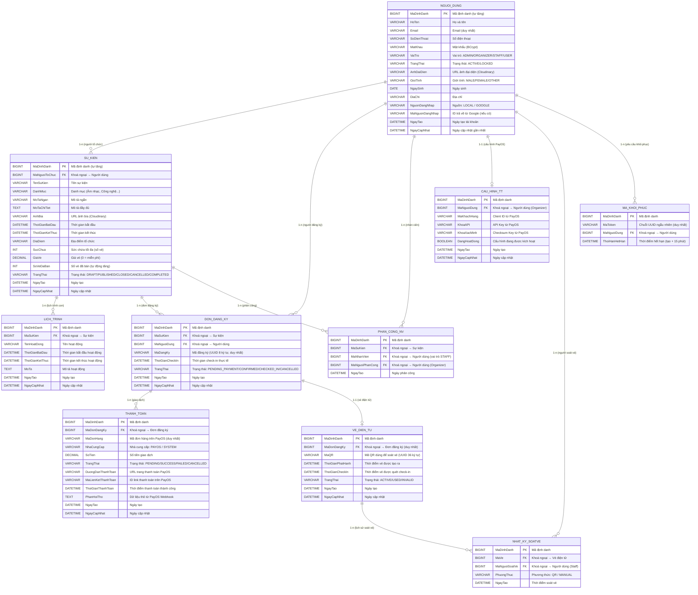

# THIẾT KẾ CƠ SỞ DỮ LIỆU (DATABASE DESIGN)
Hệ thống quản lý sự kiện, thanh toán PayOS và check-in QR

---

## I. BIỂU ĐỒ THỰC THỂ LIÊN KẾT (ERD)

---

## II. DANH SÁCH BẢNG VÀ MÔ TẢ

| STT | Tên bảng (Backend) | Tên tiếng Việt | Mô tả chức năng |
|---|---|---|---|
| 1 | `users` | **Người dùng** | Lưu thông tin tài khoản, mật khẩu, vai trò và nguồn đăng nhập (LOCAL/GOOGLE OAuth2) |
| 2 | `events` | **Sự kiện** | Thông tin sự kiện do Người tổ chức (Organizer) tạo ra |
| 3 | `event_schedules` | **Lịch trình sự kiện** | Các hoạt động chi tiết trong timeline của một sự kiện |
| 4 | `registrations` | **Đơn đăng ký** | Yêu cầu đăng ký tham gia của người dùng (ràng buộc: 1 user/1 sự kiện) |
| 5 | `payments` | **Thanh toán** | Giao dịch thanh toán qua PayOS gắn với đơn đăng ký |
| 6 | `tickets` | **Vé điện tử** | Vé QR sinh ra sau khi thanh toán/đăng ký thành công |
| 7 | `event_staff_assignments` | **Phân công nhân viên** | Gán quyền soát vé cho Staff tại từng sự kiện |
| 8 | `payment_configs` | **Cấu hình thanh toán** | Thông tin tài khoản PayOS của Organizer để nhận tiền vé |
| 9 | `checkin_logs` | **Nhật ký soát vé** | Ghi lại từng lượt soát vé (QR/thủ công), thời gian và nhân viên thực hiện |
| 10 | `password_reset_tokens` | **Mã khôi phục mật khẩu** | Token UUID một lần, hết hạn sau 15 phút, dùng để đặt lại mật khẩu |

---

## III. GIẢI THÍCH CHI TIẾT CÁC MỐI QUAN HỆ

### 1. Mối quan hệ 1 – Nhiều

| Bảng cha | Bảng con | Khoá ngoại | Ý nghĩa |
|---|---|---|---|
| Người dùng | Sự kiện | `organizer_id` | 1 Organizer tạo nhiều sự kiện; mỗi sự kiện chỉ có 1 chủ |
| Người dùng | Đơn đăng ký | `user_id` | 1 User đăng ký nhiều sự kiện; mỗi đơn chỉ thuộc 1 user |
| Người dùng | Phân công nhân viên | `staff_id` | 1 Staff được phân công nhiều sự kiện; mỗi bản ghi gắn 1 Staff |
| Người dùng | Nhật ký soát vé | `checked_in_by` | 1 Staff thực hiện nhiều lần soát vé |
| Người dùng | Mã khôi phục MK | `user_id` | 1 User có thể yêu cầu khôi phục mật khẩu nhiều lần |
| Sự kiện | Lịch trình | `event_id` | 1 Sự kiện có nhiều hoạt động trong timeline |
| Sự kiện | Đơn đăng ký | `event_id` | 1 Sự kiện nhận nhiều đơn đăng ký (giới hạn sức chứa) |
| Sự kiện | Phân công nhân viên | `event_id` | 1 Sự kiện có nhiều nhân viên soát vé |
| Đơn đăng ký | Thanh toán | `registration_id` | 1 Đơn đăng ký có thể có nhiều giao dịch (retry khi thất bại) |
| Vé điện tử | Nhật ký soát vé | `ticket_id` | 1 Vé lưu toàn bộ lịch sử lần soát |

### 2. Mối quan hệ 1 – 1

| Bảng A | Bảng B | Khoá ngoại | Ý nghĩa |
|---|---|---|---|
| Người dùng | Cấu hình thanh toán | `user_id` | Mỗi Organizer chỉ có 1 tài khoản PayOS |
| Đơn đăng ký | Vé điện tử | `registration_id` | Mỗi đơn đăng ký hợp lệ tạo ra đúng 1 mã QR vé |

---

## IV. CÁC RÀNG BUỘC NGHIỆP VỤ CHÍNH

| # | Ràng buộc | Mô tả |
|---|---|---|
| 1 | **Đăng ký duy nhất** | `(event_id, user_id)` trong bảng **Đơn đăng ký** là duy nhất — 1 user chỉ mua 1 vé cho 1 sự kiện |
| 2 | **Luồng phát vé** | Khi **Thanh toán** = THÀNH CÔNG → Tự động tạo **Vé điện tử** = ACTIVE; khi soát vé thành công → Vé = USED |
| 3 | **Phân quyền truy cập** | Admin thấy tất cả; Organizer chỉ quản lý sự kiện của mình; Staff chỉ soát vé sự kiện được phân công; User chỉ thấy sự kiện PUBLISHED |
| 4 | **Hủy tự động** | Đơn **Thanh toán** còn PENDING quá 5 phút bị hủy tự động bởi Scheduler, nhả lại chỗ |
| 5 | **Hủy vé trả phí** | Vé sự kiện có phí **không** được phép hủy sau khi thanh toán thành công |
