# BIEU DO USE CASE TONG QUAT HE THONG

**Du an:** He thong Quan ly Su kien & Check-in QR

---

## I. SO DO USE CASE TONG QUAT

> **Ghi chu:**
>
> - **Mui ten tam giac** ke thua: Actor cap duoi thua huong toan bo chuc nang cua Actor cap tren.
> - **Duong ket noi**: Actor tham gia truc tiep vao Use Case do.
> - **Mau sac goi**: Phan biet ro rang pham vi quyen han cua tung role.

```mermaid
flowchart LR
    %% ========== ACTORS ==========
    Guest(["Guest\nKhach"])
    User(["User\nNguoi dung"])
    Staff(["Staff\nNhan vien"])
    Organizer(["Organizer\nNguoi to chuc"])
    Admin(["Admin\nQuan tri vien"])

    %% ========== KE THUA ACTOR ==========
    Admin     ---|"ke thua"| Organizer
    Organizer ---|"ke thua"| Staff
    Staff     ---|"ke thua"| User
    User      ---|"ke thua"| Guest

    %% ========== [GOI 1] TRUY CAP CONG KHAI ==========
    subgraph PUB ["Truy cap cong khai"]
        direction TB
        P1(["Xem danh sach Su kien"])
        P2(["Xem chi tiet Su kien & Lich trinh"])
        P3(["Dang ky tai khoan"])
        P4(["Dang nhap thu cong / Google OAuth2"])
        P5(["Tu van tu dong qua Chatbot AI"])
    end

    %% ========== [GOI 2] QUAN LY TAI KHOAN CA NHAN ==========
    subgraph ACC ["Quan ly Tai khoan ca nhan"]
        direction TB
        A1(["Cap nhat ho so & Avatar"])
        A2(["Doi mat khau"])
    end

    %% ========== [GOI 3] QUAN LY VE & THANH TOAN ==========
    subgraph TKT ["Quan ly Ve & Thanh toan"]
        direction TB
        T1(["Dang ky tham gia Su kien"])
        T2(["Thanh toan ve qua PayOS"])
        T3(["Huy ve mien phi"])
        T4(["Xem Ve ca nhan & Ma QR"])
    end

    %% ========== [GOI 4] KIEM SOAT CHECK-IN ==========
    subgraph CHK ["Kiem soat Check-in"]
        direction TB
        K1(["Xem danh sach Ve cua Su kien"])
        K2(["Quet ma QR Check-in"])
        K3(["Check-in thu cong"])
    end

    %% ========== [GOI 5] QUAN LY SU KIEN ==========
    subgraph EVT ["Quan ly Su kien"]
        direction TB
        E1(["Tao / Chinh sua Su kien"])
        E2(["Doi trang thai Su kien"])
        E3(["Xoa Su kien"])
        E4(["Quan ly Lich trinh"])
        E5(["Cau hinh cong PayOS"])
        E6(["Xem Bao cao doanh thu"])
    end

    %% ========== [GOI 6] QUAN LY NHAN VIEN ==========
    subgraph STF ["Quan ly Nhan vien Su kien"]
        direction TB
        S1(["Xem danh sach Nhan vien phu trach"])
        S2(["Phan cong / Dong bo Nhan vien"])
        S3(["Go Nhan vien khoi Su kien"])
    end

    %% ========== [GOI 7] QUAN TRI HE THONG ==========
    subgraph ADM ["Quan tri He thong"]
        direction TB
        D1(["Xem & Tim kiem Nguoi dung"])
        D2(["Khoa / Mo khoa tai khoan"])
        D3(["Phan quyen he thong"])
        D4(["Xem Thong ke tong quan"])
    end

    %% ========== LIEN KET ACTOR USE CASE ==========
    Guest     --> PUB
    User      --> ACC & TKT
    Staff     --> CHK
    Organizer --> EVT & STF
    Admin     --> ADM

    %% Shared permissions
    Organizer --> K1
    Admin     --> E2 & E3

    %% ========== STYLE ACTORS ==========
    style Guest     fill:#f5f5f5,stroke:#9e9e9e,stroke-width:2px
    style User      fill:#e8f5e9,stroke:#2e7d32,stroke-width:2px
    style Staff     fill:#e3f2fd,stroke:#1565c0,stroke-width:2px
    style Organizer fill:#fff3e0,stroke:#e65100,stroke-width:2px
    style Admin     fill:#fce4ec,stroke:#880e4f,stroke-width:2px

    %% ========== STYLE PACKAGES ==========
    style PUB fill:#f8f9fa,stroke:#6c757d,stroke-width:2px
    style ACC fill:#e8f5e9,stroke:#2e7d32,stroke-width:2px
    style TKT fill:#d7f0dc,stroke:#388e3c,stroke-width:2px
    style CHK fill:#e3f2fd,stroke:#1565c0,stroke-width:2px
    style EVT fill:#fff3e0,stroke:#e65100,stroke-width:2px
    style STF fill:#fff8e1,stroke:#f9a825,stroke-width:2px
    style ADM fill:#fce4ec,stroke:#880e4f,stroke-width:2px
```

---

## II. BANG PHAN QUYEN THEO NHOM CHUC NANG

| Nhom chuc nang                                                            | Guest | User | Staff | Organizer | Admin |
| ------------------------------------------------------------------------- | :---: | :--: | :---: | :-------: | :---: |
| **Truy cap cong khai** (Xem SK, Dang ky TK, Dang nhap Google, Chatbot AI) |  YES  | YES  |  YES  |    YES    |  YES  |
| **Quan ly Tai khoan** (Ho so, Doi MK)                                     |   -   | YES  |  YES  |    YES    |  YES  |
| **Quan ly Ve & Thanh toan** (Mua ve, PayOS, Xem QR)                       |   -   | YES  |  YES  |    YES    |  YES  |
| **Kiem soat Check-in** (Xem ve SK, Quet QR, Check-in thu cong)            |   -   |  -   |  YES  |    YES    |  YES  |
| **Quan ly Su kien** (Tao/Sua/Xoa/Lich trinh/PayOS Config)                 |   -   |  -   |   -   |    YES    | YES\* |
| **Quan ly Nhan vien** (Phan cong, Go Staff khoi SK)                       |   -   |  -   |   -   |    YES    |   -   |
| **Quan tri He thong** (Nguoi dung, Khoa TK, Phan quyen, Thong ke)         |   -   |  -   |   -   |     -     |  YES  |

> **(\*) Admin** co the doi trang thai va xoa su kien (can thiep quan tri), nhung **khong** co quyen tao su kien moi.
