# BIỂU ĐỒ LỚP (CLASS DIAGRAM)

**Hệ thống Quản lý Sự kiện & Check-in QR**

---

## Biểu đồ lớp tổng quát

```mermaid
classDiagram
    direction TB

    %% ============================================================
    %% LỚP CHA TRỪU TƯỢNG
    %% ============================================================
    class ThucTheCo {
        <<abstract>>
        + ngayTao : LocalDateTime
        + ngayCapNhat : LocalDateTime
    }

    %% ============================================================
    %% KIỂU DỮ LIỆU LIỆT KÊ (ENUM)
    %% ============================================================
    class VaiTro {
        <<enumeration>>
        ADMIN
        ORGANIZER
        STAFF
        USER
    }

    class TrangThaiTaiKhoan {
        <<enumeration>>
        ACTIVE
        LOCKED
    }

    class GioiTinh {
        <<enumeration>>
        MALE
        FEMALE
        OTHER
    }

    class TrangThaiSuKien {
        <<enumeration>>
        DRAFT
        PUBLISHED
        CLOSED
        CANCELLED
        COMPLETED
    }

    class TrangThaiDangKy {
        <<enumeration>>
        PENDING_PAYMENT
        CONFIRMED
        CHECKED_IN
        CANCELLED
    }

    class TrangThaiThanhToan {
        <<enumeration>>
        PENDING
        SUCCESS
        FAILED
        CANCELLED
    }

    class NhaCungCapThanhToan {
        <<enumeration>>
        PAYOS
        SYSTEM
    }

    class TrangThaiVe {
        <<enumeration>>
        ACTIVE
        USED
        INVALID
    }

    class PhuongThucSoatVe {
        <<enumeration>>
        QR
        MANUAL
    }

    %% ============================================================
    %% CÁC LỚP THỰC THỂ CHÍNH
    %% ============================================================

    class NguoiDung {
        + id : Long
        + hoTen : String
        + email : String
        + soDienThoai : String
        + matKhau : String
        + vaiTro : VaiTro
        + trangThai : TrangThaiTaiKhoan
        + anhDaiDien : String
        + gioiTinh : GioiTinh
        + ngaySinh : LocalDate
        + diaChi : String
        --
        + dangKyTaiKhoan(hoTen, email, matKhau, soDienThoai) void
        + dangNhap(email, matKhau) String
        + dangNhapGoogle(authorizationCode) String
        + dangXuat() void
        + quenMatKhau(email) void
        + datLaiMatKhau(token, matKhauMoi) void
        + doiMatKhau(matKhauCu, matKhauMoi) void
        + xemHoSo() NguoiDung
        + capNhatHoSo(hoTen, soDienThoai, gioiTinh, ngaySinh, diaChi) void
        + capNhatHoSo(hoTen, soDienThoai, gioiTinh, ngaySinh, diaChi) void
        + tuKhoaTaiKhoan() void
        + kiemTraEmailTonTai(email) Boolean
        + kiemTraTrangThaiHoatDong() Boolean
    }

    class NguoiDungAdmin {
        --
        + xemDanhSachNguoiDung(trang, kichThuoc, tuKhoa, vaiTro, trangThai) List
        + khoaTaiKhoan(id) void
        + moKhoaTaiKhoan(id) void
        + phanQuyenVaiTro(id, vaiTroMoi) void
        + xemThongKeTongQuan() Object
        + kiemTraKhongTuThayDoiChinhMinh(id) void
    }

    class SuKien {
        + id : Long
        + nguoiToChuc : NguoiDung
        + tenSuKien : String
        + danhMuc : String
        + moTaNgan : String
        + moTaChiTiet : Text
        + anhBia : String
        + thoiGianBatDau : LocalDateTime
        + thoiGianKetThuc : LocalDateTime
        + diaDiem : String
        + sucChua : Integer
        + giaVe : BigDecimal
        + soVeDaBan : Integer
        + trangThai : TrangThaiSuKien
        --
        + taoSuKienMoi(thongTin, anhBia) SuKien
        + capNhatSuKien(id, thongTin) SuKien
        + xoaSuKien(id) void
        + doiTrangThai(id, trangThaiMoi) void
        + xemDanhSachSuKien(tuKhoa, danhMuc, trangThai) List
        + xemChiTietSuKien(id) SuKien
        + xemThongKeSuKien(id) Object
        + kiemTraConCho() Boolean
        + kiemTraConHanDangKy() Boolean
        + kiemTraChuSuKien(nguoiDungId) Boolean
        + giaoCho_TangSoVe() void
        + nhaoCho_GiamSoVe() void
    }

    class LichTrinhSuKien {
        + id : Long
        + suKien : SuKien
        + tenHoatDong : String
        + thoiGianBatDau : LocalDateTime
        + thoiGianKetThuc : LocalDateTime
        + moTa : Text
        --
        + themNhieuLichTrinh(suKienId, danhSach) List
        + capNhatNhieuLichTrinh(suKienId, danhSach) List
        + xoaMotLichTrinh(suKienId, lichTrinhId) void
        + xoaToanBoLichTrinh(suKienId) void
        + xemDanhSachLichTrinh(suKienId) List
        + kiemTraThoiGianHopLe(batDau, ketThuc, suKien) Boolean
    }

    class DonDangKy {
        + id : Long
        + suKien : SuKien
        + nguoiDung : NguoiDung
        + maDangKy : String
        + thoiGianCheckIn : LocalDateTime
        + trangThai : TrangThaiDangKy
        --
        + dangKyThamGia(nguoiDungId, suKienId) DonDangKy
        + huyDangKy(id) void
        + xemDanhSachDangKy(suKienId) List
        + xemDonDangKyCuaToi(nguoiDungId) List
        + kiemTraDaDangKy(nguoiDungId, suKienId) Boolean
        + xacNhanDangKy(id) void
        + huyDatCho_NhaLai(suKienId) void
        + sinhMaDangKy() String
    }

    class ThanhToan {
        + id : Long
        + donDangKy : DonDangKy
        + maDonHang : String
        + nhaCungCap : NhaCungCapThanhToan
        + soTien : BigDecimal
        + trangThai : TrangThaiThanhToan
        + duongDanThanhToan : String
        + maLienKetThanhToan : String
        + thoiGianThanhToan : LocalDateTime
        + phanHoiTho : Text
        --
        + taoLienKetThanhToan(donDangKyId, soTien) String
        + xemDonHangChoThanhToan(nguoiDungId) List
        + dongBoTrangThaiDonHang(maDonHang) Object
        + xuLyWebhookPayOS(payload, chuKy) void
        + huyDonHangHetHan() void
        + kiemTraChuKyHMAC(payload, chuKy, khoaXacMinh) Boolean
        + kiemTraIdempotency(maDonHang) Boolean
        + ghi_ThanhToanMienPhi(donDangKyId) void
    }

    class VeDienTu {
        + id : Long
        + donDangKy : DonDangKy
        + maQR : String
        + thoiGianPhatHanh : LocalDateTime
        + thoiGianCheckIn : LocalDateTime
        + trangThai : TrangThaiVe
        --
        + phatHanhVe(donDangKyId) VeDienTu
        + huyVe(id) void
        + xemVeCaNhan(nguoiDungId) List
        + xemVeSuKien(suKienId) List
        + kiemTraMaQRHopLe(maQR) Boolean
        + kiemTraConHieuLuc() Boolean
        + sinhMaQR() String
        + danhDauDaSuDung(maQR) void
    }

    class SoatVe {
        + id : Long
        + veDienTu : VeDienTu
        + nguoiSoatVe : NguoiDung
        + phuongThuc : PhuongThucSoatVe
        --
        + soatVeQR(maQR, nguoiSoatVeId) Object
        + dongBoDanhSachOffline(suKienId, danhSachMa) Object
        + xemLichSuSoatVe(veId) List
        + kiemTraQuyenSoatVe(nguoiSoatVeId, suKienId) Boolean
        + ghiNhatKy(veId, nguoiSoatVeId, phuongThuc) void
    }

    class PhanCongNhanVien {
        + id : Long
        + suKien : SuKien
        + nhanVien : NguoiDung
        + nguoiPhanCong : NguoiDung
        --
        + xemDanhSachNhanVienHeThong() List
        + xemNhanVienSuKien(suKienId) List
        + dongBoPhanCong(suKienId, danhSachId) List
        + xoaNhanVienKhoiSuKien(suKienId, nhanVienId) void
        + kiemTraNhanVienHopLe(nhanVienId) Boolean
        + kiemTraDaPhaCong(suKienId, nhanVienId) Boolean
    }

    class CauHinhThanhToan {
        + id : Long
        + nguoiDung : NguoiDung
        + maKhachHang : String
        + khoaAPI : String
        + khoaXacMinh : String
        + dangHoatDong : Boolean
        --
        + luuCauHinh(nguoiDungId, clientId, apiKey, checksumKey) void
        + xemCauHinh(nguoiDungId) CauHinhThanhToan
        + capNhatCauHinh(nguoiDungId, thongTin) void
        + kiemTraDaCauHinh(nguoiDungId) Boolean
        + layCauHinhHopLe(nguoiDungId) CauHinhThanhToan
    }

    class MaKhoiPhucMatKhau {
        + id : Long
        + token : String
        + nguoiDung : NguoiDung
        + thoiHanHetHan : LocalDateTime
        --
        + taoMaMoi(nguoiDungId) String
        + xacThucMa(token) Boolean
        + xoaMaKhoiPhuc(token) void
        + xoaMaCu(nguoiDungId) void
        + kiemTraDaHetHan() Boolean
    }

    %% ============================================================
    %% KẾ THỪA
    %% ============================================================
    ThucTheCo <|-- NguoiDung
    ThucTheCo <|-- SuKien
    ThucTheCo <|-- LichTrinhSuKien
    ThucTheCo <|-- DonDangKy
    ThucTheCo <|-- ThanhToan
    ThucTheCo <|-- VeDienTu
    ThucTheCo <|-- SoatVe
    ThucTheCo <|-- PhanCongNhanVien
    ThucTheCo <|-- CauHinhThanhToan
    NguoiDung <|-- NguoiDungAdmin

    %% ============================================================
    %% SỬ DỤNG KIỂU LIỆT KÊ
    %% ============================================================
    NguoiDung       ..> VaiTro               : sử dụng
    NguoiDung       ..> TrangThaiTaiKhoan    : sử dụng
    NguoiDung       ..> GioiTinh             : sử dụng
    SuKien          ..> TrangThaiSuKien      : sử dụng
    DonDangKy       ..> TrangThaiDangKy      : sử dụng
    ThanhToan       ..> TrangThaiThanhToan   : sử dụng
    ThanhToan       ..> NhaCungCapThanhToan  : sử dụng
    VeDienTu        ..> TrangThaiVe          : sử dụng
    SoatVe          ..> PhuongThucSoatVe     : sử dụng

    %% ============================================================
    %% QUAN HỆ GIỮA CÁC LỚP
    %% ============================================================
    NguoiDung       "1"  -->  "0..*"  SuKien              : tạo sự kiện
    NguoiDung       "1"  -->  "0..*"  DonDangKy           : đăng ký tham gia
    NguoiDung       "1"  -->  "0..1"  CauHinhThanhToan    : cấu hình PayOS
    NguoiDung       "1"  -->  "0..*"  PhanCongNhanVien    : được phân công
    NguoiDung       "1"  -->  "0..*"  SoatVe              : thực hiện soát vé
    NguoiDung       "1"  -->  "0..*"  MaKhoiPhucMatKhau   : yêu cầu khôi phục MK
    SuKien          "1"  *--  "0..*"  LichTrinhSuKien     : có lịch trình con
    SuKien          "1"  -->  "0..*"  DonDangKy           : nhận đơn đăng ký
    SuKien          "1"  *--  "0..*"  PhanCongNhanVien    : phân công nhân viên
    DonDangKy       "1"  -->  "0..*"  ThanhToan           : giao dịch thanh toán
    DonDangKy       "1"  -->  "0..1"  VeDienTu            : tạo vé điện tử
    VeDienTu        "1"  -->  "0..*"  SoatVe              : lịch sử soát vé
```

---

## Bảng tóm tắt phương thức nghiệp vụ theo lớp

| Lớp                   | Nhóm chức năng   | Phương thức tiêu biểu                                                                           |
| --------------------- | ---------------- | ----------------------------------------------------------------------------------------------- |
| **NguoiDung**         | Xác thực         | `dangKyTaiKhoan()`, `dangNhap()`, `dangNhapGoogle()`, `dangXuat()`                              |
| **NguoiDung**         | Quản lý hồ sơ    | `xemHoSo()`, `capNhatHoSo()`, `taiAnhDaiDien()`, `tuKhoaTaiKhoan()`                             |
| **NguoiDung**         | Khôi phục MK     | `quenMatKhau()`, `datLaiMatKhau()`, `doiMatKhau()`                                              |
| **NguoiDungAdmin**    | Quản trị         | `xemDanhSachNguoiDung()`, `khoaTaiKhoan()`, `phanQuyenVaiTro()`, `xemThongKeTongQuan()`         |
| **SuKien**            | CRUD sự kiện     | `taoSuKienMoi()`, `capNhatSuKien()`, `xoaSuKien()`, `doiTrangThai()`                            |
| **SuKien**            | Tra cứu          | `xemDanhSachSuKien()`, `xemChiTietSuKien()`, `xemThongKeSuKien()`                               |
| **SuKien**            | Nghiệp vụ        | `kiemTraConCho()`, `kiemTraConHanDangKy()`, `giaoCho_TangSoVe()`, `nhaoCho_GiamSoVe()`          |
| **LichTrinhSuKien**   | Quản lý timeline | `themNhieuLichTrinh()`, `capNhatNhieuLichTrinh()`, `xoaMotLichTrinh()`, `xoaToanBoLichTrinh()`  |
| **DonDangKy**         | Đăng ký          | `dangKyThamGia()`, `huyDangKy()`, `xacNhanDangKy()`, `kiemTraDaDangKy()`                        |
| **ThanhToan**         | Thanh toán       | `taoLienKetThanhToan()`, `xuLyWebhookPayOS()`, `dongBoTrangThaiDonHang()`, `huyDonHangHetHan()` |
| **VeDienTu**          | Vé QR            | `phatHanhVe()`, `huyVe()`, `xemVeCaNhan()`, `xemVeSuKien()`, `danhDauDaSuDung()`                |
| **SoatVe**            | Check-in         | `soatVeQR()`, `dongBoDanhSachOffline()`, `kiemTraQuyenSoatVe()`, `ghiNhatKy()`                  |
| **PhanCongNhanVien**  | Phân công        | `dongBoPhanCong()`, `xoaNhanVienKhoiSuKien()`, `xemNhanVienSuKien()`                            |
| **CauHinhThanhToan**  | PayOS            | `luuCauHinh()`, `capNhatCauHinh()`, `kiemTraDaCauHinh()`, `layCauHinhHopLe()`                   |
| **MaKhoiPhucMatKhau** | Token MK         | `taoMaMoi()`, `xacThucMa()`, `xoaMaKhoiPhuc()`, `kiemTraDaHetHan()`                             |

---

## Bảng tóm tắt các kiểu liệt kê (Enum)

| Enum                 | Tên tiếng Việt              | Các giá trị                                             |
| -------------------- | --------------------------- | ------------------------------------------------------- |
| `Role`               | **Vai trò**                 | ADMIN, ORGANIZER, STAFF, USER                           |
| `UserStatus`         | **Trạng thái tài khoản**    | ACTIVE (hoạt động), LOCKED (bị khóa)                    |
| `Gender`             | **Giới tính**               | MALE (nam), FEMALE (nữ), OTHER (khác)                   |
| `EventStatus`        | **Trạng thái sự kiện**      | DRAFT, PUBLISHED, CLOSED, CANCELLED, COMPLETED          |
| `RegistrationStatus` | **Trạng thái đăng ký**      | PENDING_PAYMENT, CONFIRMED, CHECKED_IN, CANCELLED       |
| `PaymentStatus`      | **Trạng thái thanh toán**   | PENDING, SUCCESS, FAILED, CANCELLED                     |
| `PaymentProvider`    | **Nhà cung cấp thanh toán** | PAYOS, SYSTEM (sự kiện miễn phí)                        |
| `TicketStatus`       | **Trạng thái vé**           | ACTIVE (còn hiệu lực), USED (đã dùng), INVALID (bị hủy) |
| `CheckInMethod`      | **Phương thức soát vé**     | QR (quét mã), MANUAL (thủ công)                         |
