# BIỂU ĐỒ PHÂN RÃ THỰC THỂ (ENTITY DECOMPOSITION DIAGRAM)
**Hệ thống Quản lý Sự kiện & Check-in QR**

---

## I. BIỂU ĐỒ PHÂN RÃ THEO CẤP ĐỘ (LEVELS)

```mermaid
graph TD
    %% ============================
    %% LEVEL 0: Hệ thống
    %% ============================
    System["HỆ THỐNG QUẢN LÝ SỰ KIỆN & CHECK-IN QR"]

    %% ============================
    %% LEVEL 1: Nhóm chức năng (hình chữ nhật)
    %% ============================
    Auth["QUẢN LÝ TÀI KHOẢN & BẢO MẬT"]
    EvMng["QUẢN LÝ NỘI DUNG SỰ KIỆN"]
    RegPay["QUẢN LÝ ĐĂNG KÝ & TÀI CHÍNH"]
    Ops["QUẢN LÝ VẬN HÀNH & SOÁT VÉ"]

    %% ============================
    %% LEVEL 2: Thực thể dữ liệu (hình oval)
    %% ============================
    NGUOI_DUNG([NGUOI_DUNG])
    MA_KHOI_PHUC([MA_KHOI_PHUC])

    SU_KIEN([SU_KIEN])
    LICH_TRINH([LICH_TRINH])
    PHAN_CONG_NHAN_VIEN([PHAN_CONG_NHAN_VIEN])

    DON_DANG_KY([DON_DANG_KY])
    THANH_TOAN([THANH_TOAN])
    CAU_HINH_THANH_TOAN([CAU_HINH_THANH_TOAN])

    VE_DIEN_TU([VE_DIEN_TU])
    NHAT_KY_SOATVE([NHAT_KY_SOATVE])

    %% ============================
    %% KẾT NỐI Level 0 → Level 1
    %% ============================
    System --> Auth
    System --> EvMng
    System --> RegPay
    System --> Ops

    %% ============================
    %% KẾT NỐI Level 1 → Level 2
    %% ============================
    Auth    --> NGUOI_DUNG
    Auth    --> MA_KHOI_PHUC

    EvMng   --> SU_KIEN
    EvMng   --> LICH_TRINH
    EvMng   --> PHAN_CONG_NHAN_VIEN

    RegPay  --> DON_DANG_KY
    RegPay  --> THANH_TOAN
    RegPay  --> CAU_HINH_THANH_TOAN

    Ops     --> VE_DIEN_TU
    Ops     --> NHAT_KY_SOATVE

    %% ============================
    %% STYLING
    %% ============================
    style System fill:#1a237e,color:#fff,stroke:#1a237e,stroke-width:3px

    style Auth    fill:#e8eaf6,stroke:#3f51b5,stroke-width:2px
    style EvMng   fill:#e8eaf6,stroke:#3f51b5,stroke-width:2px
    style RegPay  fill:#e8eaf6,stroke:#3f51b5,stroke-width:2px
    style Ops     fill:#e8eaf6,stroke:#3f51b5,stroke-width:2px

    style NGUOI_DUNG          fill:#fff,stroke:#333,stroke-width:1px
    style MA_KHOI_PHUC        fill:#fff,stroke:#333,stroke-width:1px
    style SU_KIEN             fill:#fff,stroke:#333,stroke-width:1px
    style LICH_TRINH          fill:#fff,stroke:#333,stroke-width:1px
    style PHAN_CONG_NHAN_VIEN fill:#fff,stroke:#333,stroke-width:1px
    style DON_DANG_KY         fill:#fff,stroke:#333,stroke-width:1px
    style THANH_TOAN          fill:#fff,stroke:#333,stroke-width:1px
    style CAU_HINH_THANH_TOAN fill:#fff,stroke:#333,stroke-width:1px
    style VE_DIEN_TU          fill:#fff,stroke:#333,stroke-width:1px
    style NHAT_KY_SOATVE      fill:#fff,stroke:#333,stroke-width:1px
```

**Chú thích ký hiệu:**
| Ký hiệu | Ý nghĩa |
|---|---|
| ▭ Hình chữ nhật | Hệ thống (Level 0) hoặc Nhóm chức năng nghiệp vụ (Level 1) |
| ⬭ Hình oval | Thực thể dữ liệu (Level 2) — tương ứng với các bảng trong CSDL |

> **Các thực thể dữ liệu ở Level 2 sẽ được sử dụng để xây dựng biểu đồ ERD, thể hiện chi tiết các mối quan hệ (1-1, 1-N) giữa các thực thể trong hệ thống. Xem chi tiết tại: [03_database_design.md](./03_database_design.md)**

---

## II. MÔ TẢ CHI TIẾT TỪNG CẤP ĐỘ PHÂN RÃ

### LEVEL 0 — Hệ thống tổng quát
Toàn bộ nghiệp vụ của đề tài nằm trong một hệ thống duy nhất: **Quản lý Sự kiện & Check-in QR**.

---

### LEVEL 1 — Nhóm chức năng nghiệp vụ (Subject Areas)

| STT | Nhóm chức năng | Mô tả |
|---|---|---|
| 1 | **QUẢN LÝ TÀI KHOẢN & BẢO MẬT** | Xử lý định danh người dùng, xác thực, phân quyền và khôi phục mật khẩu |
| 2 | **QUẢN LÝ NỘI DUNG SỰ KIỆN** | Tạo, cập nhật sự kiện, lịch trình hoạt động và phân công nhân sự |
| 3 | **QUẢN LÝ ĐĂNG KÝ & TÀI CHÍNH** | Xử lý đơn đăng ký tham gia và luồng thanh toán qua PayOS |
| 4 | **QUẢN LÝ VẬN HÀNH & SOÁT VÉ** | Phát hành vé QR và ghi nhận lịch sử soát vé tại cổng sự kiện |

---

### LEVEL 2 — Thực thể dữ liệu (Entities)

| Nhóm (Level 1) | Thực thể (Level 2) | Tên bảng trong ERD | Vai trò |
|---|---|---|---|
| Tài khoản | **NGUOI_DUNG** | `NGUOI_DUNG` | Lưu thông tin định danh, vai trò (Admin/Organizer/Staff/User) và trạng thái tài khoản |
| | **MA_KHOI_PHUC** | `MA_KHOI_PHUC` | Lưu token UUID có thời hạn 15 phút dùng một lần để đặt lại mật khẩu |
| Sự kiện | **SU_KIEN** | `SU_KIEN` | Thực thể trung tâm — chứa toàn bộ thông tin mô tả một sự kiện |
| | **LICH_TRINH** | `LICH_TRINH` | Danh sách các mốc thời gian hoạt động (Timeline) của sự kiện |
| | **PHAN_CONG_NHAN_VIEN** | `PHAN_CONG_NHAN_VIEN` | Bảng cầu nối giữa `SU_KIEN` và `NGUOI_DUNG` (Staff) |
| Đăng ký & Tài chính | **DON_DANG_KY** | `DON_DANG_KY` | Ghi nhận yêu cầu tham gia của người dùng (ràng buộc 1 user/1 sự kiện) |
| | **THANH_TOAN** | `THANH_TOAN` | Lịch sử giao dịch qua cổng PayOS gắn với từng đơn đăng ký |
| | **CAU_HINH_THANH_TOAN** | `CAU_HINH_THANH_TOAN` | API Key/Checksum của Organizer để kết nối với cổng PayOS |
| Vận hành | **VE_DIEN_TU** | `VE_DIEN_TU` | Vé QR được phát hành sau thanh toán thành công, dùng để soát vé |
| | **NHAT_KY_SOATVE** | `NHAT_KY_SOATVE` | Lịch sử ghi nhận mỗi lần quét mã tại cổng (ai soát, khi nào, bằng gì) |

---

## III. KẾT LUẬN

Quá trình phân rã từ **1 hệ thống → 4 nhóm chức năng → 10 thực thể dữ liệu** đảm bảo:
- **Tính đầy đủ:** Bao phủ toàn bộ tính năng từ xác thực đến check-in.
- **Tính nhất quán:** Tên thực thể đồng nhất 100% với biểu đồ ERD.
- **Tính sẵn sàng:** Các thực thể Level 2 là nền tảng trực tiếp để thiết kế các bảng vật lý trong Cơ sở dữ liệu.
