# BIỂU ĐỒ PHÂN RÃ THỰC THỂ HỆ THỐNG (ENTITY DECOMPOSITION DIAGRAM - EDD)

**Hệ thống Quản lý Sự kiện & Check-in QR (HubEvent)**

---

## I. NGUYÊN TẮC PHÂN RÃ THỰC THỂ TRONG BÁO CÁO PTTKHT

Để phù hợp với văn phong báo cáo đồ án tốt nghiệp trong Phân tích và Thiết kế Hệ thống (PTTKHT), Biểu đồ Phân rã Thực thể (EDD) được xây dựng theo mô hình **Nhóm thực thể nghiệp vụ (Entity Clusters / Groups)**. 

Nguyên tắc quan trọng nhất là **100% các nút trong sơ đồ đều là Danh từ chỉ đối tượng dữ liệu**, tuyệt đối không dùng động từ hay các từ chỉ chức năng xử lý (như "Quản lý...", "Tạo...", "Quét..."):

1. **Level 0 (Toàn bộ CSDL):** Cơ sở dữ liệu Hệ thống Quản lý Sự kiện & Check-in QR.
2. **Level 1 (Các Nhóm thực thể nghiệp vụ):** 4 nhóm thực thể lớn được gom cụm dựa trên mối quan hệ nghiệp vụ và liên kết khóa ngoại (PK-FK) trong CSDL:
   - *Nhóm thực thể Tài khoản & Bảo mật*
   - *Nhóm thực thể Sự kiện & Lịch trình*
   - *Nhóm thực thể Đăng ký & Thanh toán*
   - *Nhóm thực thể Vé & Kiểm soát ra vào*
3. **Level 2 (Các Thực thể dữ liệu chi tiết):** 10 bảng dữ liệu chính thức trong CSDL MySQL (`users`, `events`, `registrations`, `tickets`...).

---

## II. BIỂU ĐỒ PHÂN RÃ THỰC THỂ HỆ THỐNG (MERMAID DIAGRAM)

Dưới đây là Biểu đồ Phân rã Thực thể với tên gọi Level 1 tự nhiên, chuẩn văn phong học thuật Việt Nam và cực kỳ dễ hiểu:

```mermaid
graph TD
    %% ==========================================
    %% LEVEL 0: TOÀN BỘ CSDL HỆ THỐNG
    %% ==========================================
    DB["CSDL HỆ THỐNG QUẢN LÝ SỰ KIỆN VÀ CHECK-IN QR"]

    %% ==========================================
    %% LEVEL 1: 4 NHÓM THỰC THỂ NGHIỆP VỤ (ENTITY GROUPS)
    %% ==========================================
    G1["NHÓM THỰC THỂ TÀI KHOẢN VÀ BẢO MẬT"]
    G2["NHÓM THỰC THỂ SỰ KIỆN VÀ LỊCH TRÌNH"]
    G3["NHÓM THỰC THỂ ĐĂNG KÝ VÀ THANH TOÁN"]
    G4["NHÓM THỰC THỂ VÉ VÀ KIỂM SOÁT RA VÀO"]

    %% ==========================================
    %% LEVEL 2: 10 THỰC THỂ DỮ LIỆU (ENTITIES / TABLES)
    %% ==========================================
    %% G1: Tài khoản và Bảo mật
    E_User([NGUOI_DUNG<br/>users])
    E_Reset([MA_KHOI_PHUC<br/>password_reset_tokens])

    %% G2: Sự kiện và Lịch trình
    E_Event([SU_KIEN<br/>events])
    E_Schedule([LICH_TRINH<br/>event_schedules])
    E_Assign([PHAN_CONG_NHAN_VIEN<br/>event_staff_assignments])

    %% G3: Đăng ký và Thanh toán
    E_Reg([DON_DANG_KY<br/>registrations])
    E_Pay([THANH_TOAN<br/>payments])
    E_PayConfig([CAU_HINH_THANH_TOAN<br/>payment_configs])

    %% G4: Vé và Kiểm soát ra vào
    E_Ticket([VE_DIEN_TU<br/>tickets])
    E_Checkin([NHAT_KY_SOAT_VE<br/>checkin_logs])

    %% ==========================================
    %% KẾT NỐI LEVEL 0 -> LEVEL 1
    %% ==========================================
    DB ==> G1 & G2 & G3 & G4

    %% ==========================================
    %% KẾT NỐI LEVEL 1 -> LEVEL 2
    %% ==========================================
    G1 ---> E_User & E_Reset
    G2 ---> E_Event & E_Schedule & E_Assign
    G3 ---> E_Reg & E_Pay & E_PayConfig
    G4 ---> E_Ticket & E_Checkin

    %% ==========================================
    %% STYLING (MÀU SẮC CHUẨN HỌC THUẬT)
    %% ==========================================
    style DB fill:#1a237e,color:#fff,stroke:#0d47a1,stroke-width:3px

    style G1 fill:#e3f2fd,color:#0d47a1,stroke:#1565c0,stroke-width:2px
    style G2 fill:#e3f2fd,color:#0d47a1,stroke:#1565c0,stroke-width:2px
    style G3 fill:#e3f2fd,color:#0d47a1,stroke:#1565c0,stroke-width:2px
    style G4 fill:#e3f2fd,color:#0d47a1,stroke:#1565c0,stroke-width:2px

    style E_User      fill:#fff,stroke:#1565c0,stroke-width:1.5px
    style E_Reset     fill:#fff,stroke:#1565c0,stroke-width:1.5px

    style E_Event     fill:#fff,stroke:#1565c0,stroke-width:1.5px
    style E_Schedule  fill:#fff,stroke:#1565c0,stroke-width:1.5px
    style E_Assign    fill:#fff,stroke:#1565c0,stroke-width:1.5px

    style E_Reg       fill:#fff,stroke:#1565c0,stroke-width:1.5px
    style E_Pay       fill:#fff,stroke:#1565c0,stroke-width:1.5px
    style E_PayConfig fill:#fff,stroke:#1565c0,stroke-width:1.5px

    style E_Ticket    fill:#fff,stroke:#1565c0,stroke-width:1.5px
    style E_Checkin   fill:#fff,stroke:#1565c0,stroke-width:1.5px
```



---

## III. CẤU TRÚC PHÂN RÃ DẠNG CÂY (TEXT TREE)

Cấu trúc cây dưới đây sử dụng từ ngữ thuần Việt, cực kỳ rõ ràng, tối ưu để copy-paste vào file báo cáo Word (.docx) hoặc slide thuyết trình PowerPoint:

```text
CSDL HỆ THỐNG QUẢN LÝ SỰ KIỆN và CHECK-IN QR (HUBEVENTH)
│
├── 1. NHÓM THỰC THỂ TÀI KHOẢN & BẢO MẬT
│   ├── 1.1. NGUOI_DUNG (users)
│   └── 1.2. MA_KHOI_PHUC (password_reset_tokens)
│
├── 2. NHÓM THỰC THỂ SỰ KIỆN & LỊCH TRÌNH
│   ├── 2.1. SU_KIEN (events)
│   ├── 2.2. LICH_TRINH (event_schedules)
│   └── 2.3. PHAN_CONG_NHAN_VIEN (event_staff_assignments)
│
├── 3. NHÓM THỰC THỂ ĐĂNG KÝ & THANH TOÁN
│   ├── 3.1. DON_DANG_KY (registrations)
│   ├── 3.2. THANH_TOAN (payments)
│   └── 3.3. CAU_HINH_THANH_TOAN (payment_configs)
│
└── 4. NHÓM THỰC THỂ VÉ & KIỂM SOÁT RA VÀO
    ├── 4.1. VE_DIEN_TU (tickets)
    └── 4.2. NHAT_KY_SOAT_VE (checkin_logs)
```

---

## IV. BẢNG MÔ TẢ CHI TIẾT CÁC NHÓM THỰC THỂ VÀ BẢNG DỮ LIỆU

| Nhóm thực thể nghiệp vụ (Level 1) | Thực thể dữ liệu (Level 2) | Tên bảng MySQL | Khóa chính (PK) | Mối quan hệ liên kết trong ERD & Đặc điểm nghiệp vụ |
| :--- | :--- | :--- | :--- | :--- |
| **1. NHÓM THỰC THỂ TÀI KHOẢN & BẢO MẬT** | **`NGUOI_DUNG`** | `users` | `id` (BIGINT) | Thực thể trung tâm của hệ thống. Lưu thông tin tài khoản, vai trò RBAC (`ADMIN`, `ORGANIZER`, `STAFF`, `USER`), trạng thái khóa (`status = ACTIVE/LOCKED`) và định dạng nguồn đăng nhập (`LOCAL / GOOGLE OAuth2`). |
| | **`MA_KHOI_PHUC`** | `password_reset_tokens` | `id` (BIGINT) | Liên kết 1-N với `users` (`user_id`). Lưu chuỗi UUID ngẫu nhiên phục vụ luồng tự khôi phục mật khẩu, có ràng buộc thời gian hết hạn sau 15 phút. |
| **2. NHÓM THỰC THỂ SỰ KIỆN & LỊCH TRÌNH** | **`SU_KIEN`** | `events` | `id` (BIGINT) | Liên kết N-1 với `users` (`organizer_id`). Lưu thông tin chi tiết về sự kiện, sức chứa tối đa (`capacity`), giá vé và số lượng vé đã bán (`sold_tickets`). |
| | **`LICH_TRINH`** | `event_schedules` | `id` (BIGINT) | Liên kết N-1 với `events` (`event_id`). Lưu chi tiết các mốc thời gian, hoạt động trong timeline diễn ra sự kiện. |
| | **`PHAN_CONG_NHAN_VIEN`** | `event_staff_assignments` | `id` (BIGINT) | Bảng trung gian giải quyết quan hệ N-N giữa Sự kiện (`event_id`) và Nhân viên soát vé (`staff_id`), kèm người phân công (`assigner_id`). |
| **3. NHÓM THỰC THỂ ĐĂNG KÝ & THANH TOÁN** | **`DON_DANG_KY`** | `registrations` | `id` (BIGINT) | Liên kết N-1 với `events` và `users`. Có ràng buộc duy nhất kép **`UniqueConstraint(event_id, user_id)`** đảm bảo 1 user chỉ có tối đa 1 đơn đăng ký cho 1 sự kiện. |
| | **`THANH_TOAN`** | `payments` | `id` (BIGINT) | Liên kết N-1 với `registrations` (`registration_id`). Lưu mã đơn hàng PayOS (`order_code`), số tiền, trạng thái giao dịch (`PENDING / PAID / FAILED / CANCELLED`) và dữ liệu Webhook. |
| | **`CAU_HINH_THANH_TOAN`** | `payment_configs` | `id` (BIGINT) | Liên kết 1-1 với `users` (`organizer_id`). Lưu cấu hình `Client ID`, `API Key` và `Checksum Key` của cổng PayOS cho từng Ban tổ chức. |
| **4. NHÓM THỰC THỂ VÉ & KIỂM SOÁT RA VÀO** | **`VE_DIEN_TU`** | `tickets` | `id` (BIGINT) | Liên kết 1-1 với `registrations` (`registration_id`). Lưu chuỗi định danh mã QR (`qr_code` - UUID 36 ký tự) và trạng thái soát vé (`ACTIVE / USED / CANCELLED`). |
| | **`NHAT_KY_SOAT_VE`** | `checkin_logs` | `id` (BIGINT) | Liên kết N-1 với `tickets` (`ticket_id`) và `users` (`checked_in_by`). Lưu vết lịch sử kiểm toán từng lần soát vé tại cổng ra vào, phương thức check-in (`QR / MANUAL`). |

---

## V. TẠI SAO CÁCH PHÂN RÃ THEO NHÓM THỰC THỂ LẠI CHUẨN XÁC VÀ DỄ HIỂU?

1. **Văn phong báo cáo đồ án chuẩn mực:** Cách gọi tên như *Nhóm thực thể Tài khoản & Bảo mật*, *Nhóm thực thể Đăng ký & Thanh toán* cực kỳ gần gũi, tự nhiên trong tiếng Việt, giúp hội đồng và người đọc báo cáo hiểu ngay lập tức cấu trúc dữ liệu của dự án mà không cảm thấy bị gượng ép hay nặng tính lý thuyết trừu tượng.
2. **Khắc phục triệt để lỗi lẫn lộn Chức năng - Thực thể:** 100% tên gọi ở Level 1 và Level 2 đều là **Danh từ**, khẳng định đây là mô hình phân rã lưu trữ dữ liệu tĩnh, không bị lẫn với biểu đồ phân rã chức năng (BFD).
3. **Độ tụ dữ liệu cao (High Cohesion):** 4 nhóm thực thể phản ánh đúng 4 cụm quan hệ Khóa chính - Khóa ngoại (PK-FK) trong cơ sở dữ liệu quan hệ của hệ thống HubEvent, tạo sự đồng bộ hoàn hảo với Biểu đồ Thực thể Liên kết (ERD) và thiết kế bảng CSDL MySQL.
