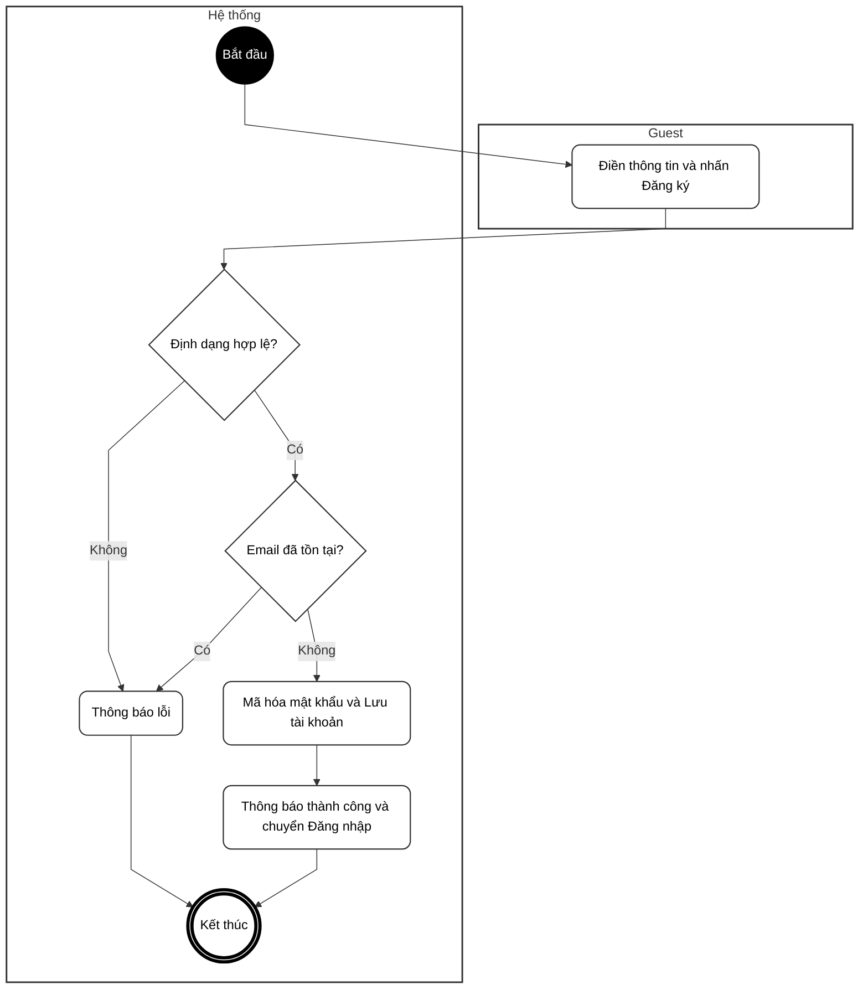
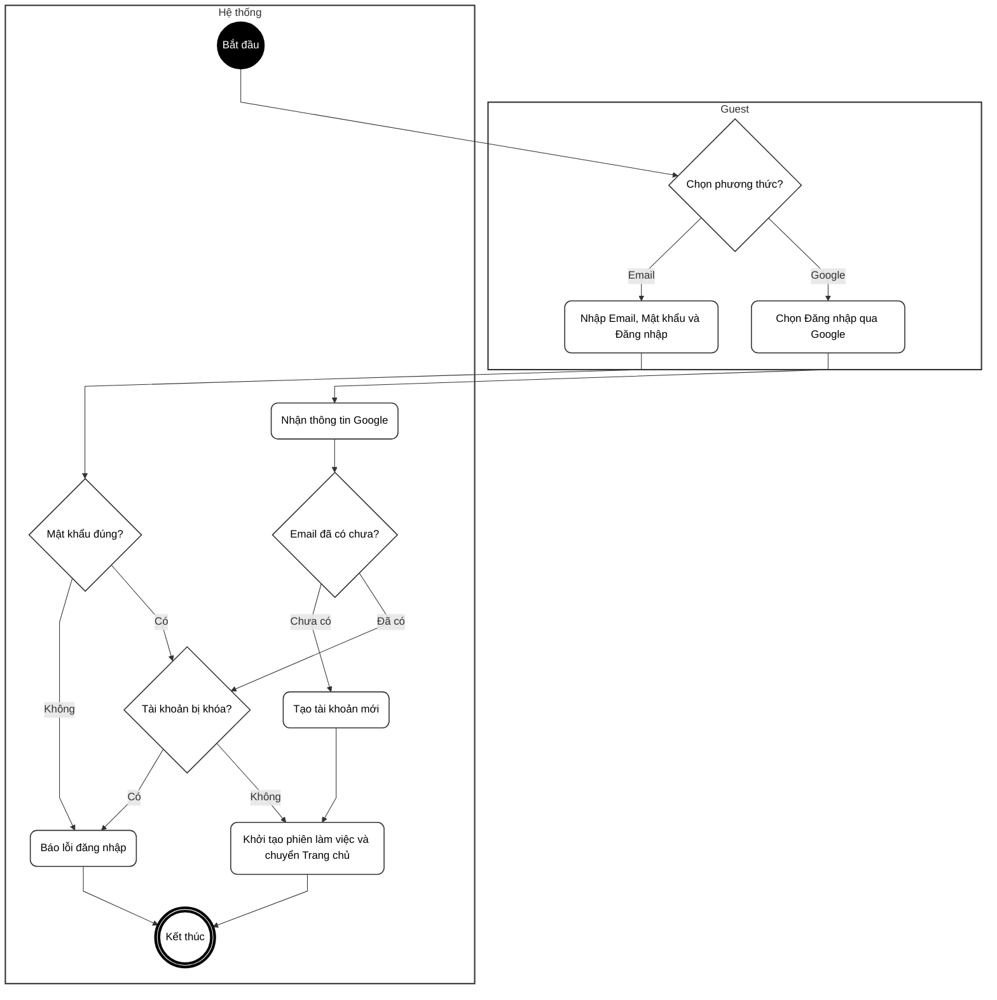
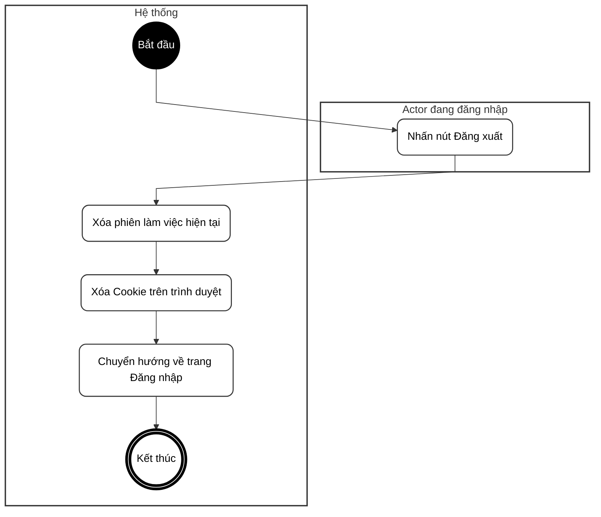
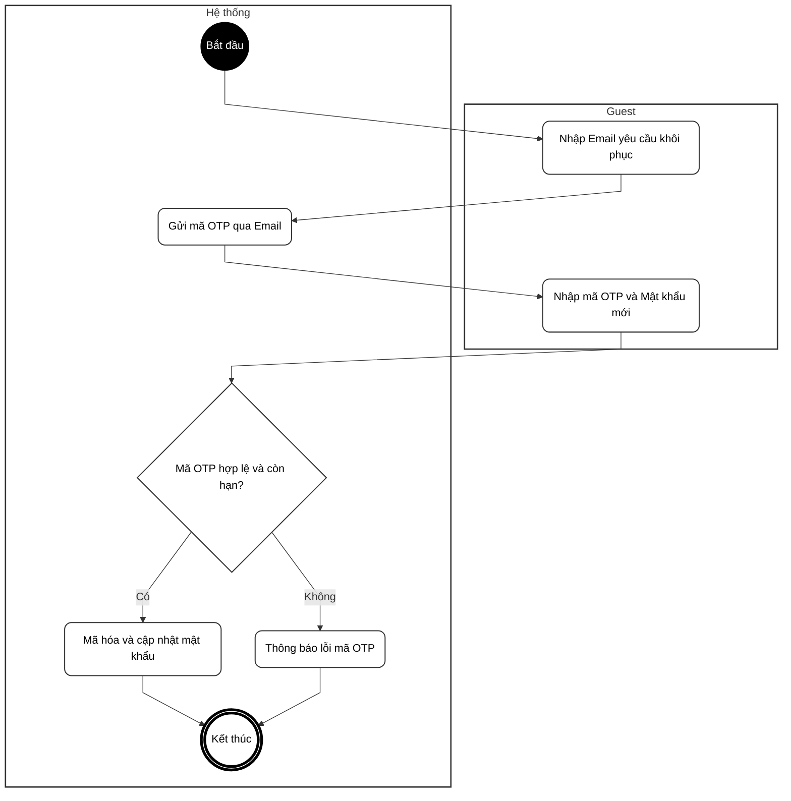
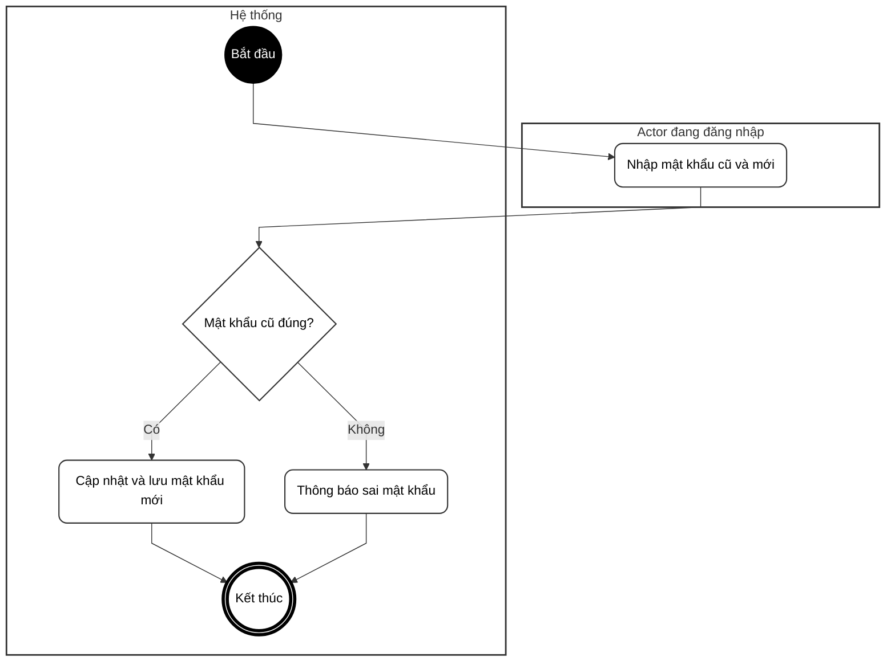
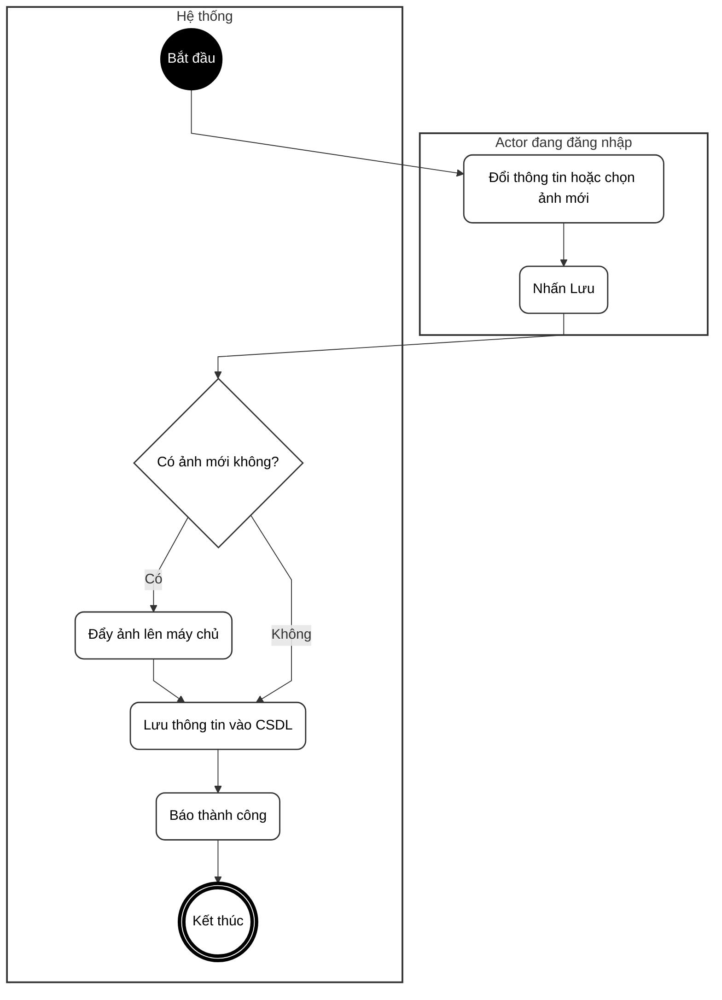
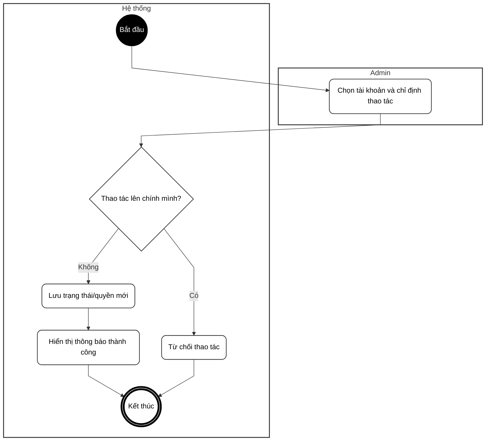
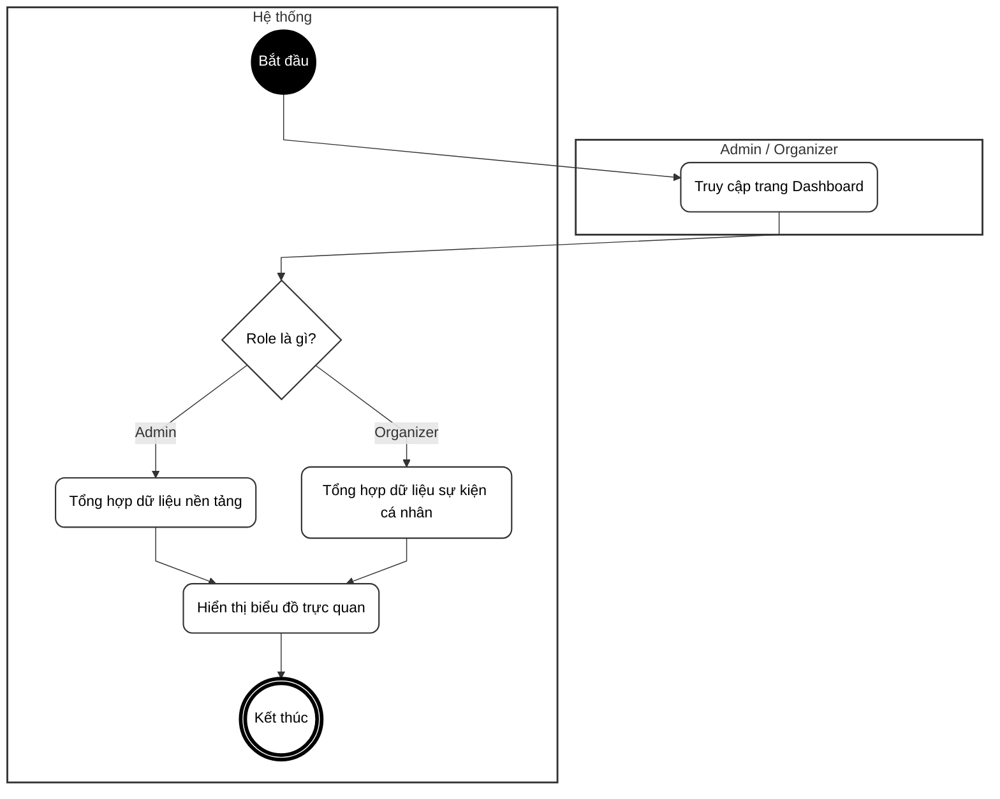

# BIỂU ĐỒ HOẠT ĐỘNG - PHẦN A: NỀN TẢNG HỆ THỐNG (UC01 – UC08)

---

## UC01 – Đăng ký tài khoản

---

## UC02 – Đăng nhập hệ thống

---

## UC03 – Đăng xuất

---

## UC04 – Quên mật khẩu

---

## UC05 – Đổi mật khẩu

---

## UC06 – Cập nhật hồ sơ cá nhân

---

## UC07 – Quản lý tài khoản người dùng

---

## UC08 – Xem báo cáo thống kê tổng quan (Dashboard)

