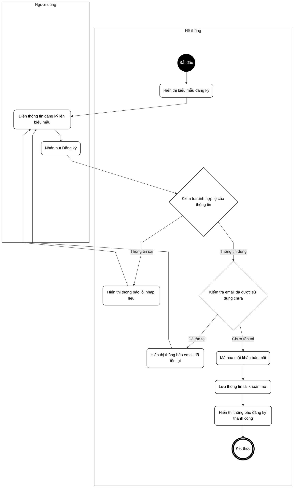
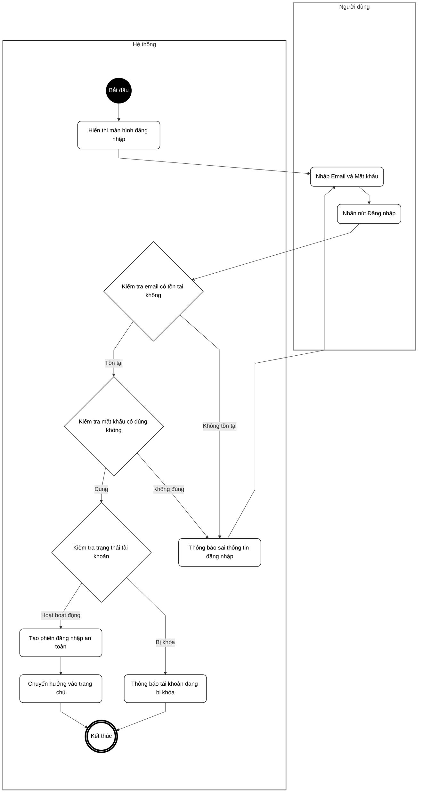
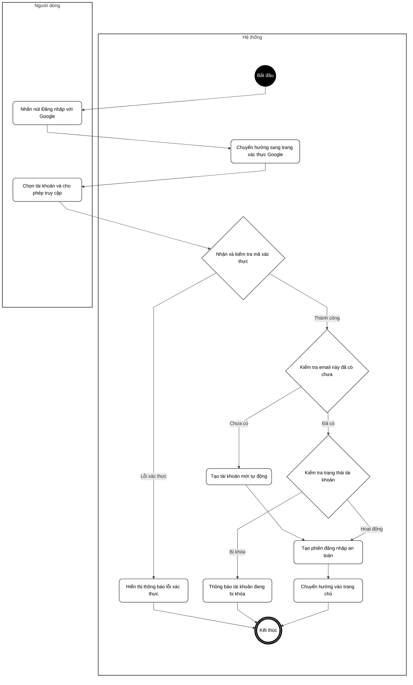
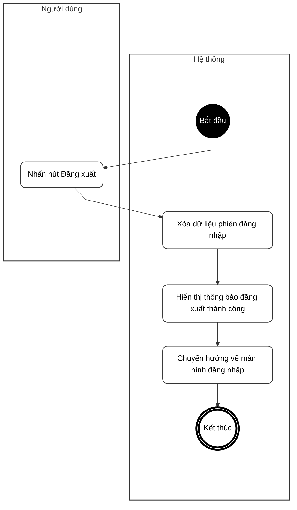
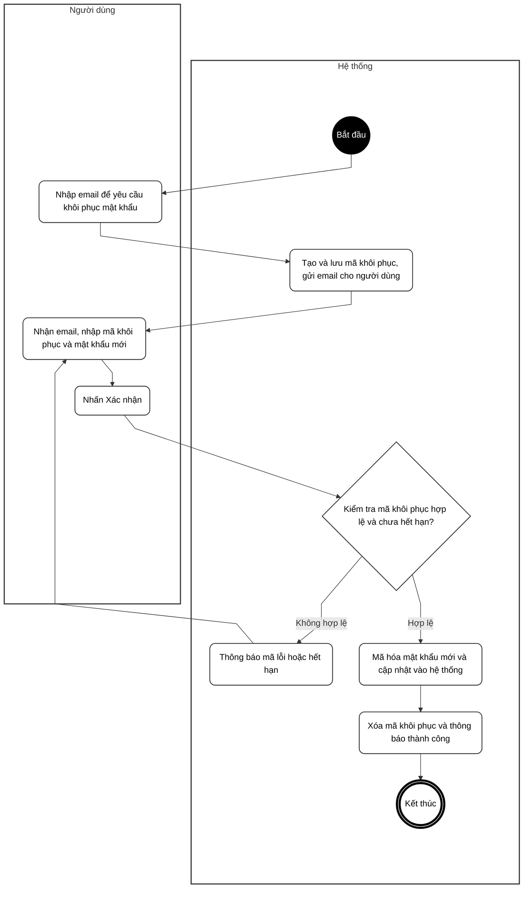
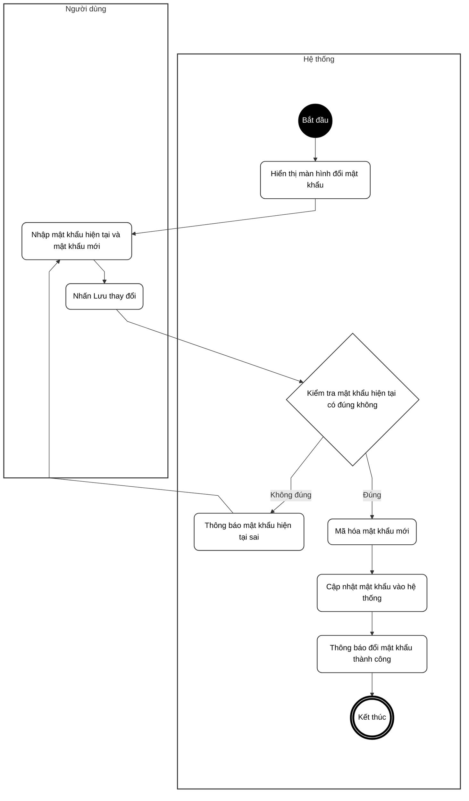
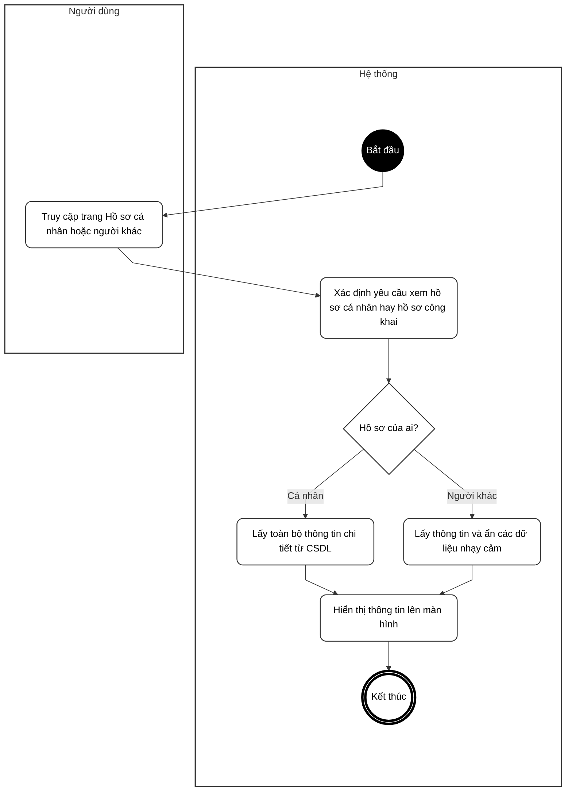
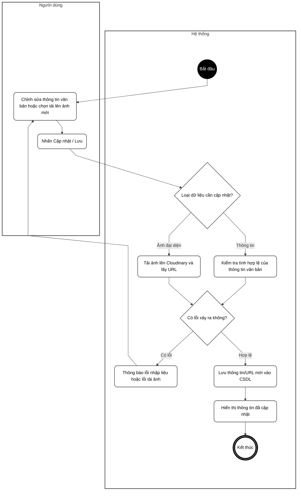
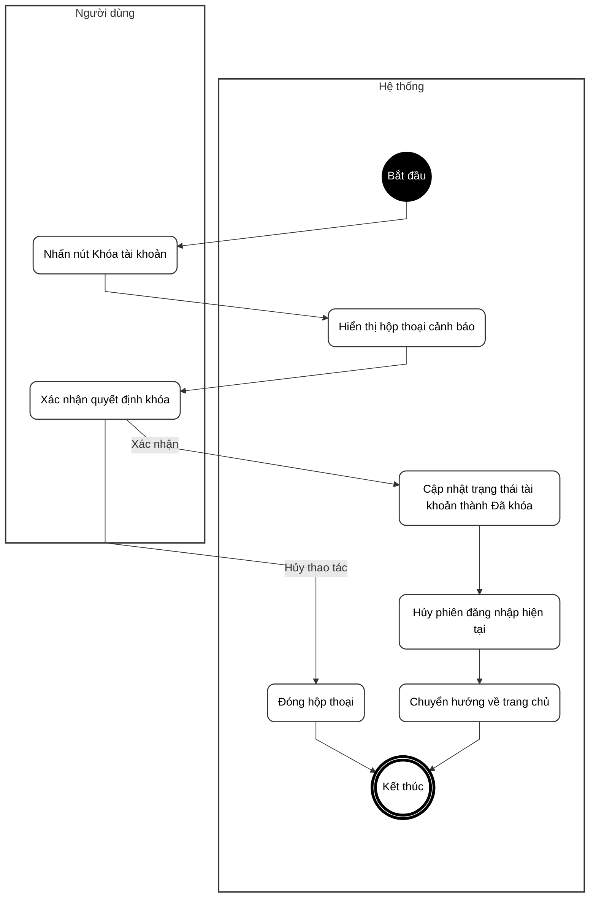

# BIỂU ĐỒ HOẠT ĐỘNG - PHẦN A: XÁC THỰC & HỒ SƠ CÁ NHÂN

**Hệ thống Quản lý Sự kiện & Check-in QR**

---

Tài liệu này chứa các Biểu đồ Hoạt động (Activity Diagrams) mô tả chi tiết từng bước thực hiện của các chức năng. Biểu đồ được chia thành 2 cột rõ ràng: **Tác nhân** (Người dùng thực hiện) và **Hệ thống** (Xử lý ngầm), sử dụng ngôn ngữ tự nhiên dễ hiểu.

---

## UC01 – Đăng ký tài khoản

---

## UC02 – Đăng nhập hệ thống

---

## UC03 – Đăng nhập bằng Google

---

## UC04 – Đăng xuất

---

## UC05 – Quên mật khẩu & Đặt lại mật khẩu

---

## UC06 – Đổi mật khẩu

---

## UC07 – Xem thông tin cá nhân & Hồ sơ người dùng khác

---

## UC08 – Cập nhật thông tin cá nhân & Ảnh đại diện

---

## UC09 – Tự khóa / xóa tài khoản (Soft Delete)

