# BIỂU ĐỒ HOẠT ĐỘNG - PHẦN A: XÁC THỰC & HỒ SƠ
**Hệ thống Quản lý Sự kiện & Check-in QR**

---

Tài liệu này chứa các Biểu đồ Hoạt động (Activity Diagrams) mô tả chi tiết từng bước thực hiện của các chức năng. Biểu đồ được chia thành 2 cột rõ ràng: **Tác nhân** (Người dùng thực hiện) và **Hệ thống** (Xử lý ngầm), sử dụng ngôn ngữ tự nhiên dễ hiểu.

---

## UC01 – Đăng ký tài khoản

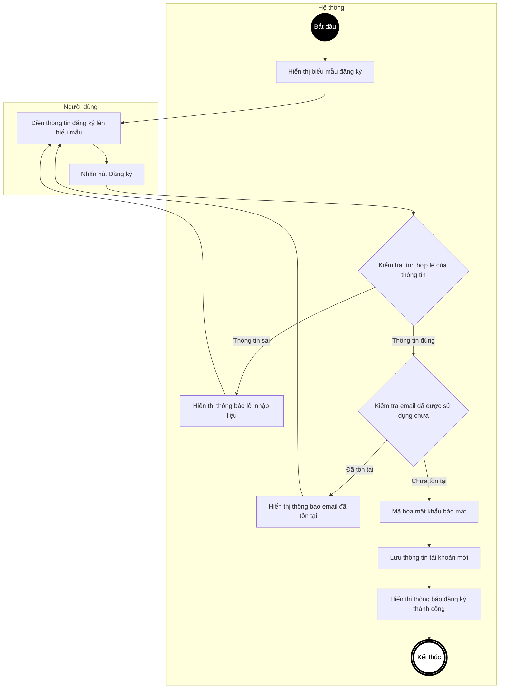

---

## UC02 – Đăng nhập hệ thống

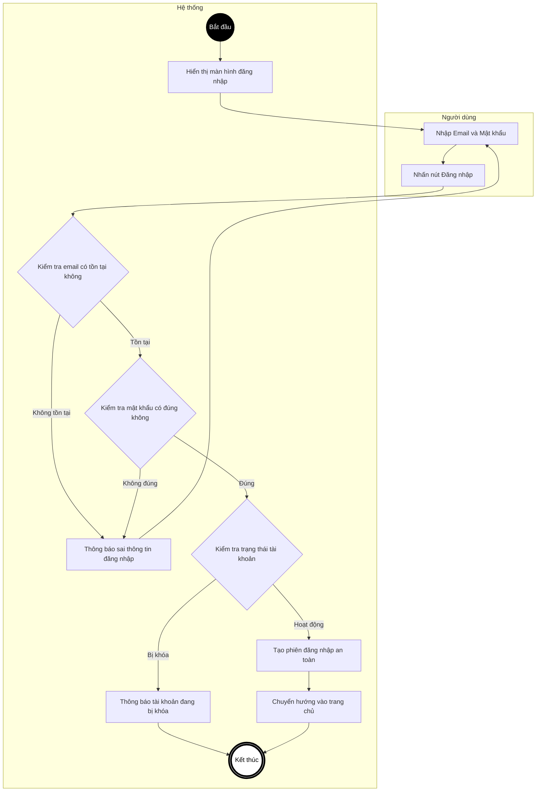

---

## UC02a – Đăng nhập bằng Google

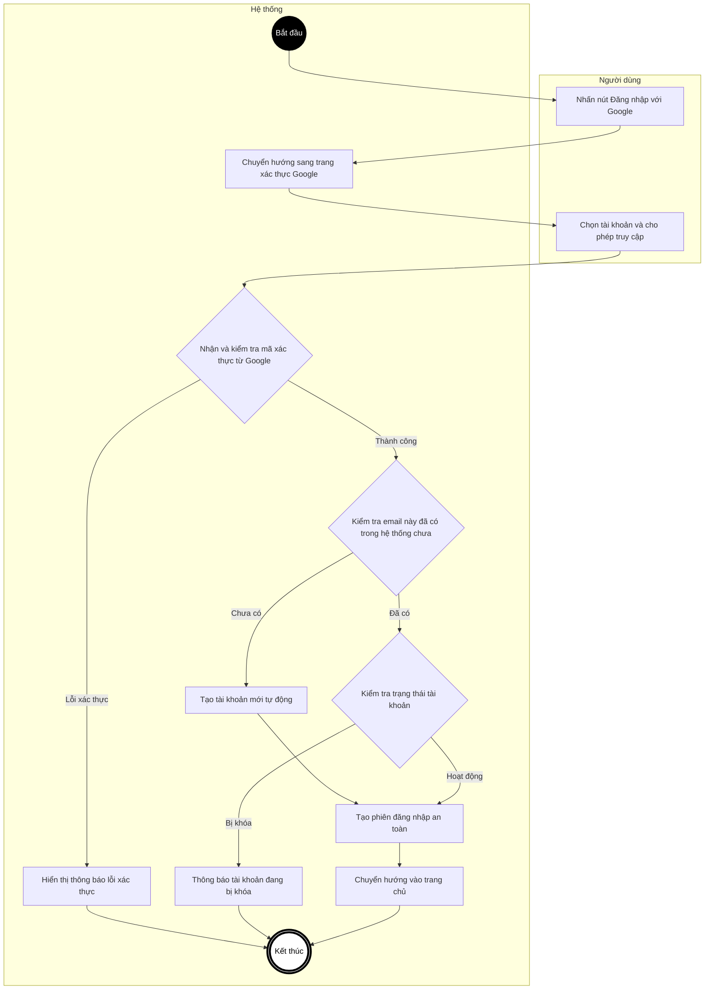

---

## UC03 – Đăng xuất

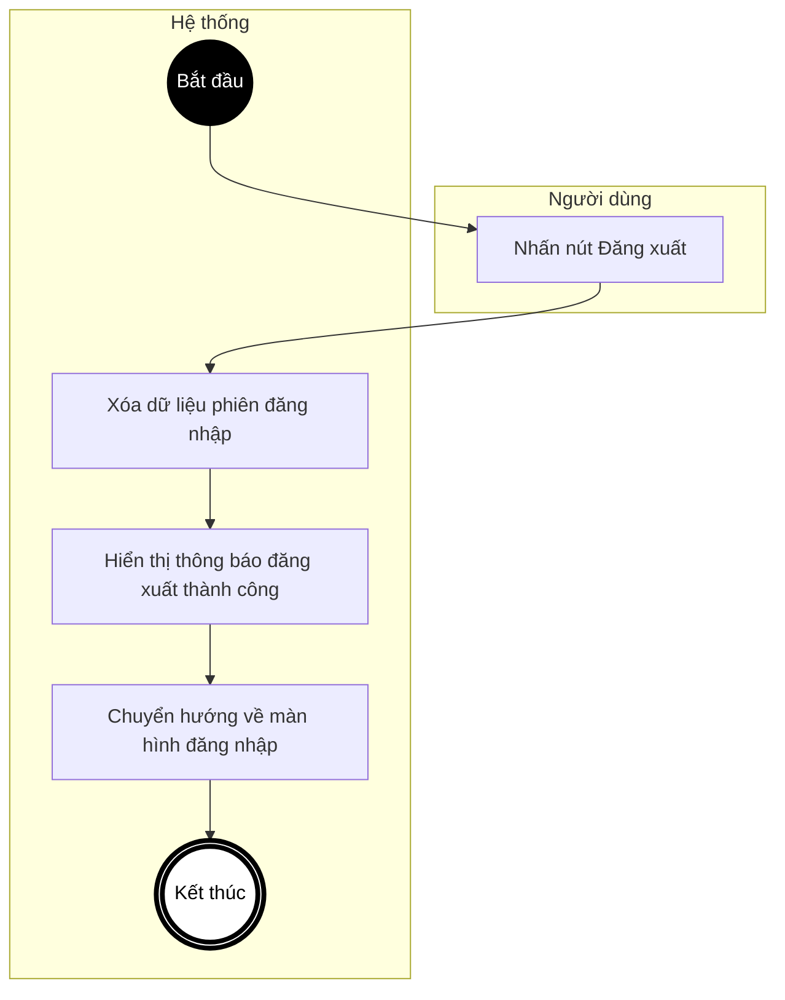

---

## UC04 – Quên mật khẩu

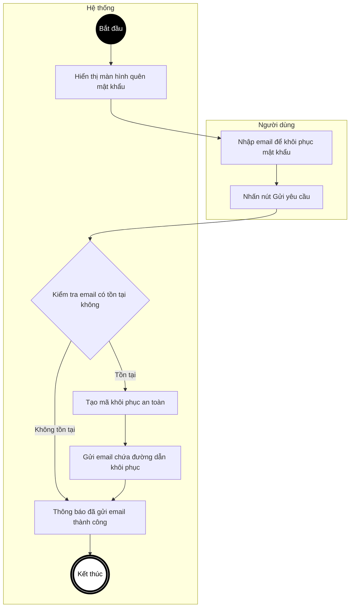

---

## UC05 – Đặt lại mật khẩu mới

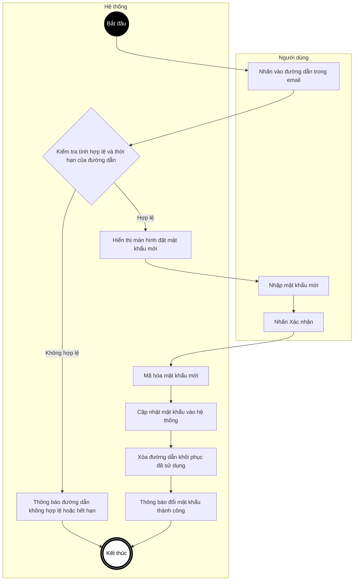

---

## UC06 – Đổi mật khẩu chủ động

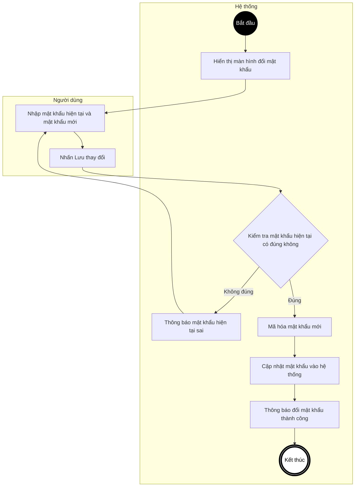

---

## UC07 – Xem thông tin cá nhân

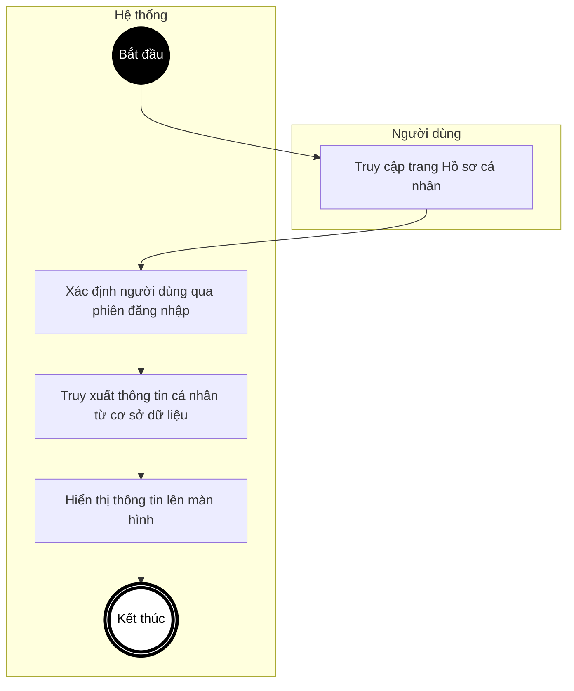

---

## UC08 – Cập nhật thông tin cá nhân

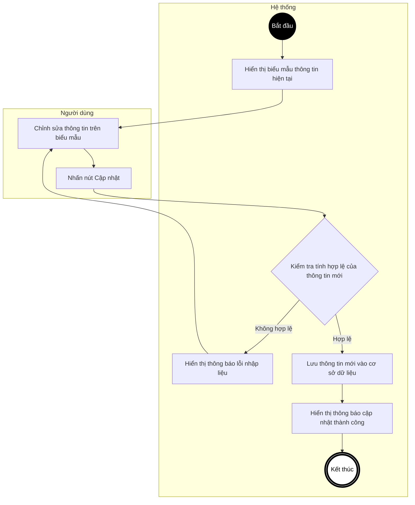

---

## UC09 – Cập nhật ảnh đại diện

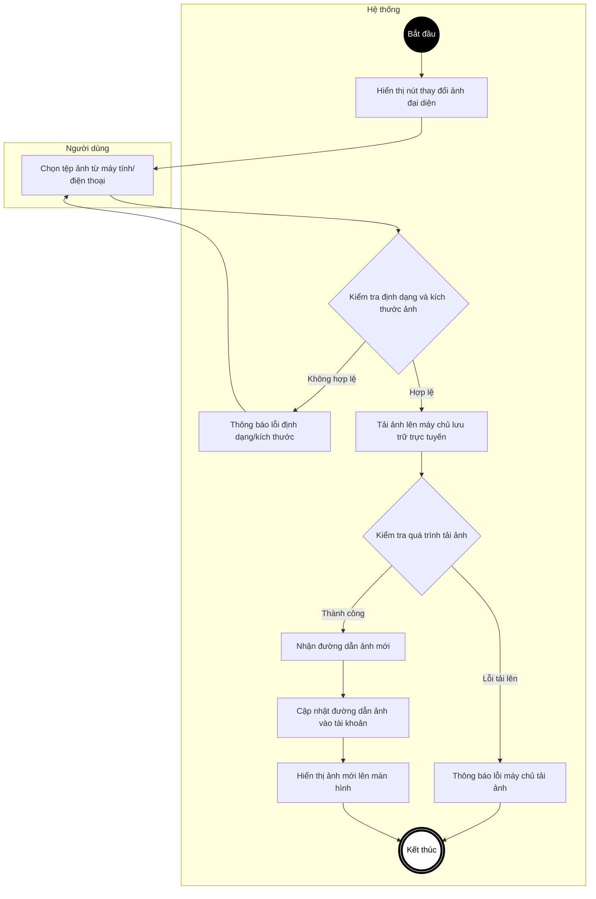

---

## UC10 – Yêu cầu khóa tài khoản

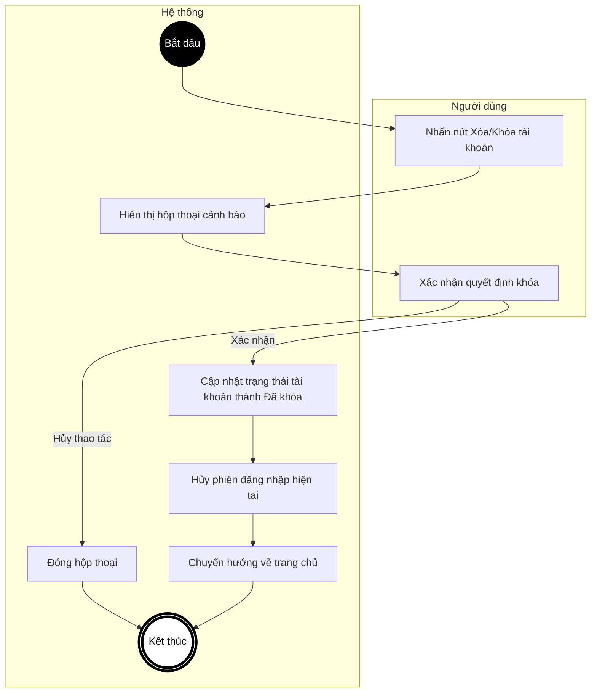
