# BIỂU ĐỒ HOẠT ĐỘNG - PHẦN B: QUẢN TRỊ & SỰ KIỆN
**Hệ thống Quản lý Sự kiện & Check-in QR**

---

Tài liệu này chứa các Biểu đồ Hoạt động (Activity Diagrams) mô tả các chức năng dành cho Quản trị viên (Admin) và Ban tổ chức sự kiện (Organizer).

---

## UC11 – Xem danh sách người dùng

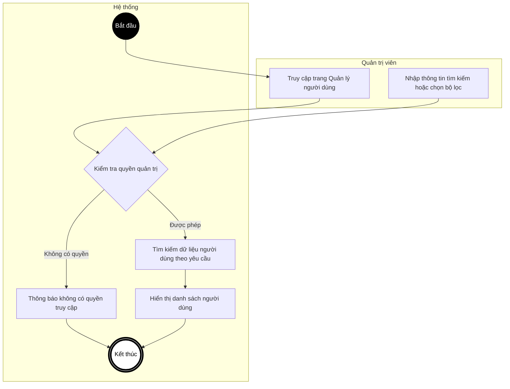

---

## UC12 – Khóa / Mở khóa tài khoản

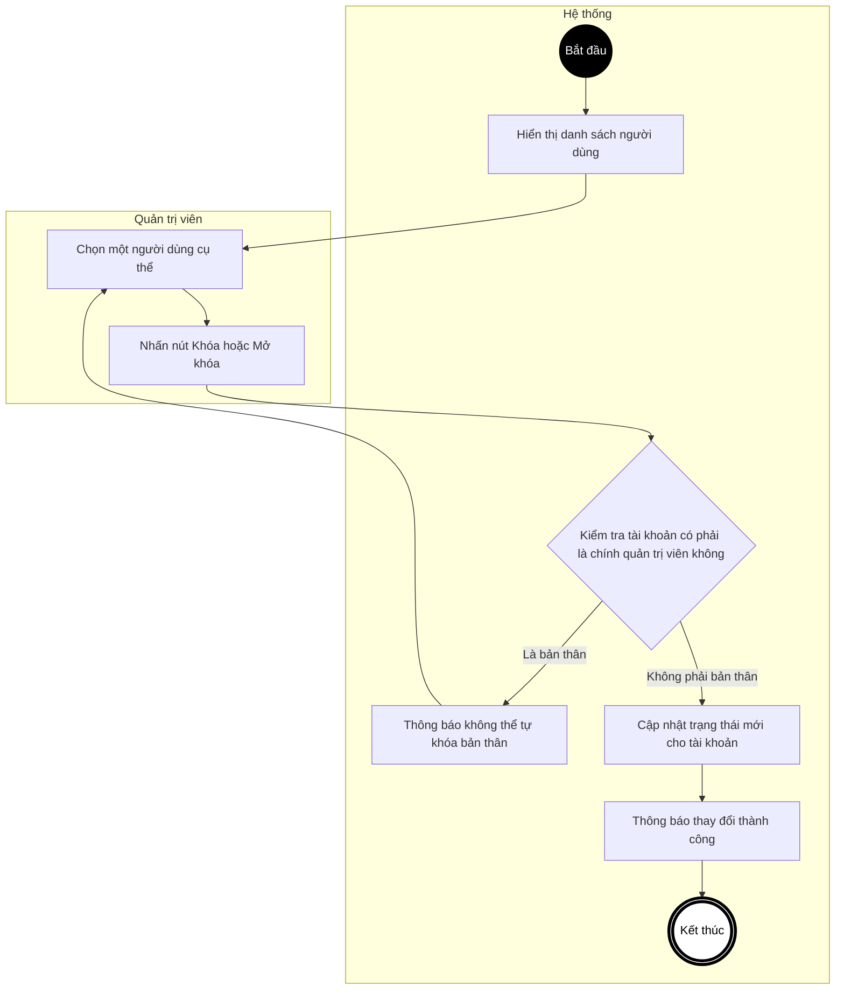

---

## UC13 – Phân quyền người dùng

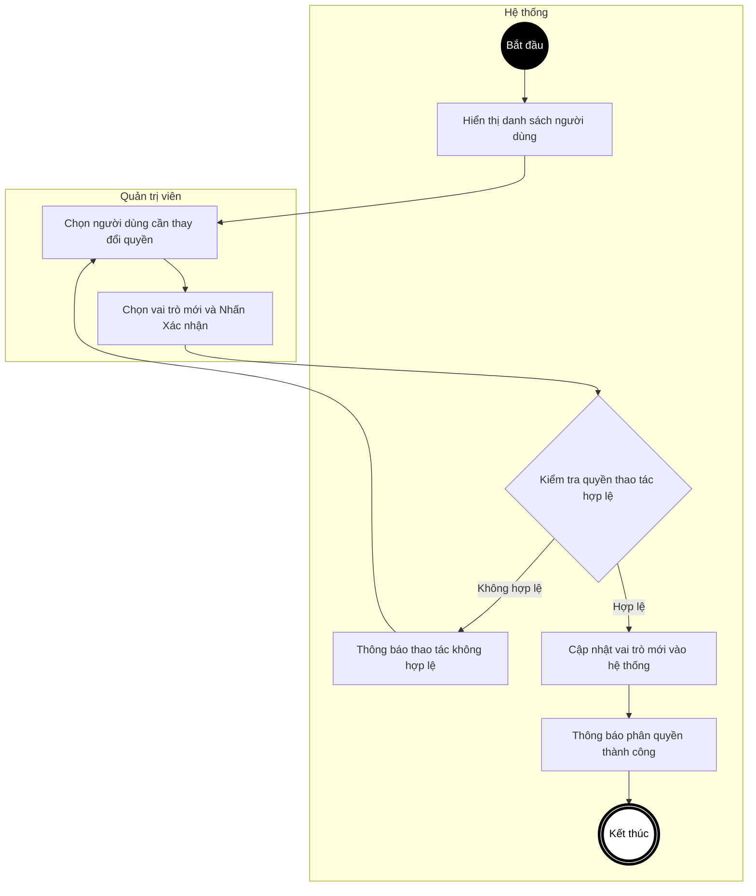

---

## UC13a – Xem thống kê tổng quan (Dashboard)

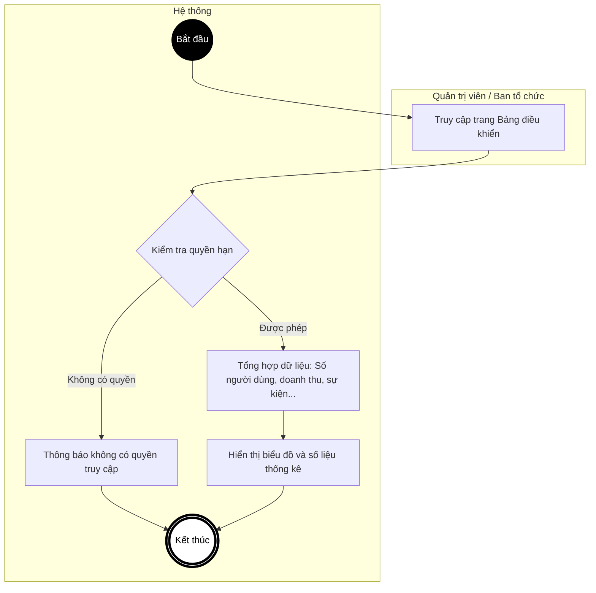

---

## UC13b – Xem thống kê của một sự kiện

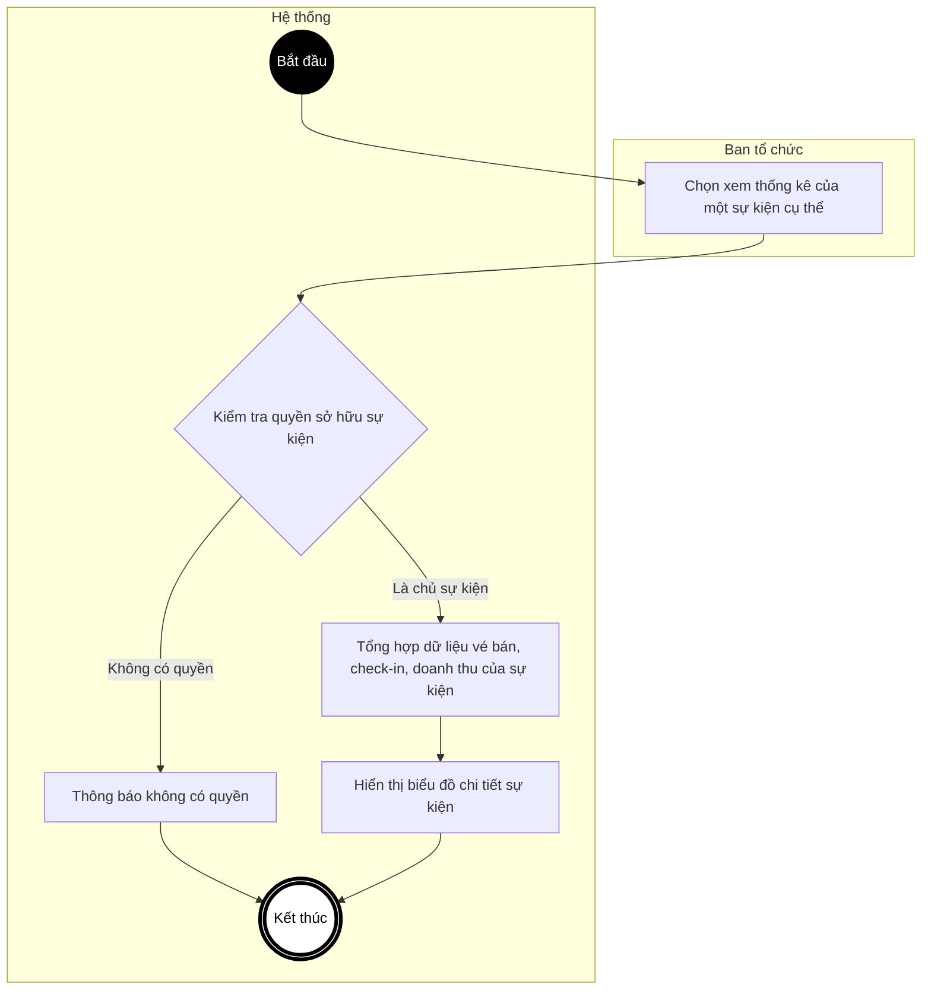

---

## UC14 – Xem danh sách sự kiện

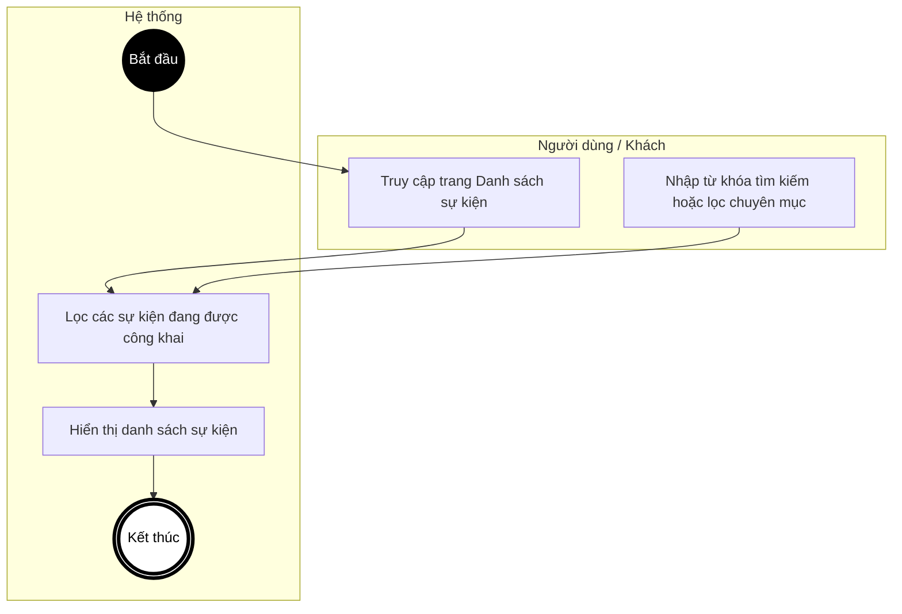

---

## UC15 – Xem chi tiết sự kiện

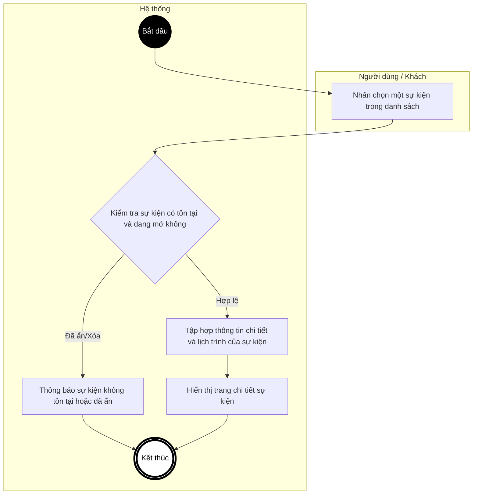

---

## UC16 – Tạo sự kiện mới

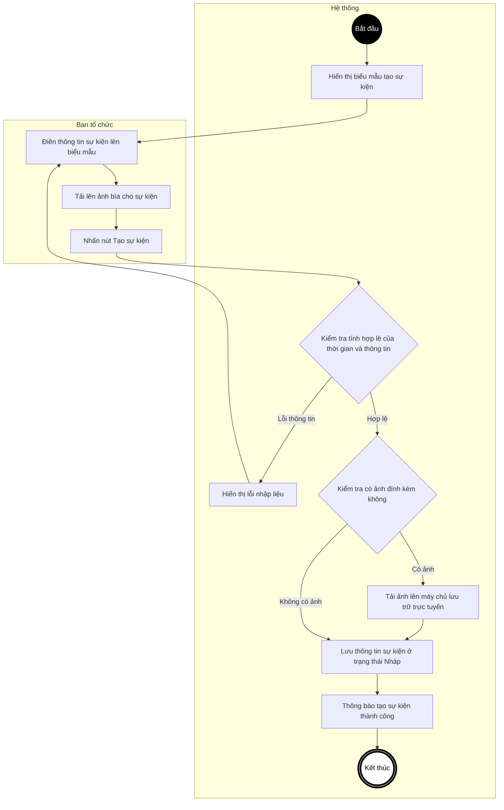

---

## UC17 – Cập nhật thông tin sự kiện

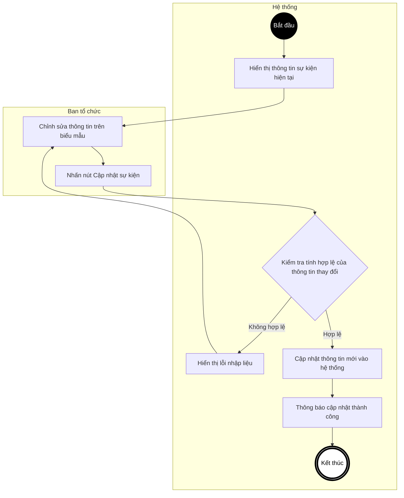

---

## UC18 – Thay đổi trạng thái sự kiện

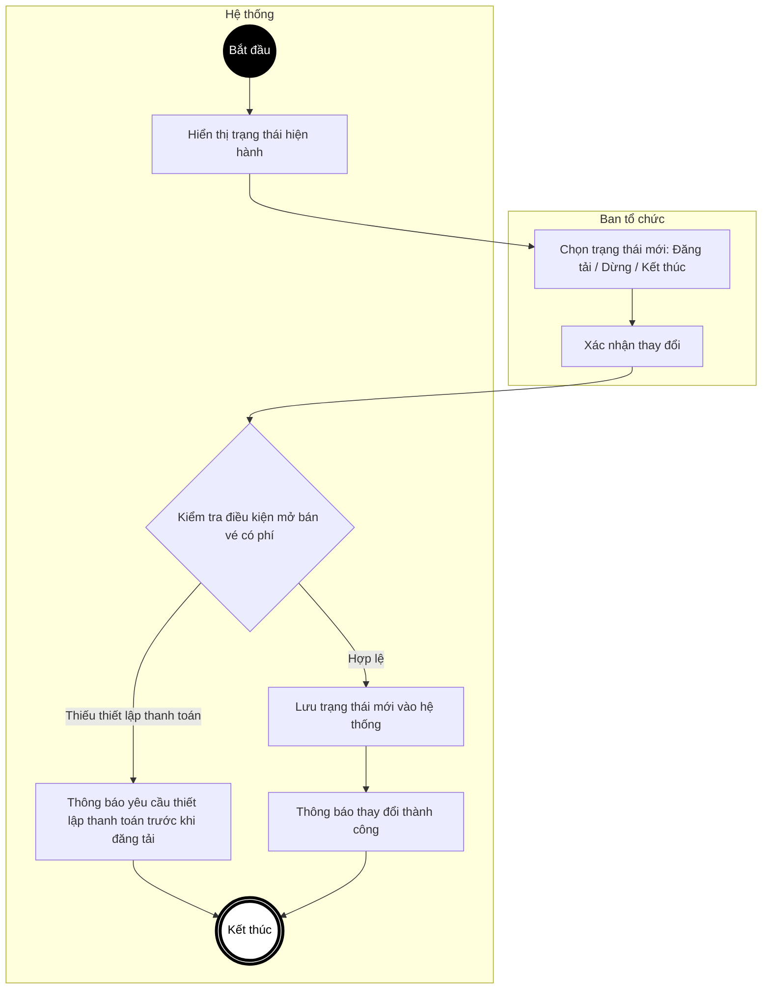

---

## UC19 – Xóa sự kiện

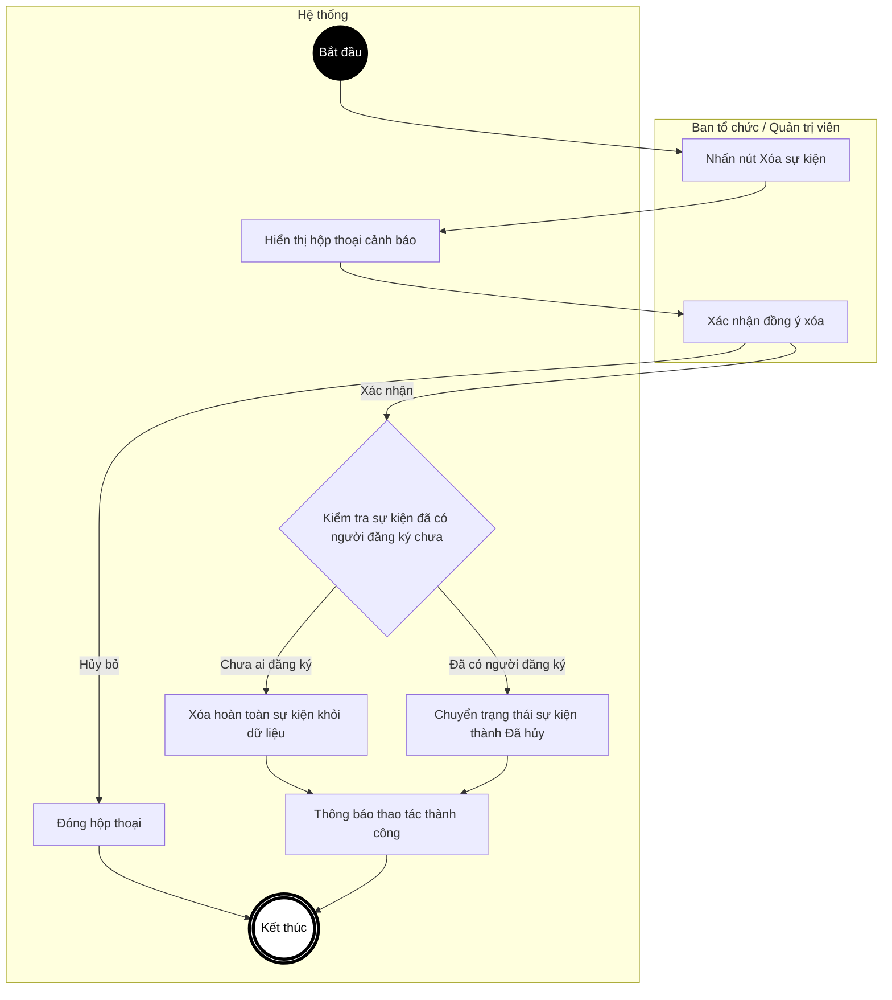
