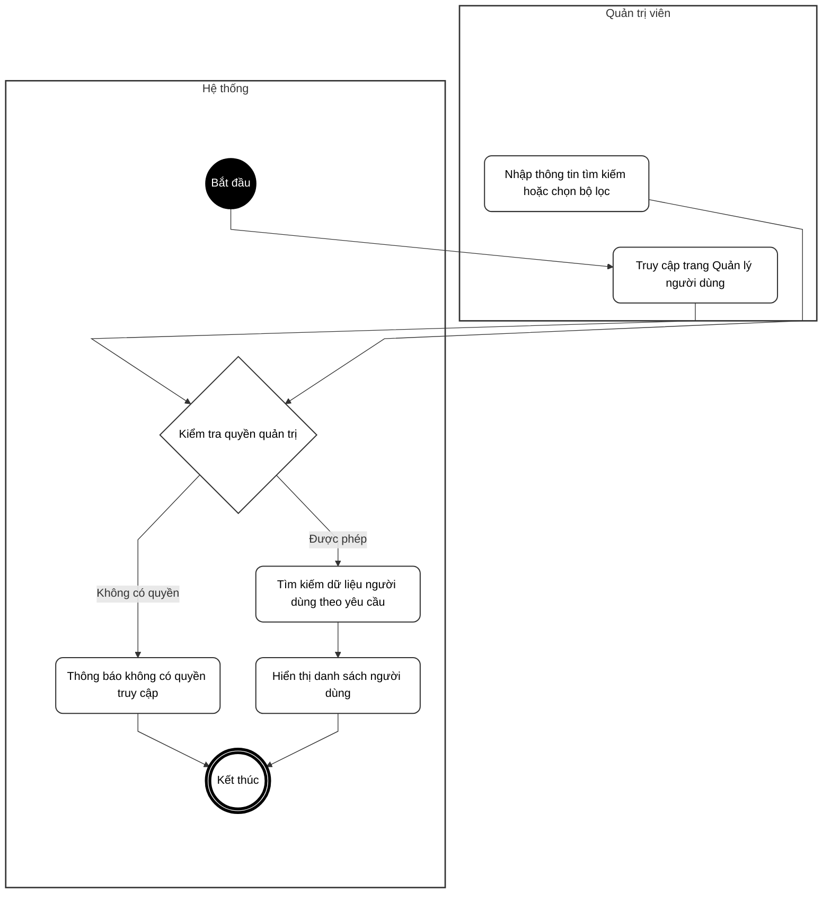
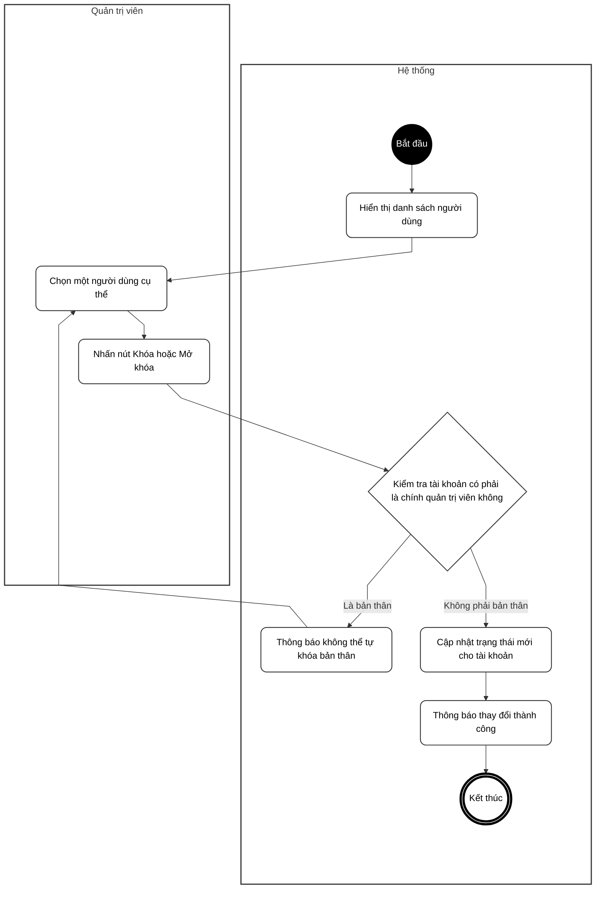
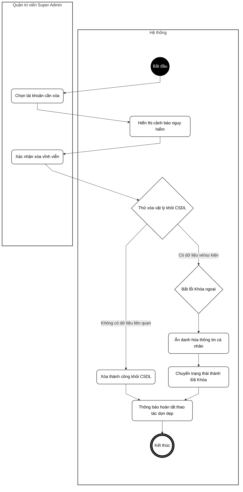
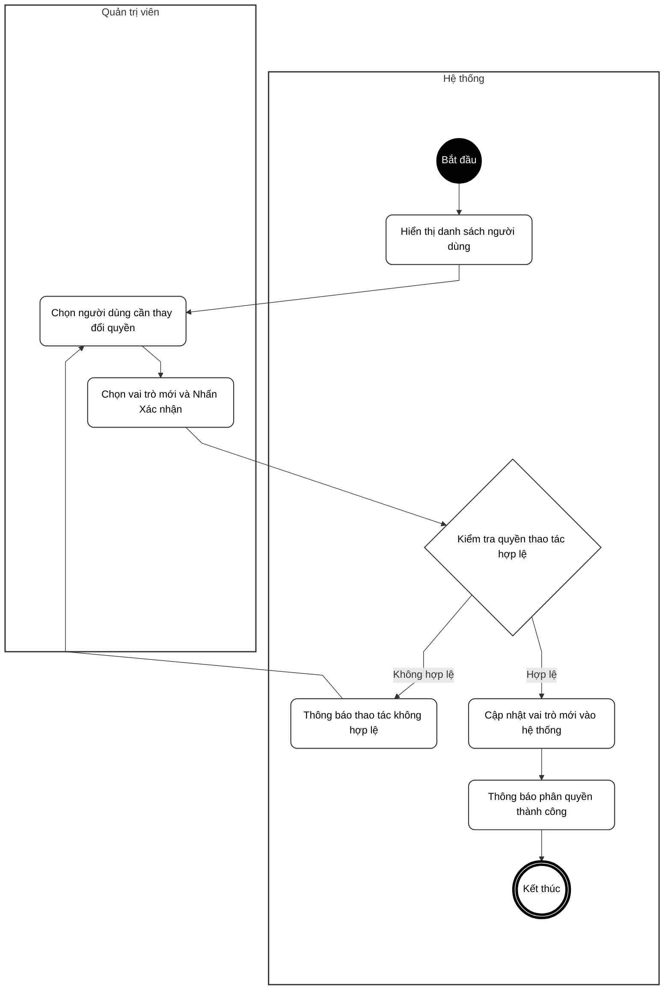
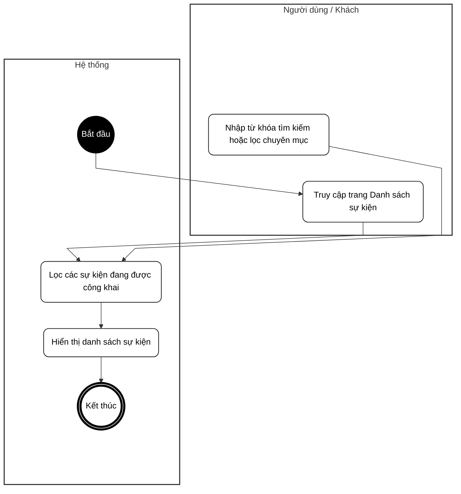
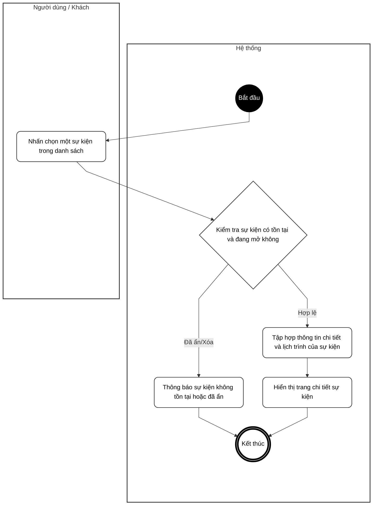
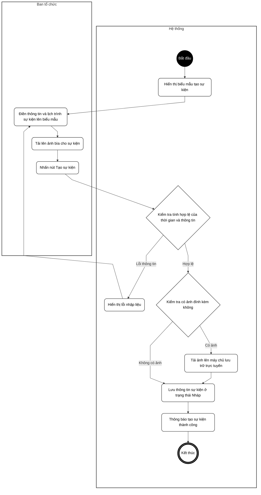
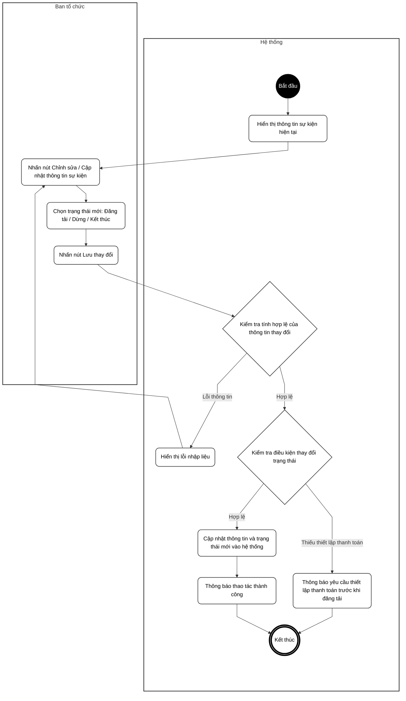
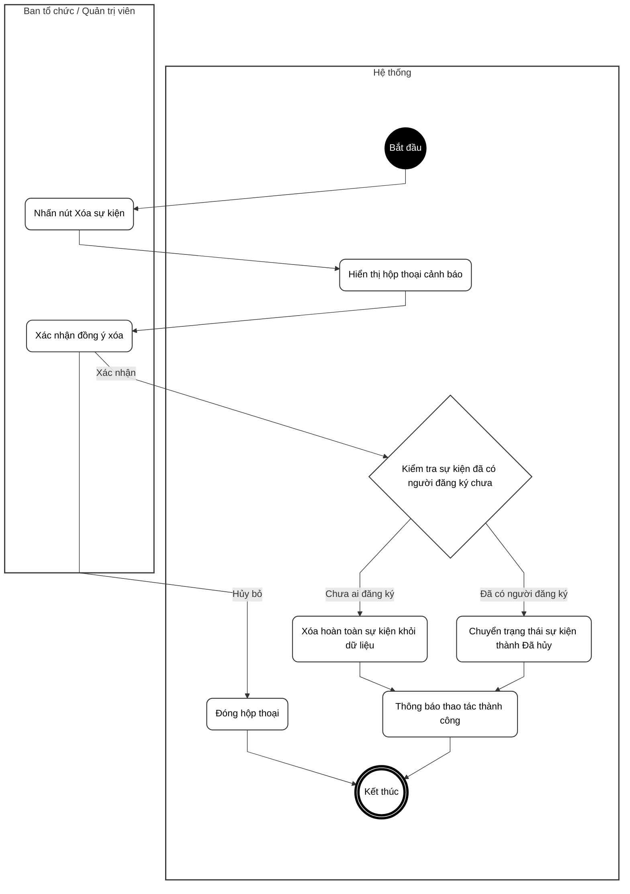

# BIỂU ĐỒ HOẠT ĐỘNG - PHẦN B: QUẢN TRỊ & SỰ KIỆN

**Hệ thống Quản lý Sự kiện & Check-in QR**

---

Tài liệu này chứa các Biểu đồ Hoạt động (Activity Diagrams) mô tả các chức năng dành cho Quản trị viên (Admin) và Ban tổ chức sự kiện (Organizer).

---

## UC10 – Xem danh sách người dùng

---

## UC11 – Khóa / Mở khóa tài khoản

---

## UC12 – Xóa tài khoản vĩnh viễn (Hybrid Delete)

---

## UC13 – Phân quyền người dùng

---

## UC14 – Xem thống kê tổng quan (Dashboard)

---

## UC15 – Xem thống kê của một sự kiện

---

## UC16 – Xem danh sách sự kiện

---

## UC17 – Xem chi tiết sự kiện

---

## UC18 – Tạo sự kiện mới

---

## UC19 – Cập nhật thông tin và trạng thái sự kiện

---

## UC20 – Xóa sự kiện

