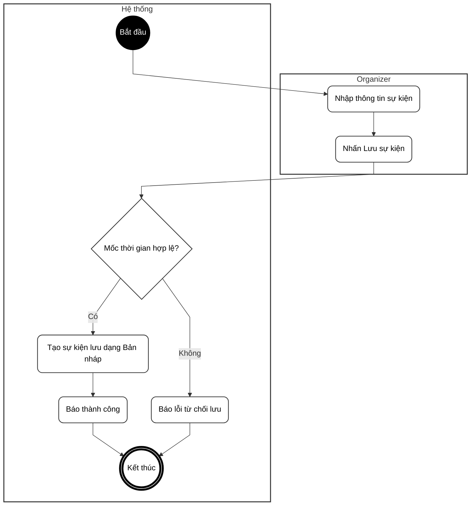
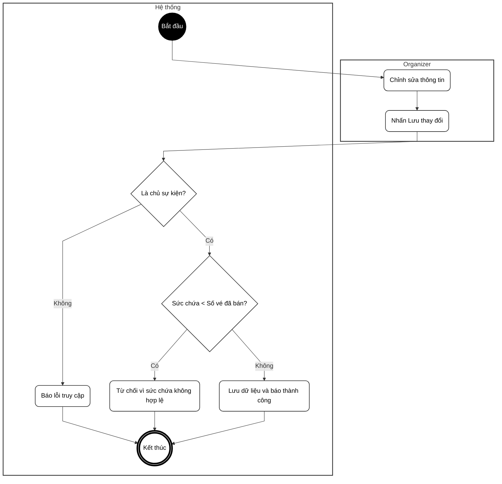
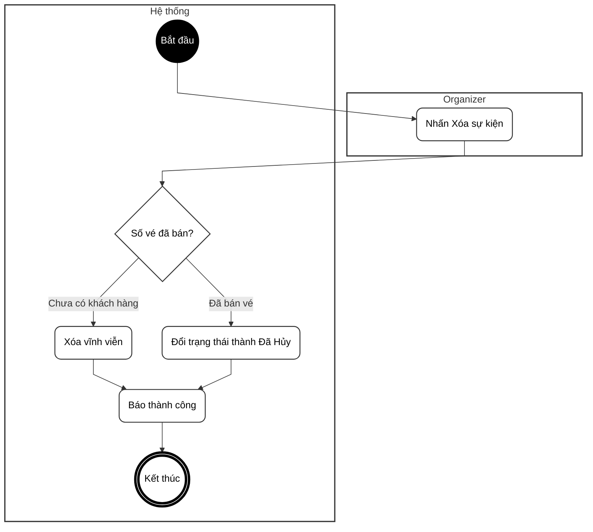
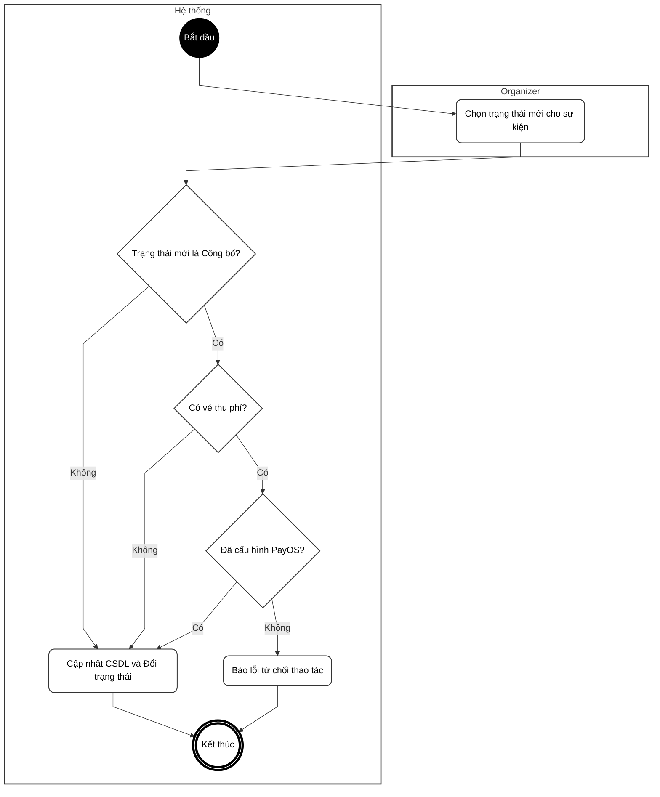
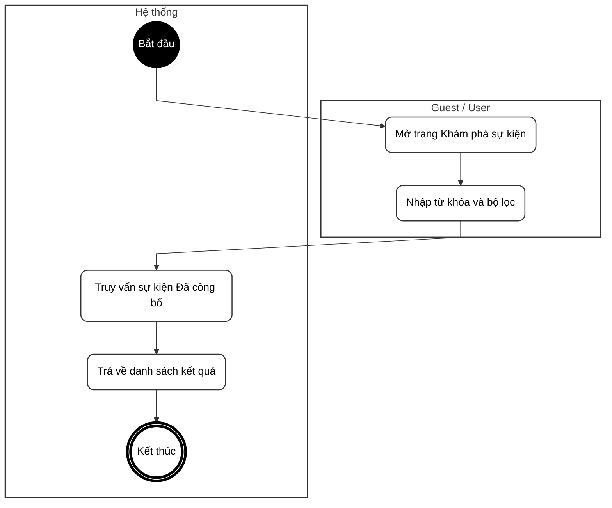
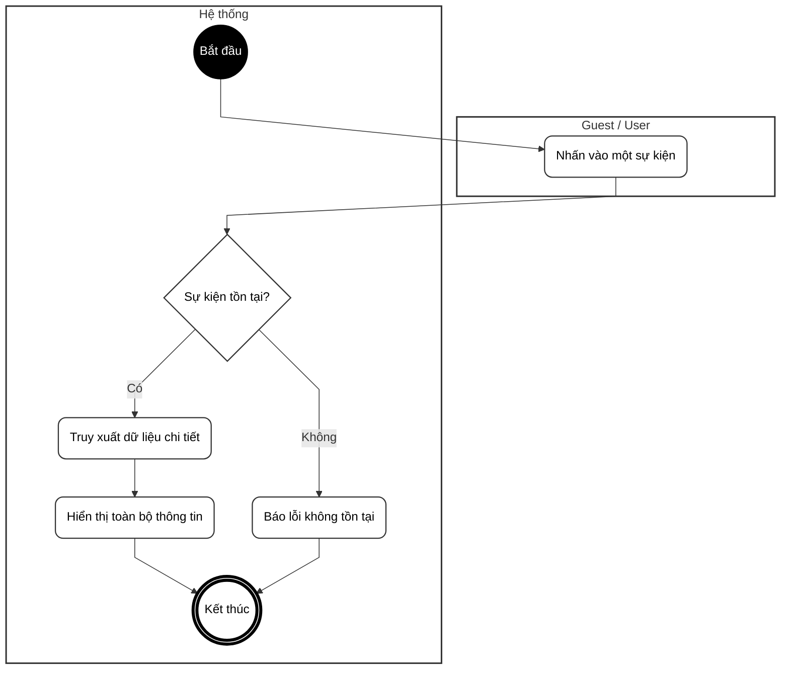

# BIỂU ĐỒ HOẠT ĐỘNG - PHẦN B: QUẢN LÝ SỰ KIỆN (UC09 – UC14)

---

## UC09 – Thêm mới sự kiện

---

## UC10 – Cập nhật thông tin sự kiện

---

## UC11 – Xóa / Hủy sự kiện

---

## UC12 – Thay đổi trạng thái sự kiện

---

## UC13 – Tra cứu / Tìm kiếm sự kiện

---

## UC14 – Xem chi tiết sự kiện

