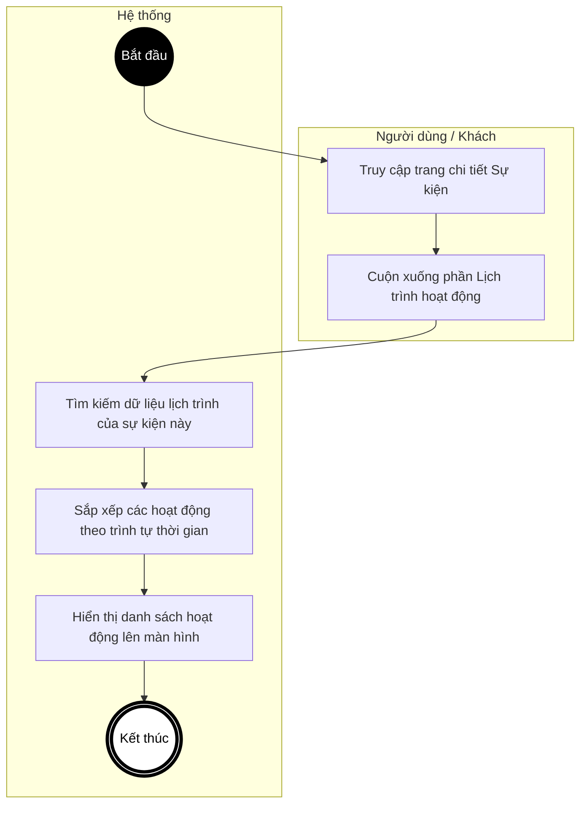
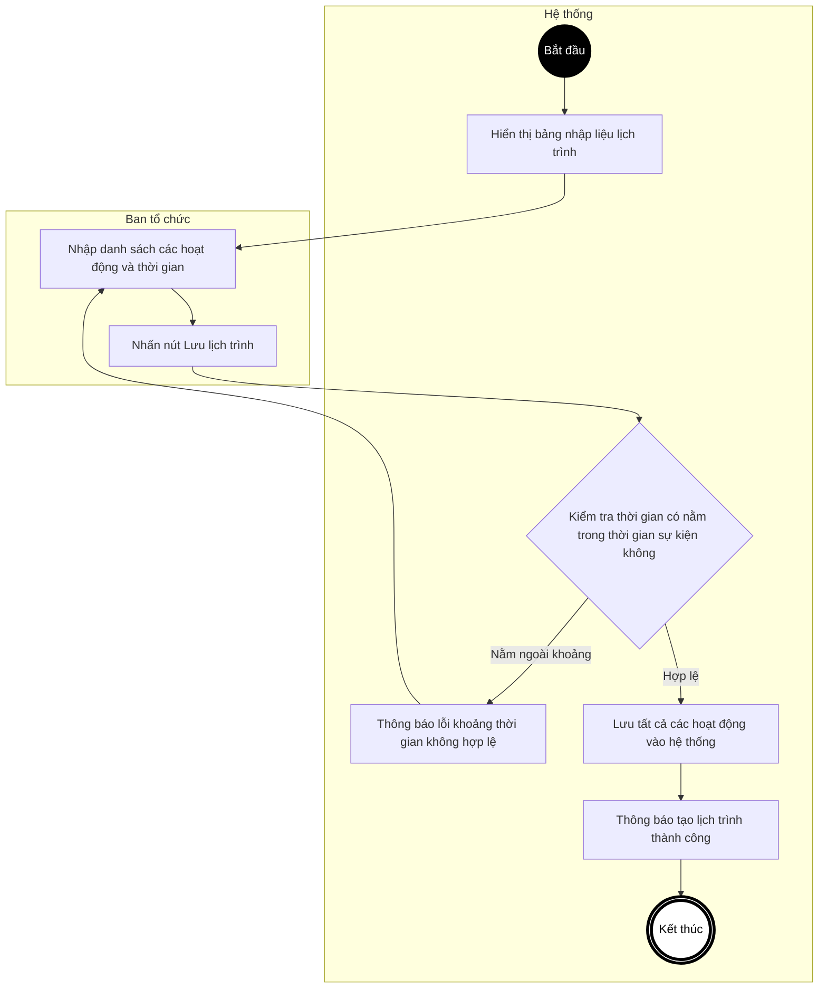
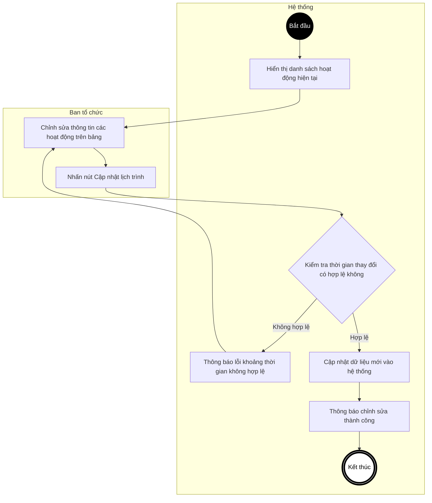
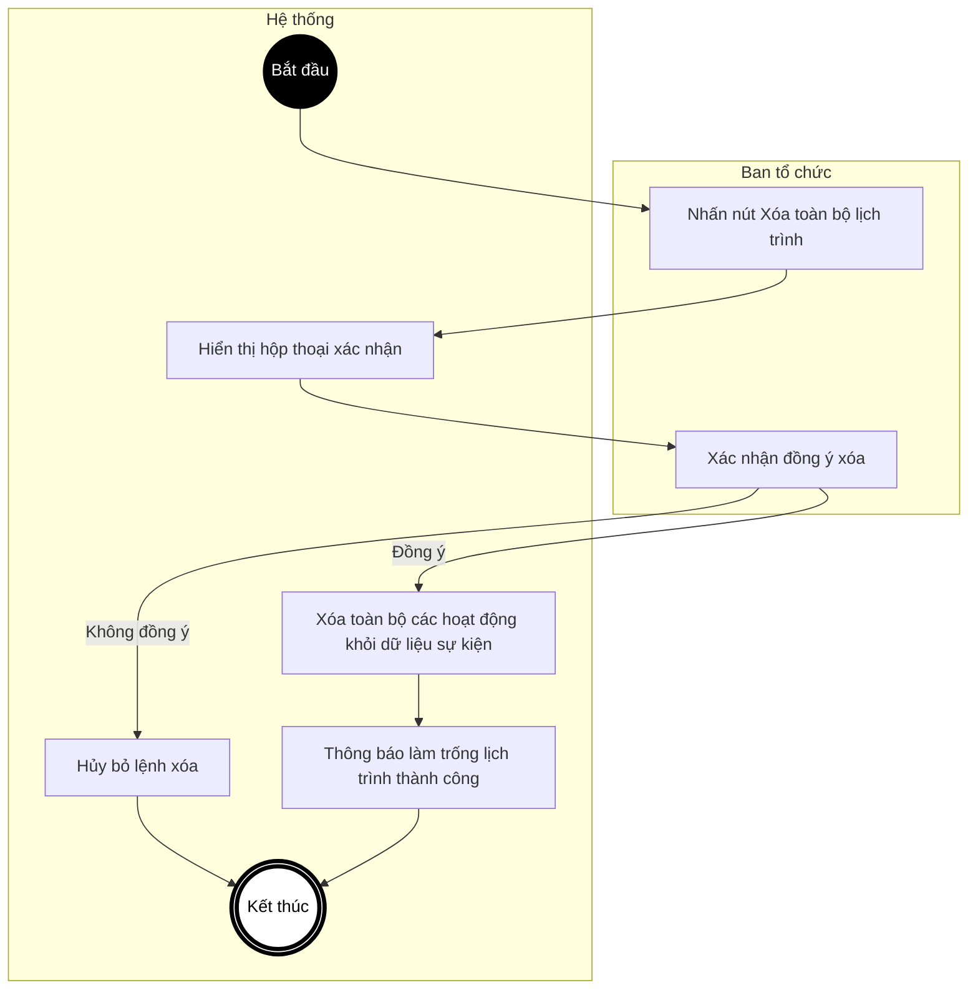
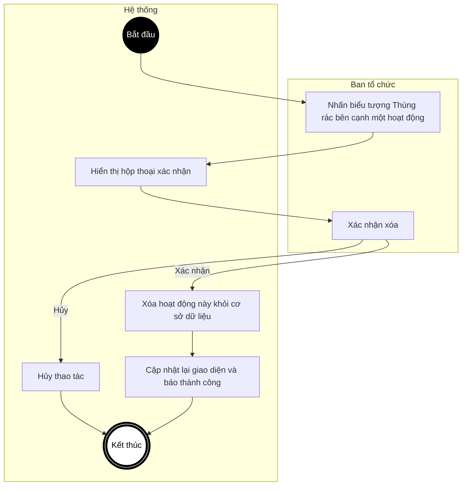
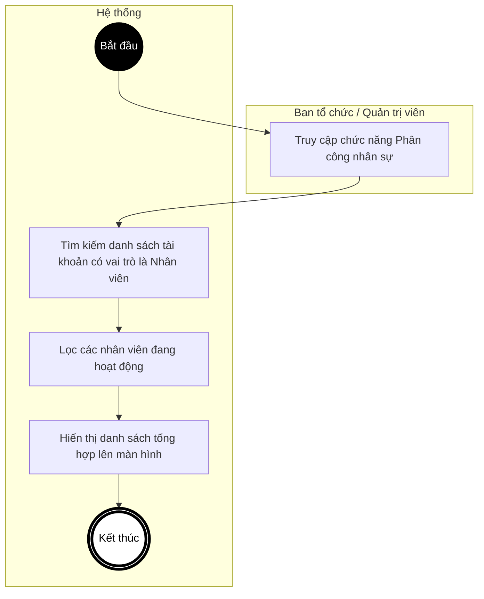
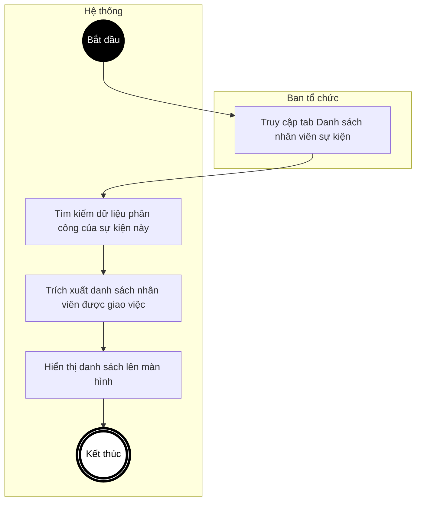
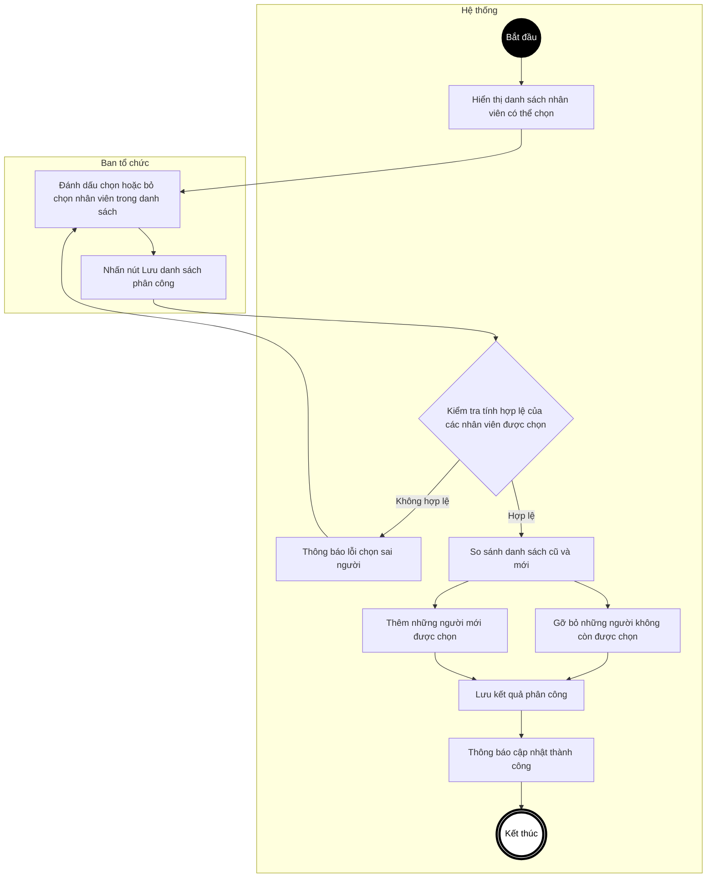
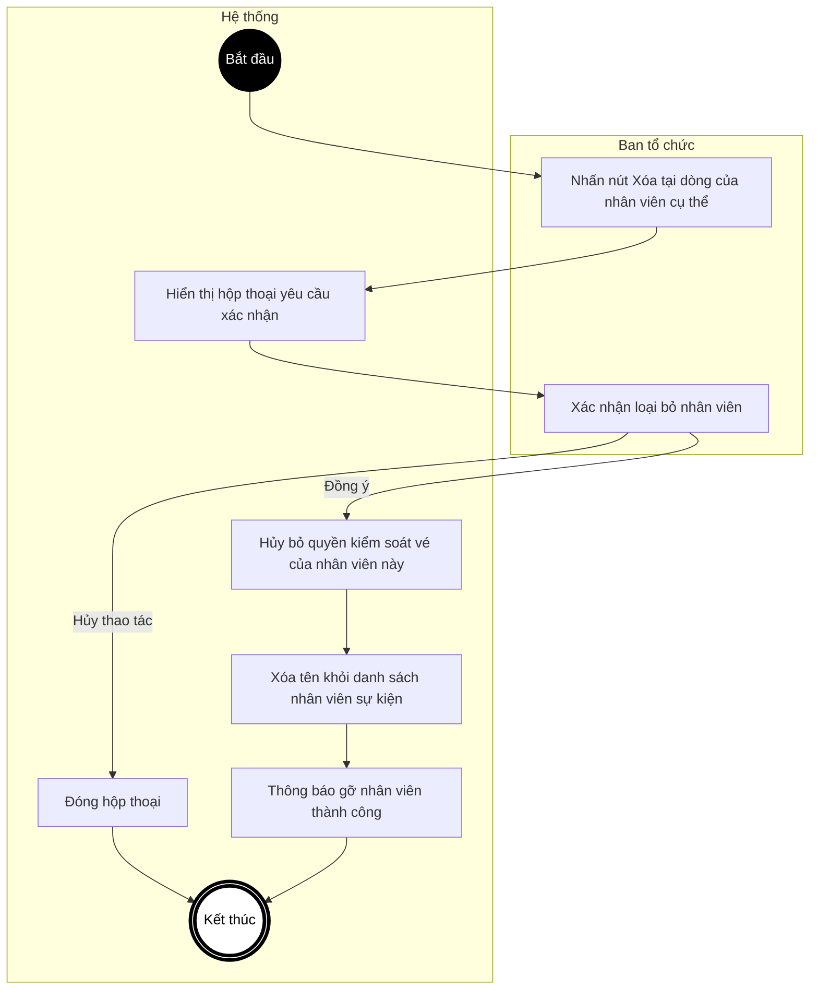

# BIỂU ĐỒ HOẠT ĐỘNG - PHẦN C: LỊCH TRÌNH & PHÂN CÔNG NHÂN SỰ
**Hệ thống Quản lý Sự kiện & Check-in QR**

---

Tài liệu này chứa các Biểu đồ Hoạt động (Activity Diagrams) mô tả thao tác xây dựng dòng thời gian (Timeline) của sự kiện và quản lý đội ngũ nhân viên soát vé.

---

## UC20 – Xem lịch trình sự kiện

---

## UC21 – Tạo lịch trình con (Hàng loạt)

---

## UC22 – Cập nhật lịch trình con (Hàng loạt)

---

## UC23 – Xóa toàn bộ lịch trình

---

## UC24 – Xóa một hoạt động trong lịch trình

---

## UC25 – Xem danh sách nhân viên hệ thống

---

## UC26 – Xem danh sách nhân viên của sự kiện

---

## UC27 – Thay đổi phân công nhân viên (Thêm / Bớt)

---

## UC28 – Xóa nhân viên khỏi sự kiện

