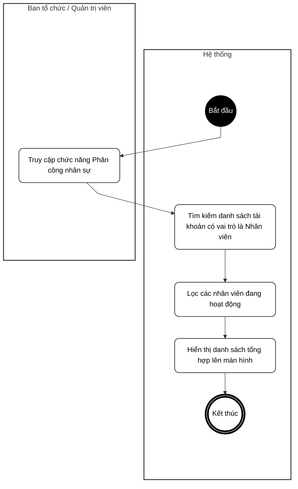
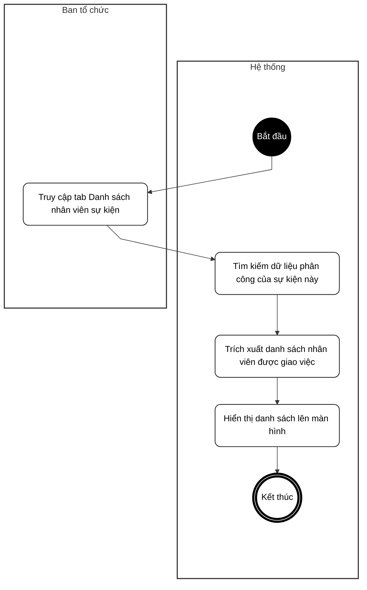
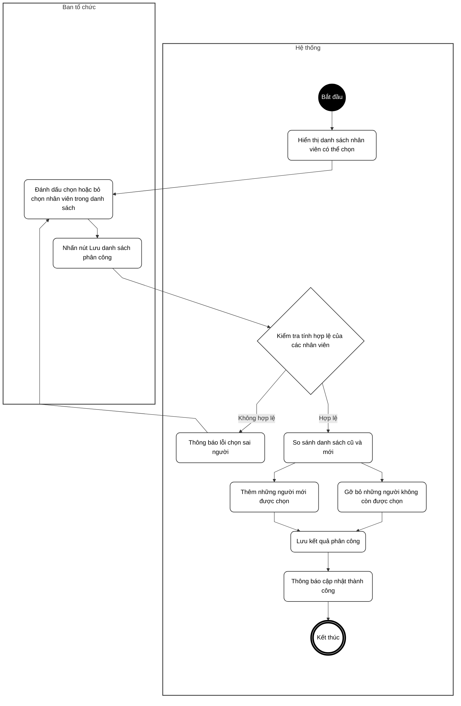
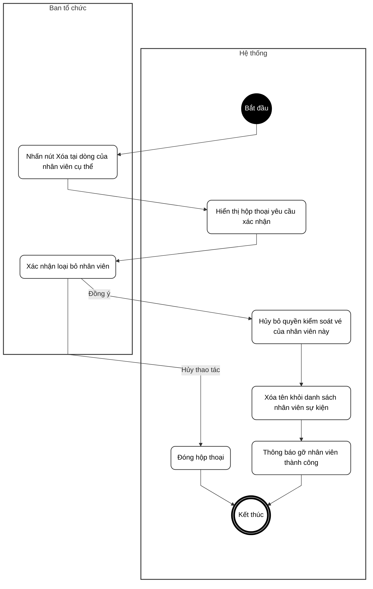

# BIỂU ĐỒ HOẠT ĐỘNG - PHẦN D: LỊCH TRÌNH & PHÂN CÔNG NHÂN SỰ

**Hệ thống Quản lý Sự kiện & Check-in QR**

---

Tài liệu này chứa các Biểu đồ Hoạt động (Activity Diagrams) mô tả thao tác quản lý đội ngũ nhân viên soát vé.

> **[LƯU Ý QUAN TRỌNG VỀ KIẾN TRÚC MỚI]**
> Kể từ phiên bản V2, các chức năng Tạo, Sửa, Xóa, Xem lịch trình con độc lập **đã bị loại bỏ**.
> Các thao tác này đã được tích hợp đồng bộ thành một mảng `schedules` và được xử lý chung trong luồng Tạo/Cập nhật/Xem Sự kiện (Xem phần B và C).

---

## UC21 – Xem danh sách nhân viên hệ thống

---

## UC22 – Xem danh sách nhân viên của sự kiện

---

## UC23 – Đồng bộ phân công Nhân viên

---

## UC24 – Xóa nhân viên khỏi sự kiện

