# BIỂU ĐỒ HOẠT ĐỘNG - PHẦN D: THANH TOÁN, VÉ & CHECK-IN
**Hệ thống Quản lý Sự kiện & Check-in QR**

---

Tài liệu này chứa các Biểu đồ Hoạt động (Activity Diagrams) mô tả luồng mua vé, thanh toán trực tuyến, quản lý đơn hàng và nghiệp vụ soát vé tại cổng sự kiện.

---

## UC29 – Thiết lập cấu hình thanh toán

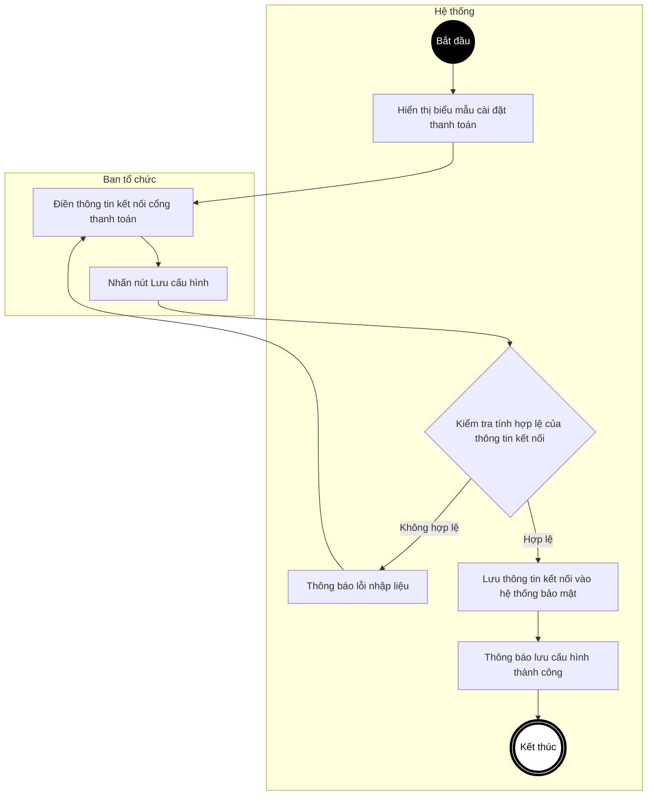

---

## UC30 – Xem cấu hình thanh toán hiện hành

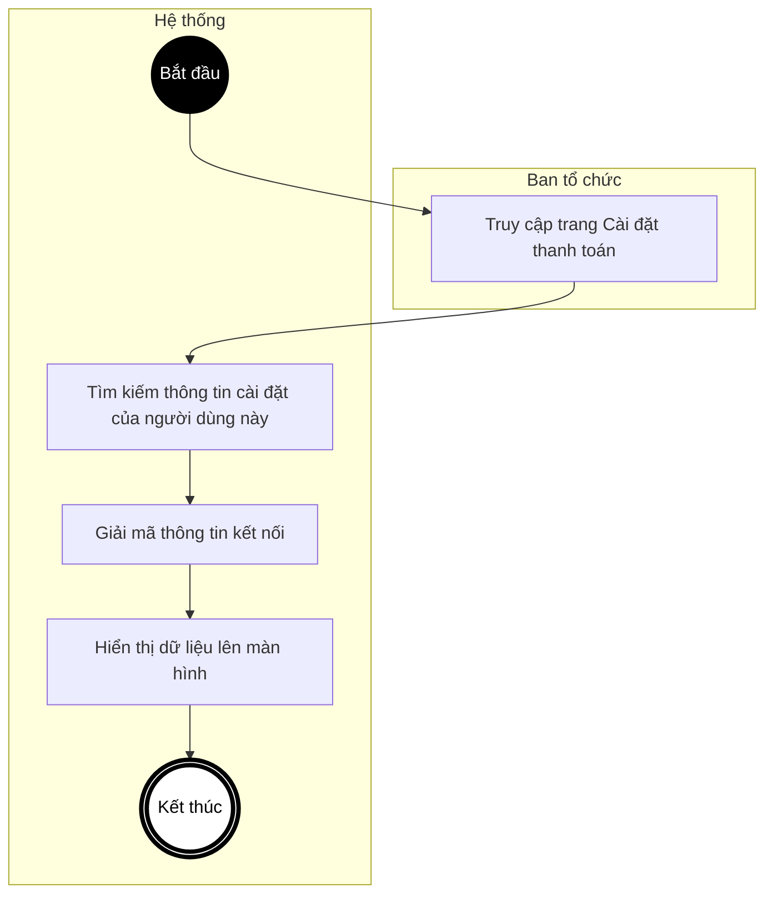

---

## UC31 – Đăng ký mua vé tham gia sự kiện

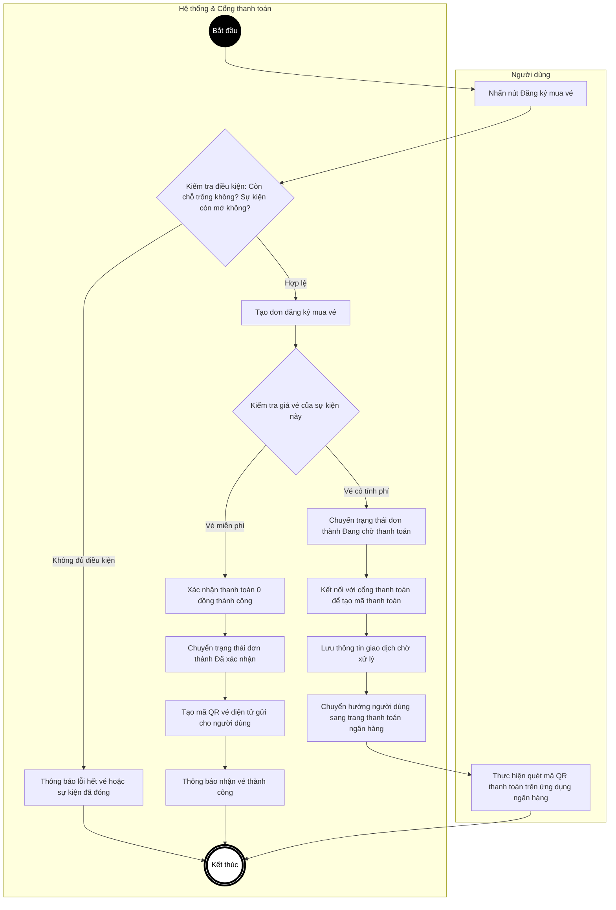

---

## UC32 – Hủy vé đã đăng ký

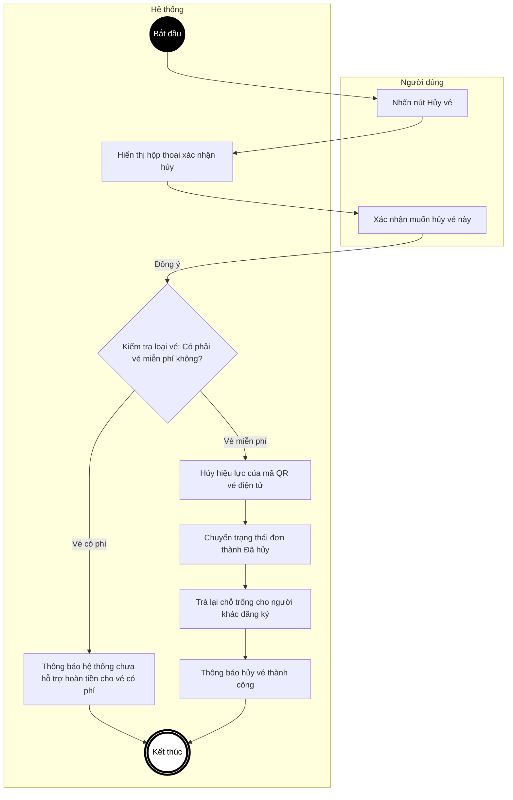

---

## UC33 – Xử lý thông báo thanh toán tự động (Webhook)

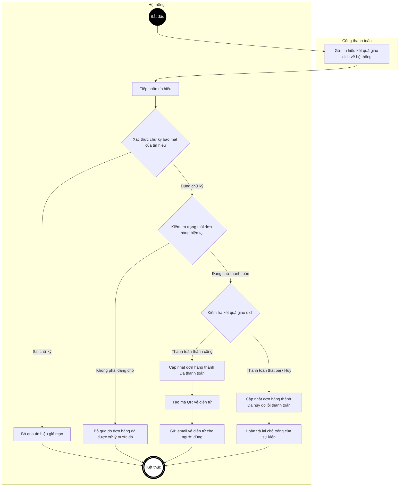

---

## UC34 – Đồng bộ trạng thái đơn hàng thủ công

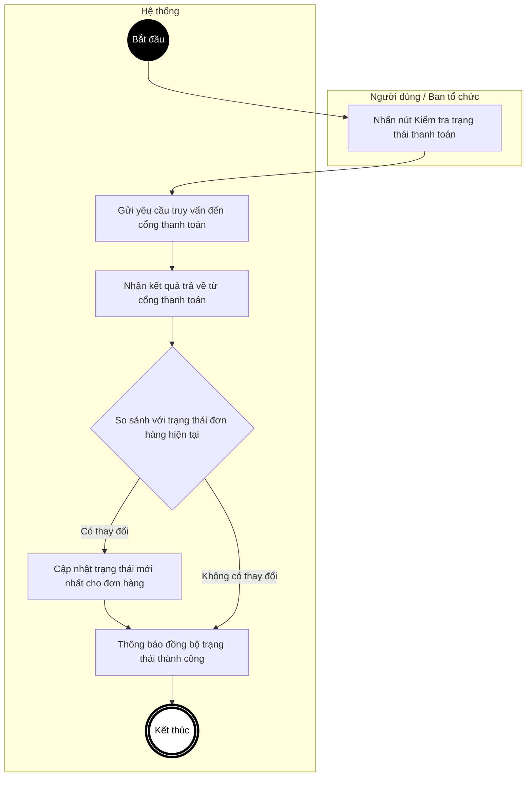

---

## UC35 – Xem danh sách đơn hàng chờ thanh toán

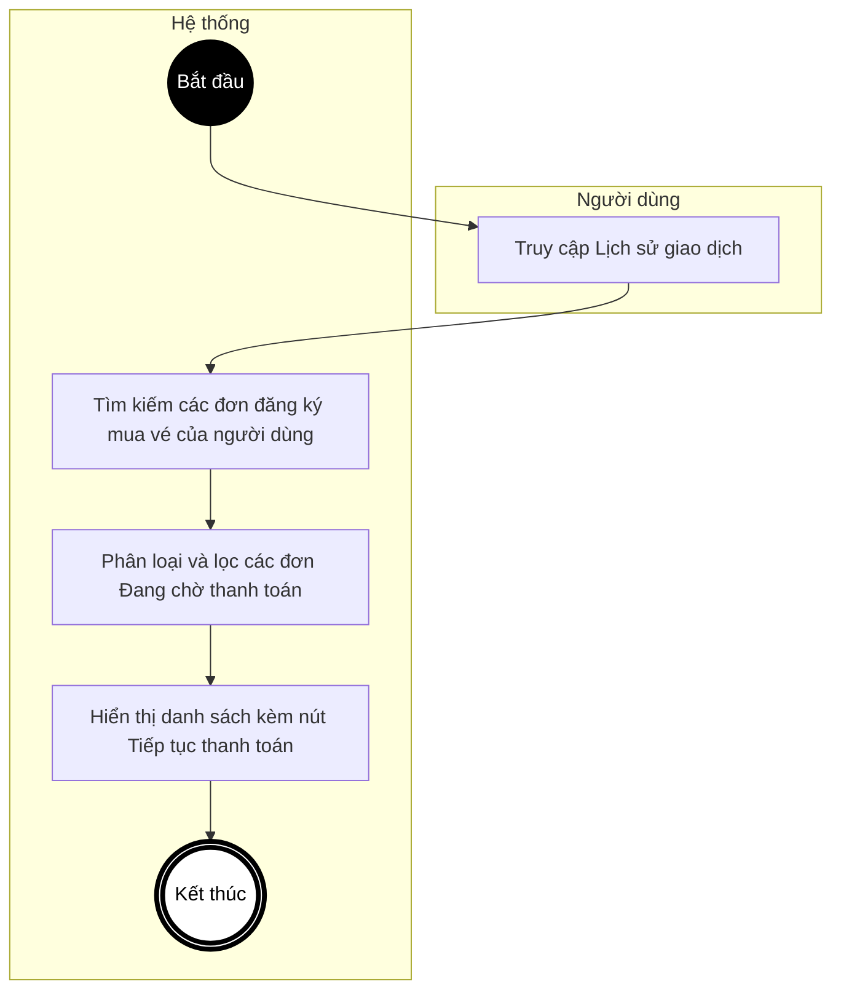

---

## UC36 – Xem danh sách vé của tôi (My Tickets)

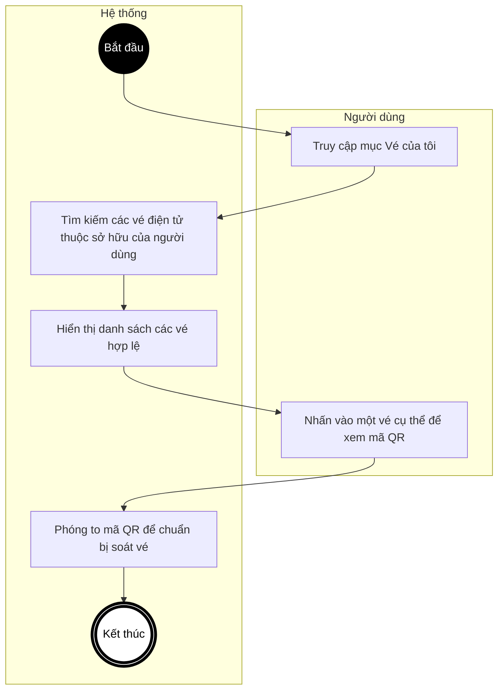

---

## UC37 – Xem danh sách vé đã bán của sự kiện

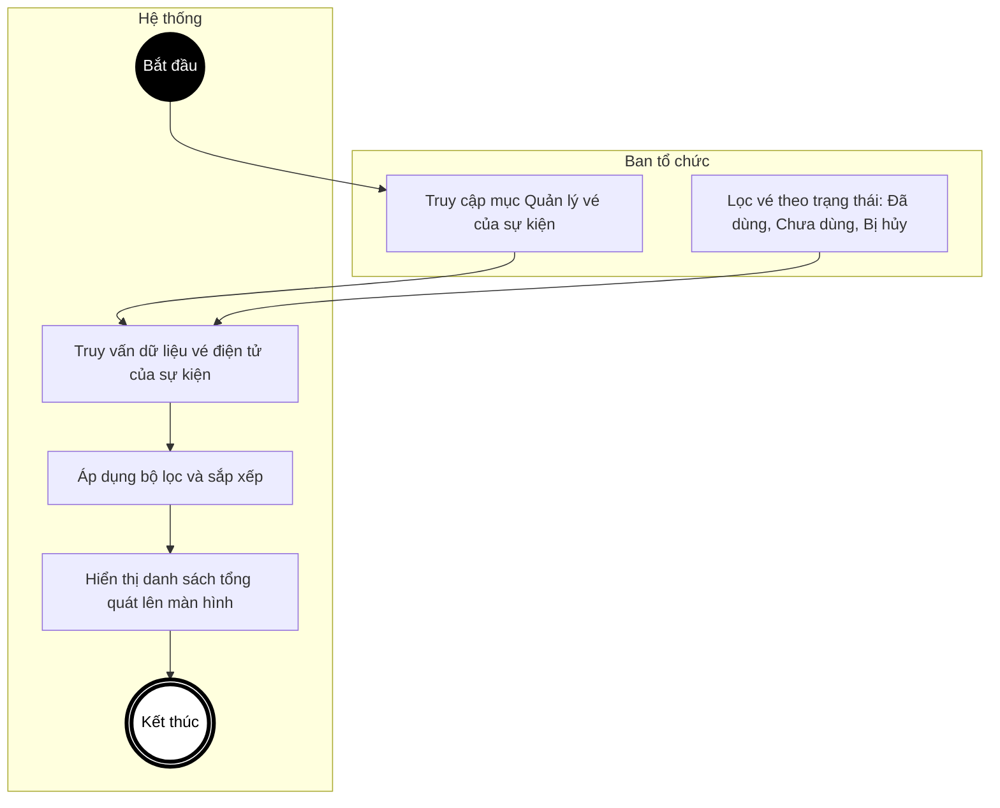

---

## UC38 – Soát vé điện tử (Check-in bằng QR)

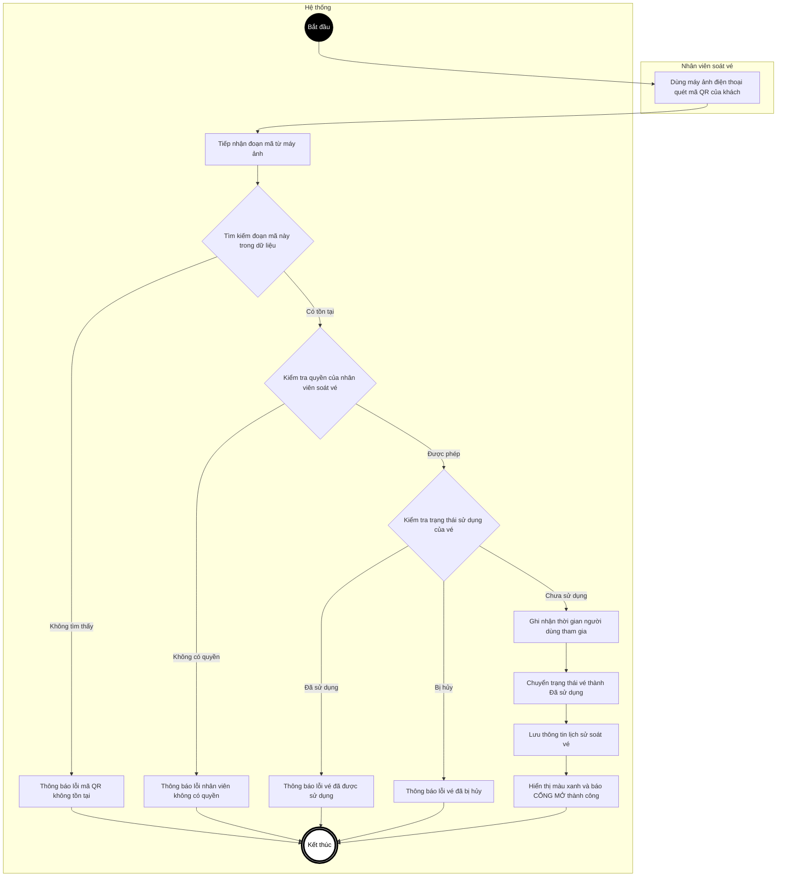

---

## UC39 – Đồng bộ dữ liệu Check-in ngoại tuyến (Offline)

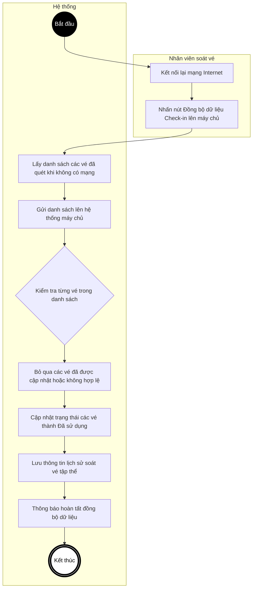

---

## UC40 – Tự động hủy đơn hàng chưa thanh toán quá hạn

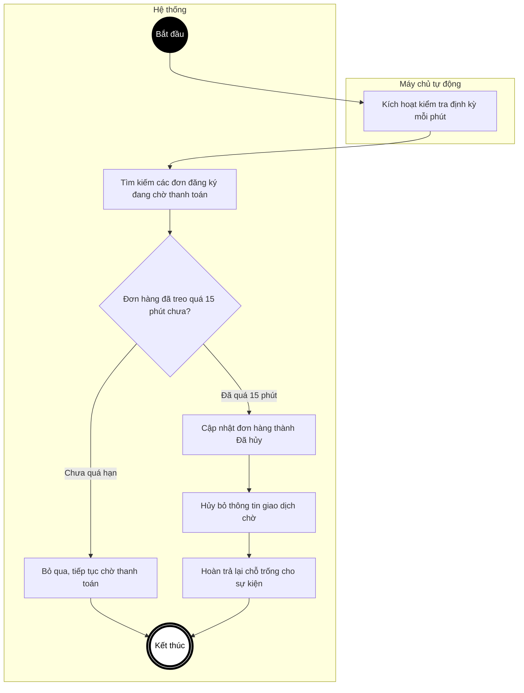
