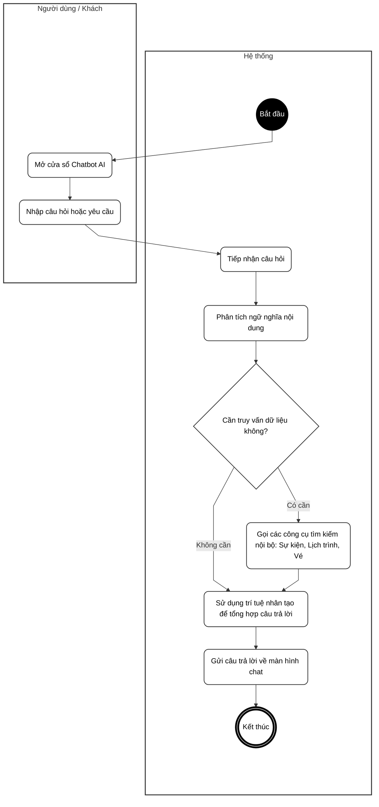
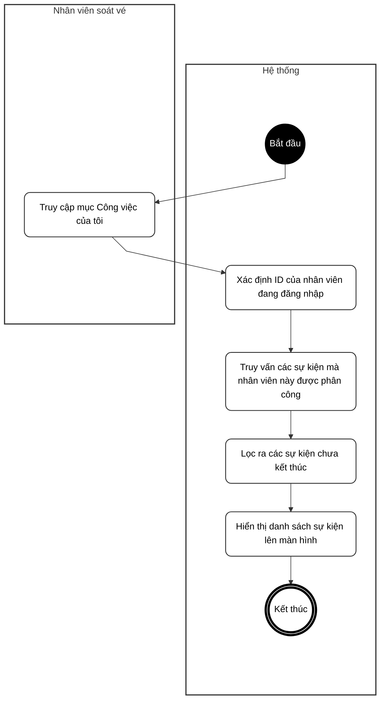
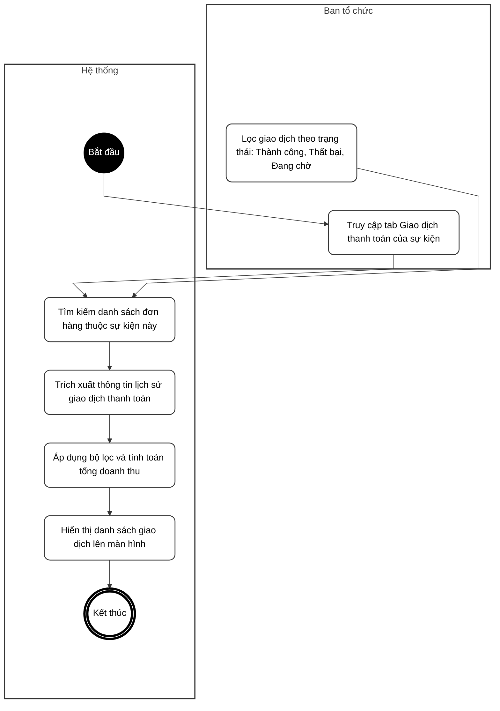
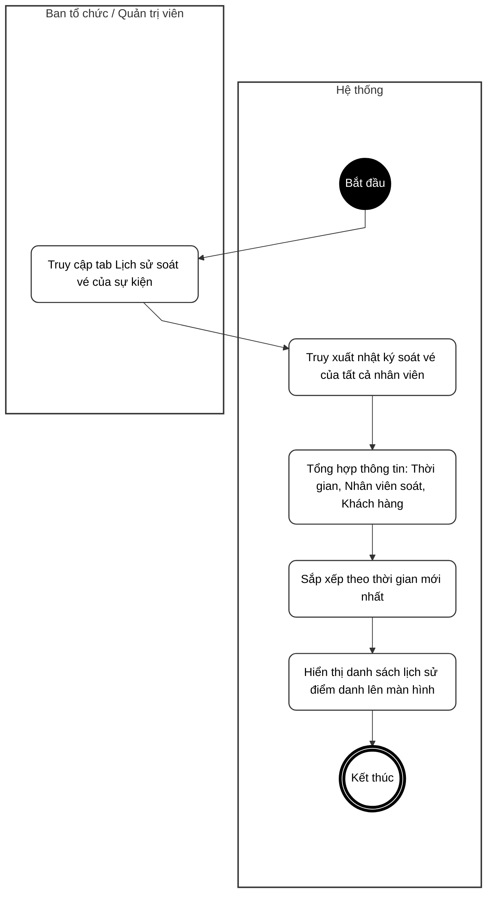

# BIỂU ĐỒ HOẠT ĐỘNG - PHẦN F: TRỢ LÝ ẢO AI CHATBOT & BÁO CÁO (UC37 – UC40)

**Hệ thống Quản lý Sự kiện & Check-in QR**

---

## UC38 – Trò chuyện với Trợ lý ảo AI (Chatbot)

---

## UC39 – Xem danh sách sự kiện được phân công của 1 nhân viên

---

## UC40 – Xem danh sách giao dịch thanh toán của sự kiện

---

## UC41 – Xem lịch sử điểm danh (Check-in) của sự kiện

