# 📌 BIỂU ĐỒ USE CASE TỔNG QUÁT HỆ THỐNG HUBEVENT (CHUẨN HÓA TỪ HÌNH VẼ CỦA BẠN)

**Dự án:** Hệ thống Quản lý Sự kiện & Check-in QR (HubEvent)  
**Tài liệu:** Phân tích Thiết kế Hệ thống - Biểu đồ Use Case Chuẩn UML  

---

## I. PHÂN TÍCH & BỔ SUNG TỪ HÌNH VẼ GỐC CỦA BẠN

Từ bản vẽ của bạn, tôi đã kiểm tra lại toàn bộ kiến trúc Backend HubEvent và chuẩn hóa lại như sau:

### 1. Các chức năng còn thiếu được bổ sung:
* **Tư vấn qua AI Chatbot (`Tư vấn AI Chatbot`):** Hệ thống tích hợp Spring AI với 17 tool tra cứu cho phép cả `Guest` và `Người dùng hệ thống` hỏi đáp tự động.
* **Hủy vé / Hủy đăng ký (`Hủy vé`):** Bổ sung nhánh mở rộng từ `Quản lý vé` để người tham gia có thể hủy đơn đăng ký trước giờ diễn ra sự kiện.
* **Check-in thủ công (`Check-in thủ công`):** Bổ sung nhánh mở rộng cho `Staff` khi khách lỗi mã QR hoặc camera không quét được.

### 2. Chuẩn hóa các quan hệ `«include»` và `«extend»`:
* **Luồng Đăng ký & Thanh toán:**  
  *Sửa lỗi hình cũ:* `Đăng ký tham gia` không nối với ai và extend vào `Quản lý vé`.  
  *Sửa chuẩn:* Nối `Người dùng hệ thống` vào **`Đăng ký tham gia`**. Vì sự kiện có thể Miễn phí hoặc Trả phí, nên Use Case **`Thanh toán`** nối **`«extend»`** vào **`Đăng ký tham gia`** (chỉ kích hoạt khi `Price > 0`).
* **Luồng Quản lý vé:**  
  Từ Use Case **`Quản lý vé`**, người dùng có lựa chọn mở rộng **`«extend»`** sang **`Hủy vé / Hủy đăng ký`**.
* **Luồng Quản lý sự kiện của Organizer:**  
  Khi tạo mới/sửa sự kiện (**`Quản lý sự kiện`**), các chức năng như **`Cấu hình thanh toán`** (cho sự kiện có phí), **`Quản lý lịch trình`** và **`Quản lý nhân viên`** là các nhánh mở rộng **`«extend»`** của quy trình tổ chức sự kiện.
* **Luồng Kiểm duyệt của Admin:**  
  *Sửa lỗi hình cũ:* `Xóa sự kiện` nối extend chéo sang Organizer.  
  *Sửa chuẩn:* Admin quản lý **`Giám sát & Kiểm duyệt sự kiện`**, từ đó có nhánh mở rộng **`«extend»`** là **`Xóa / Khóa sự kiện vi phạm`**. Trong **`Quản lý tài khoản user`** có nhánh mở rộng **`«extend»`** là **`Khóa tài khoản vi phạm`**.

---

## II. BIỂU ĐỒ USE CASE HOÀN CHỈNH (MERMAID)

```mermaid
flowchart TB
    %% ==================== ACTORS ====================
    Guest(["👤 Guest\n(Khách viếng thăm)"])
    SysUser(["👤 Người dùng hệ thống\n(Tài khoản đã đăng nhập)"])
    
    User(["👤 User\n(Người tham gia)"])
    Staff(["👤 Staff\n(Nhân viên Check-in)"])
    Organizer(["👤 Organizer\n(Ban tổ chức)"])
    Admin(["👤 Admin\n(Quản trị viên)"])

    %% ==================== QUAN HỆ KẾ THỪA ACTOR ====================
    User      -- "kế thừa" --> SysUser
    Staff     -- "kế thừa" --> SysUser
    Organizer -- "kế thừa" --> SysUser
    Admin     -- "kế thừa" --> SysUser

    %% ==================== GUEST & NGƯỜI DÙNG HỆ THỐNG ====================
    UC_RegLogin(["Đăng ký / Đăng nhập"])
    UC_ViewEvent(["Xem sự kiện"])
    UC_AIChat(["Tư vấn AI Chatbot"])
    UC_Logout(["Đăng xuất"])
    UC_Profile(["Quản lý tài khoản cá nhân"])
    UC_EventRegister(["Đăng ký tham gia"])
    UC_Payment(["Thanh toán"])
    UC_TicketManage(["Quản lý vé"])
    UC_CancelTicket(["Hủy vé / Hủy đăng ký"])

    Guest --> UC_RegLogin
    Guest --> UC_ViewEvent
    Guest --> UC_AIChat

    SysUser --> UC_ViewEvent
    SysUser --> UC_AIChat
    SysUser --> UC_Logout
    SysUser --> UC_Profile
    SysUser --> UC_EventRegister
    SysUser --> UC_TicketManage

    %% Quan hệ chuẩn cho Free/Paid Event
    UC_Payment -. "«extend»\n(Khi sự kiện Trả phí)" .-> UC_EventRegister
    UC_CancelTicket -. "«extend»\n(Khi đủ điều kiện hủy)" .-> UC_TicketManage

    Note_Auth["📌 {Ràng buộc Precondition (Tiền điều kiện Đăng nhập):\nBẤT KỲ chức năng nghiệp vụ nào (Quản lý tài khoản, Đăng ký,\nThanh toán, Quản lý vé, Check-in, Quản lý sự kiện...)\nđều BẮT BUỘC người dùng phải Đăng nhập trước}"]
    Note_Auth -.- SysUser
    Note_Auth -.- UC_RegLogin

    Note_RuleReg["📌 {Ràng buộc Đăng ký & Thanh toán:\n1. Sự kiện Miễn phí (0đ): Đăng ký xong cấp vé ngay.\n2. Sự kiện Trả phí (>0đ): Mở rộng «extend» sang Thanh toán PayOS.\n3. Ngoại lệ: STAFF không được mua vé sự kiện mình soát vé.\n4. Số vé bán ra không vượt quá Sức chứa (Capacity).}"]
    Note_RuleReg -.- UC_EventRegister

    %% ==================== STAFF ====================
    UC_StaffCheckin(["Soát vé & Check-in"])
    UC_ScanQR(["Quét mã QR checkin"])
    UC_ManualCheckin(["Check-in thủ công"])

    Staff --> UC_StaffCheckin
    UC_StaffCheckin -. "«include»" .-> UC_ScanQR
    UC_ManualCheckin -. "«extend»\n(Khi QR lỗi)" .-> UC_StaffCheckin

    Note_Staff["📌 {Ràng buộc Check-in:\nStaff chỉ được thao tác soát vé tại sự kiện\nđược Organizer phân công}"]
    Note_Staff -.- UC_StaffCheckin

    %% ==================== ORGANIZER ====================
    UC_OrgManageEvent(["Quản lý sự kiện"])
    UC_OrgManageStaff(["Quản lý nhân viên"])
    UC_OrgConfigPay(["Cấu hình thanh toán"])
    UC_OrgSchedule(["Quản lý lịch trình"])
    UC_OrgViewParticipants(["Xem danh sách người tham gia"])
    UC_EventStats(["Thống kê chi tiết sự kiện"])

    Organizer --> UC_OrgManageEvent
    Organizer --> UC_OrgViewParticipants
    Organizer --> UC_EventStats

    UC_OrgConfigPay -. "«extend»\n(Nếu sự kiện có phí)" .-> UC_OrgManageEvent
    UC_OrgSchedule -. "«extend»" .-> UC_OrgManageEvent
    UC_OrgManageStaff -. "«extend»" .-> UC_OrgManageEvent

    Note_Org["📌 {Ràng buộc Ban tổ chức:\nOrganizer chỉ được quản lý và phân công Staff\ncho sự kiện do chính mình tạo ra}"]
    Note_Org -.- UC_OrgManageEvent

    %% ==================== ADMIN ====================
    UC_AdminManageUser(["Quản lý tài khoản user"])
    UC_LockUser(["Khóa tài khoản vi phạm"])
    UC_AdminSysStats(["Thống kê hệ thống"])
    UC_AdminMonitorEvent(["Giám sát & Kiểm duyệt sự kiện"])
    UC_AdminDeleteEvent(["Xóa / Khóa sự kiện vi phạm"])

    Admin --> UC_AdminManageUser
    Admin --> UC_AdminSysStats
    Admin --> UC_AdminMonitorEvent
    Admin --> UC_EventStats

    UC_LockUser -. "«extend»" .-> UC_AdminManageUser
    UC_AdminDeleteEvent -. "«extend»\n(Khi sự kiện vi phạm)" .-> UC_AdminMonitorEvent

    %% ==================== STYLING ====================
    style Guest     fill:#f5f5f5,stroke:#424242,stroke-width:2px
    style SysUser   fill:#e8f5e9,stroke:#2e7d32,stroke-width:3px
    style User      fill:#c8e6c9,stroke:#1b5e20,stroke-width:2px
    style Staff     fill:#e3f2fd,stroke:#1565c0,stroke-width:2px
    style Organizer fill:#fff3e0,stroke:#e65100,stroke-width:2px
    style Admin     fill:#fce4ec,stroke:#880e4f,stroke-width:2px

    style Note_Auth    fill:#ffcdd2,stroke:#c62828,stroke-width:2px,stroke-dasharray: 4 4
    style Note_RuleReg fill:#fff9c4,stroke:#fbc02d,stroke-width:1px,stroke-dasharray: 4 4
    style Note_Staff   fill:#fff9c4,stroke:#fbc02d,stroke-width:1px,stroke-dasharray: 4 4
    style Note_Org     fill:#fff9c4,stroke:#fbc02d,stroke-width:1px,stroke-dasharray: 4 4
```

---

## III. TỔNG HỢP CÁC QUAN HỆ UML ĐÃ CHUẨN HÓA

| Mối quan hệ | Nguồn | Đích | Ý nghĩa & Điều kiện nghiệp vụ |
| :--- | :--- | :--- | :--- |
| **«extend»** | `Thanh toán` | `Đăng ký tham gia` | Kích hoạt khi giá vé sự kiện lớn hơn 0đ (Sự kiện Trả phí). |
| **«extend»** | `Hủy vé / Hủy đăng ký` | `Quản lý vé` | Kích hoạt khi người dùng muốn hủy đơn giữ chỗ trước giờ diễn ra sự kiện. |
| **«include»** | `Soát vé & Check-in` | `Quét mã QR checkin` | Thao tác quét QR là nhiệm vụ bắt buộc của quy trình soát vé tại cửa. |
| **«extend»** | `Check-in thủ công` | `Soát vé & Check-in` | Kích hoạt khi camera hỏng hoặc mã QR của người tham gia bị lỗi không đọc được. |
| **«extend»** | `Cấu hình thanh toán` | `Quản lý sự kiện` | Kích hoạt khi Organizer cấu hình tài khoản nhận tiền cho sự kiện trả phí. |
| **«extend»** | `Quản lý lịch trình`, `Quản lý nhân viên` | `Quản lý sự kiện` | Các bước thiết lập mở rộng xung quanh một sự kiện cụ thể. |
| **«extend»** | `Xóa / Khóa sự kiện vi phạm` | `Giám sát & Kiểm duyệt sự kiện` | Kích hoạt khi Admin phát hiện sự kiện vi phạm tiêu chuẩn cộng đồng. |
| **«extend»** | `Khóa tài khoản vi phạm` | `Quản lý tài khoản user` | Kích hoạt khi Admin xử lý kỷ luật tài khoản vi phạm. |
