# BIỂU ĐỒ TUẦN TỰ - PHẦN A: XÁC THỰC & HỒ SƠ CÁ NHÂN (UC01 – UC10)

> **Quy ước ký hiệu:**
> - **Actor**: Người dùng thực hiện hành động
> - **Màn hình**: Giao diện hiển thị với người dùng
> - **Hệ thống**: Xử lý logic nghiệp vụ phía máy chủ
> - **CSDL**: Cơ sở dữ liệu lưu trữ
> - **Dịch vụ ngoài**: Email, Cloudinary, Google OAuth

---

## UC01 – Đăng ký tài khoản

```mermaid
sequenceDiagram
    actor Guest as Khách (Guest)
    participant UI as Màn hình Đăng ký
    participant HT as Hệ thống
    participant DB as Cơ sở dữ liệu

    Guest->>UI: 1. Điền Họ tên, Email, Mật khẩu, SĐT
    UI->>HT: 2. Gửi yêu cầu đăng ký
    HT->>HT: 3. Kiểm tra định dạng Email (@gmail.com), Mật khẩu ≥ 6 ký tự, SĐT đúng chuẩn VN
    alt Thông tin không hợp lệ
        HT-->>UI: 4a. Thông báo lỗi validate
        UI-->>Guest: 4b. Hiển thị lỗi cụ thể
    else Thông tin hợp lệ
        HT->>DB: 4. Kiểm tra Email đã tồn tại chưa
        alt Email đã tồn tại
            DB-->>HT: 5a. Email đã có trong hệ thống
            HT-->>UI: 5b. Thông báo tài khoản đã tồn tại
            UI-->>Guest: 5c. Hiển thị lỗi
        else Email mới
            DB-->>HT: 5. Email chưa tồn tại
            HT->>HT: 6. Mã hóa mật khẩu (BCrypt)
            HT->>DB: 7. Lưu tài khoản mới (Vai trò: USER, Trạng thái: ACTIVE)
            DB-->>HT: 8. Lưu thành công
            HT-->>UI: 9. Đăng ký thành công
            UI-->>Guest: 10. Thông báo tạo tài khoản thành công
        end
    end
```

---

## UC02 – Đăng nhập hệ thống

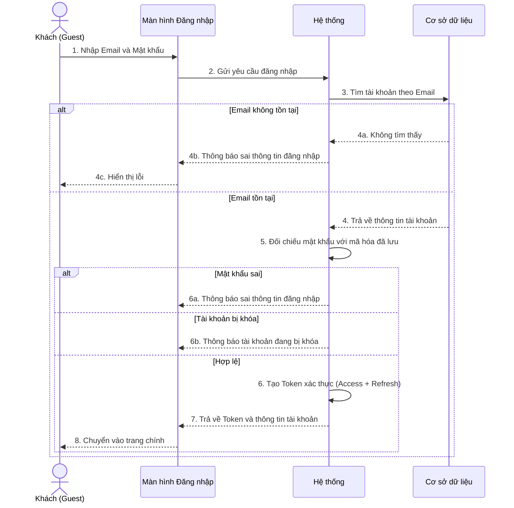

---

## UC02a – Đăng nhập bằng Google (OAuth 2.0)

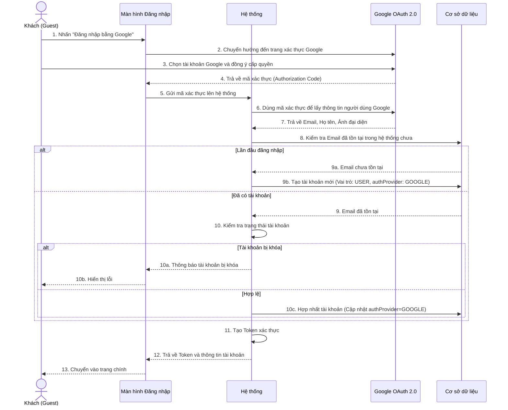

---

## UC03 – Đăng xuất

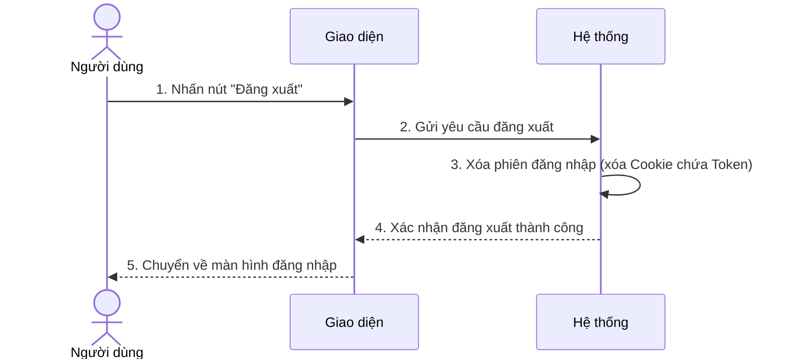

---

## UC04 – Quên mật khẩu

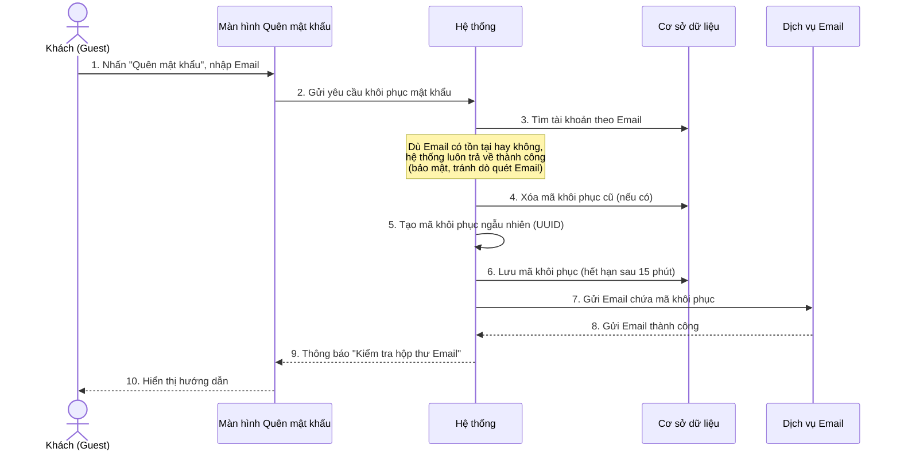

---

## UC05 – Đặt lại mật khẩu

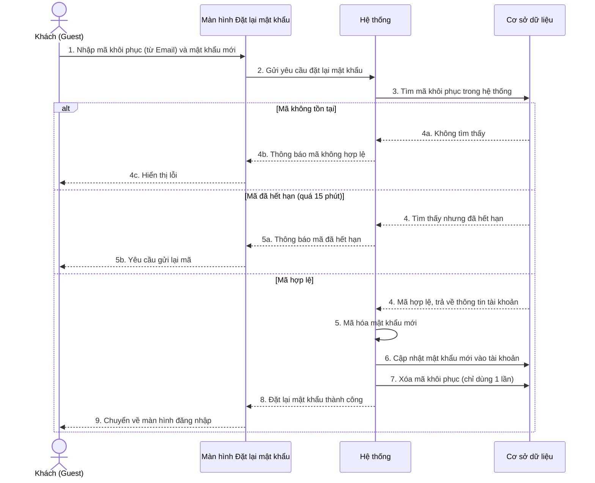

---

## UC06 – Đổi mật khẩu (khi đã đăng nhập)

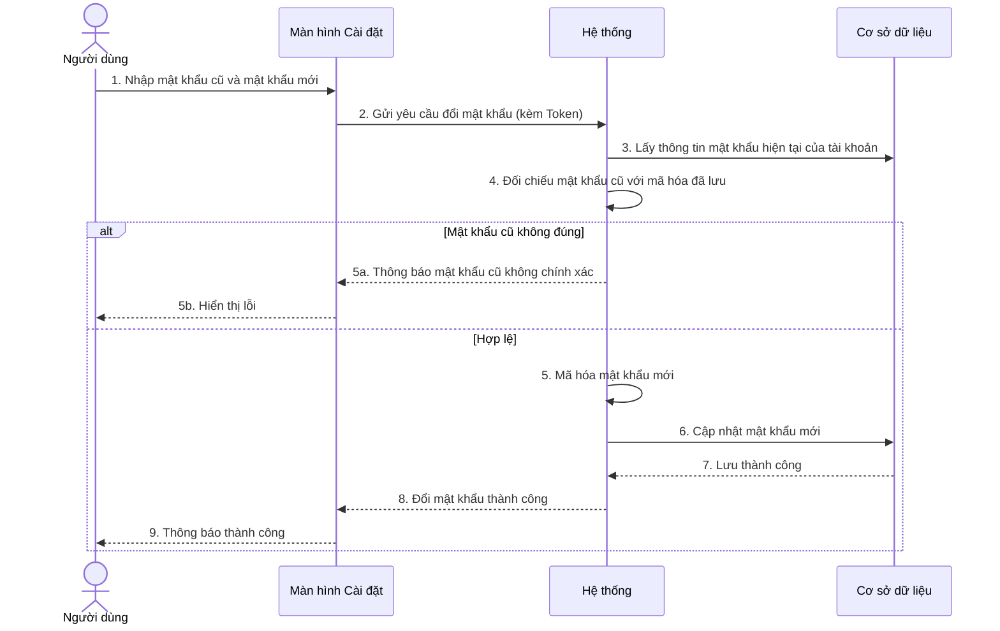

---

## UC07 – Xem hồ sơ cá nhân

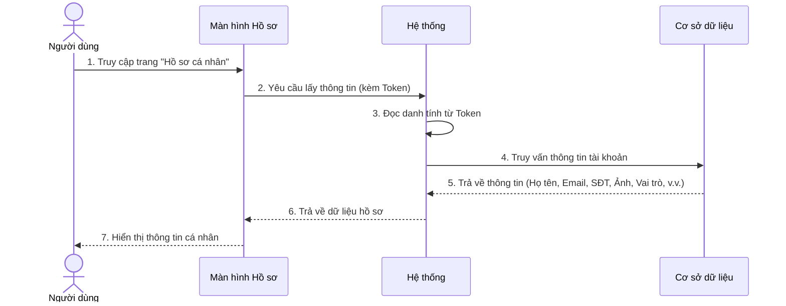

---

## UC08 – Cập nhật hồ sơ cá nhân

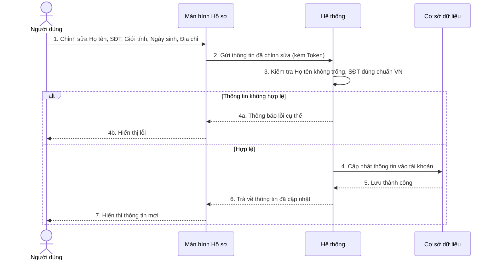

---

## UC09 – Upload ảnh đại diện

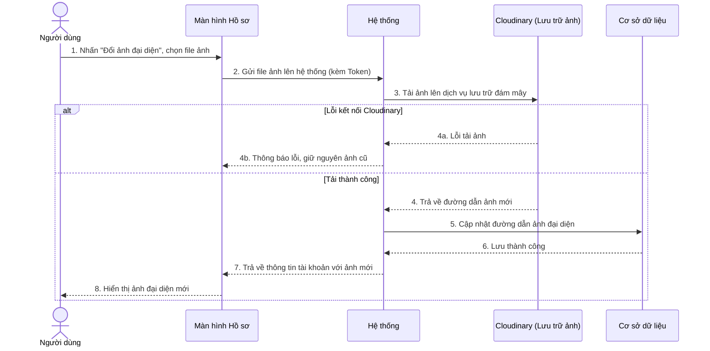

---

## UC10 – Tự khóa tài khoản

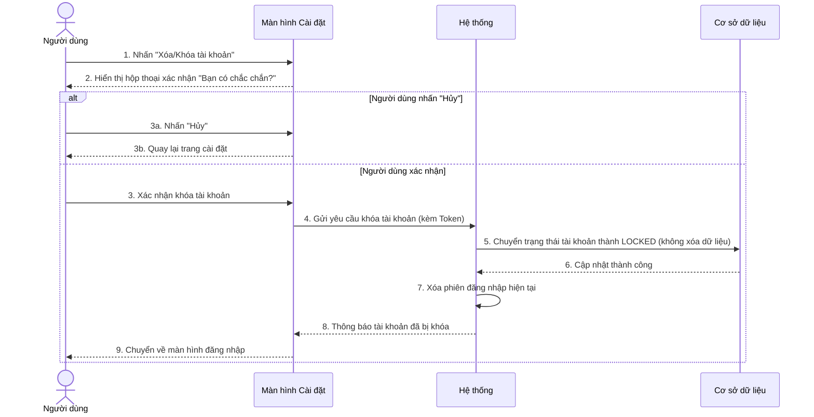

---

## UC10b – Xem hồ sơ công khai của người dùng khác

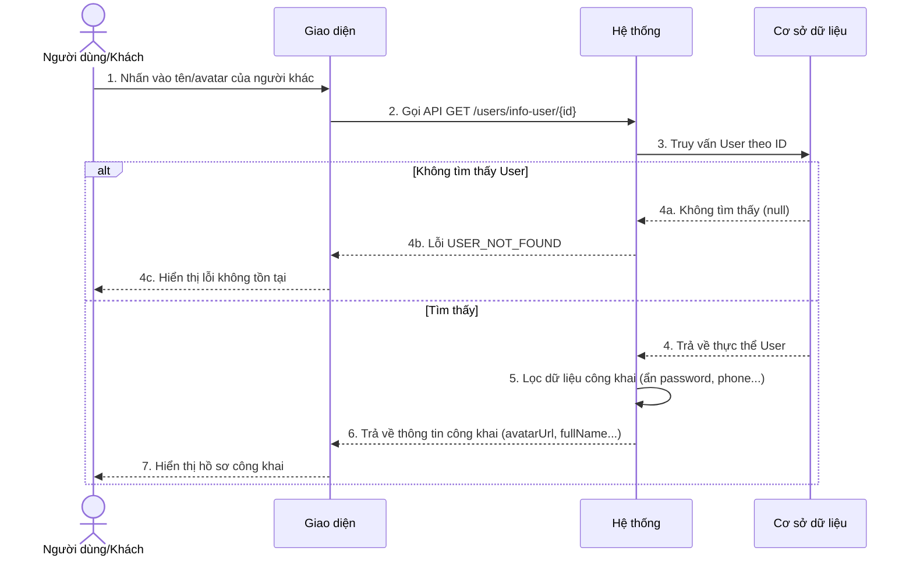
