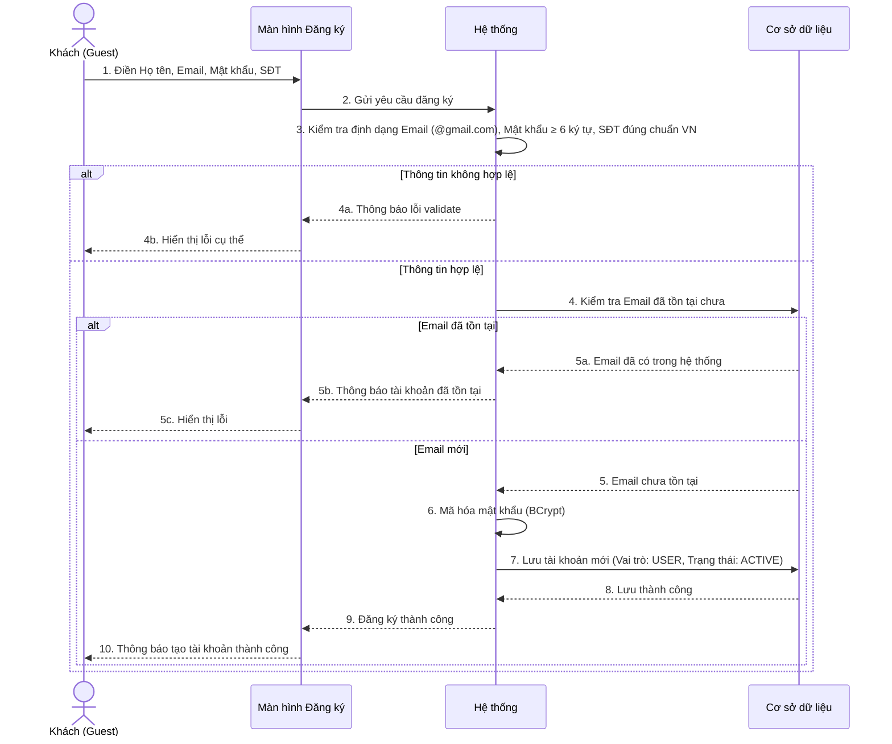
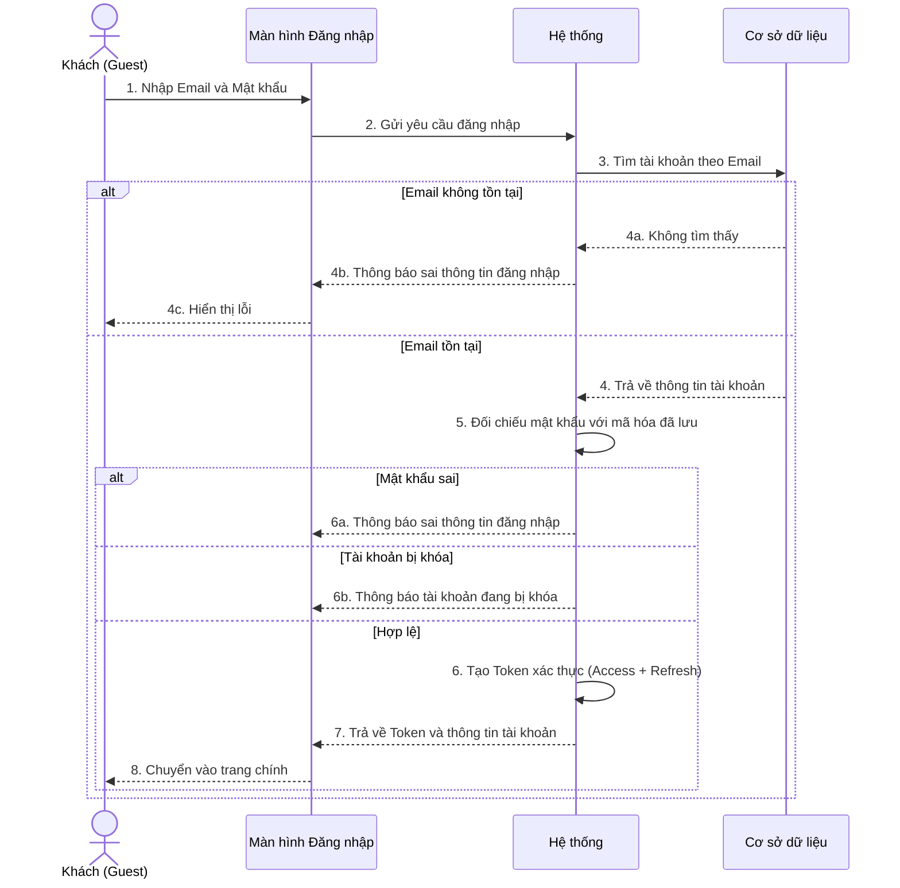
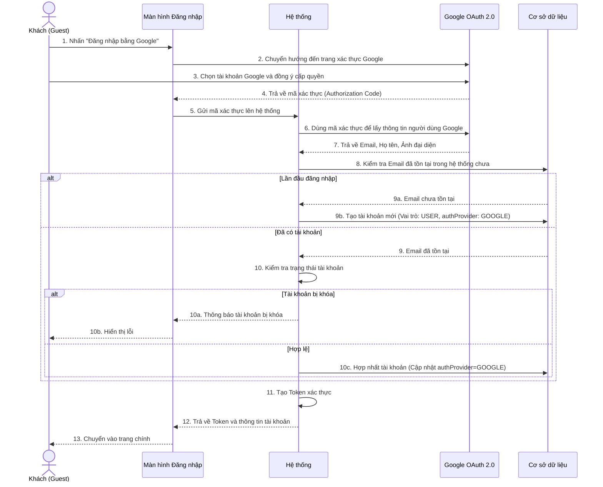
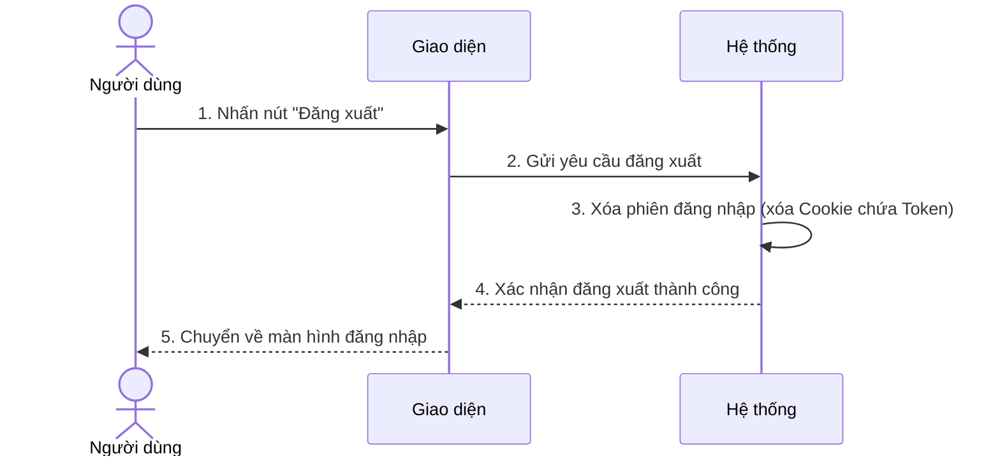
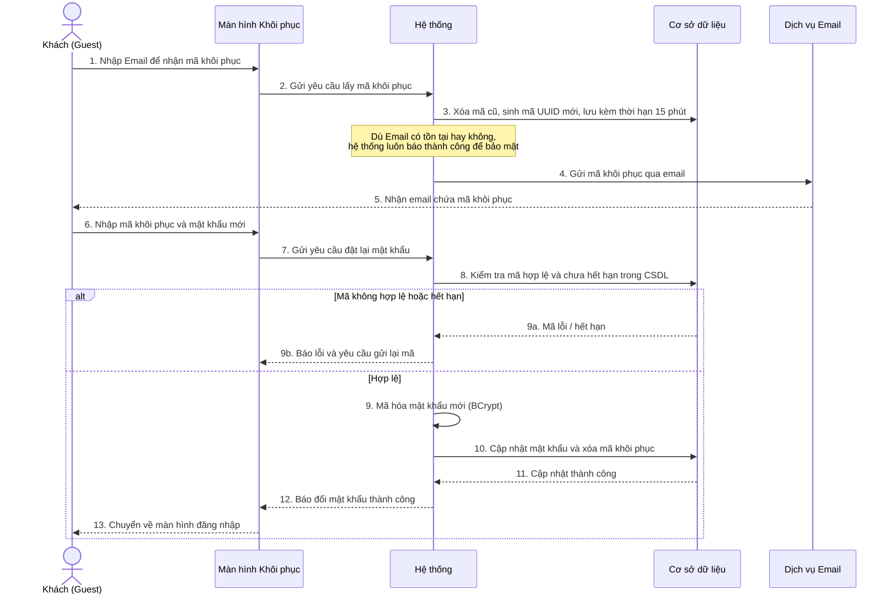
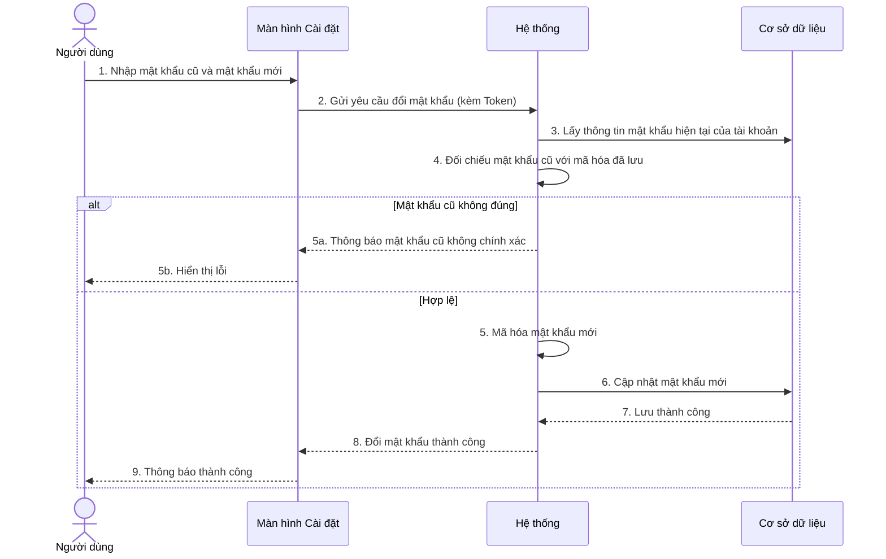
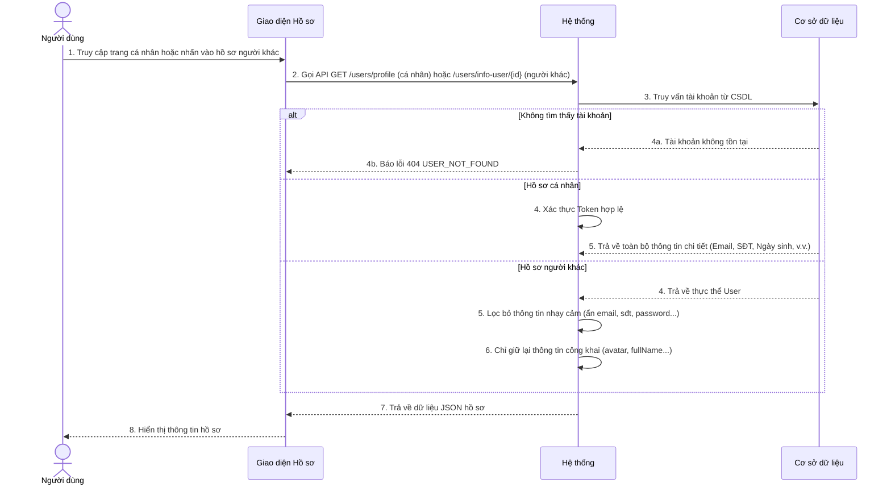
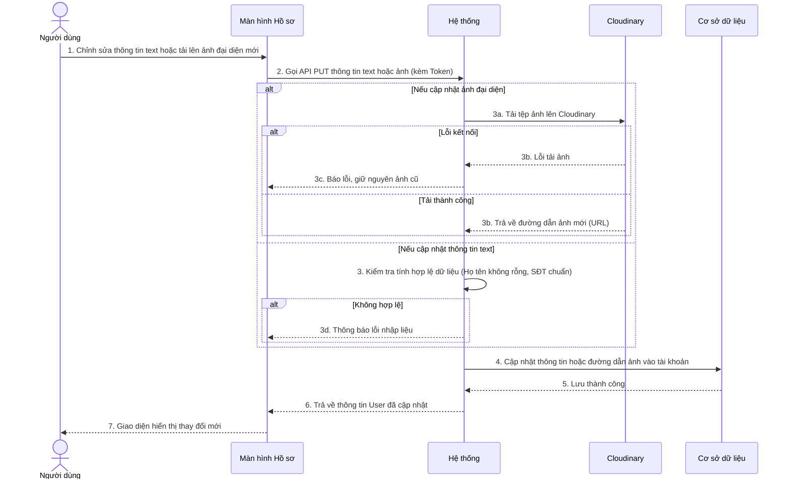
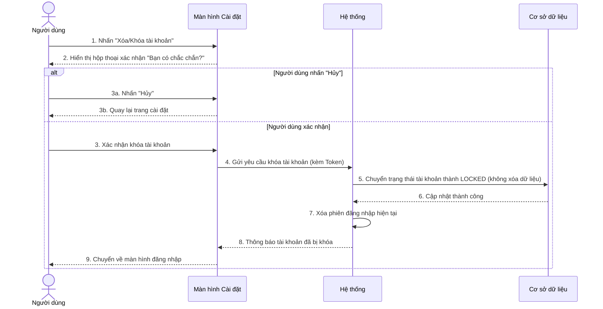

# BIỂU ĐỒ TUẦN TỰ - PHẦN A: XÁC THỰC & HỒ SƠ CÁ NHÂN (UC01 – UC09)

> **Quy ước ký hiệu:**
>
> - **Actor**: Người dùng thực hiện hành động
> - **Màn hình**: Giao diện hiển thị với người dùng
> - **Hệ thống**: Xử lý logic nghiệp vụ phía máy chủ
> - **CSDL**: Cơ sở dữ liệu lưu trữ
> - **Dịch vụ ngoài**: Email, Cloudinary, Google OAuth

---

## UC01 – Đăng ký tài khoản

---

## UC02 – Đăng nhập hệ thống

---

## UC03 – Đăng nhập bằng Google (OAuth 2.0)

---

## UC04 – Đăng xuất

---

## UC05 – Quên mật khẩu & Đặt lại mật khẩu

---

## UC06 – Đổi mật khẩu

---

## UC07 – Xem thông tin cá nhân & Hồ sơ người dùng khác

---

## UC08 – Cập nhật thông tin cá nhân & Ảnh đại diện

---

## UC09 – Tự khóa / xóa tài khoản (Soft Delete)

