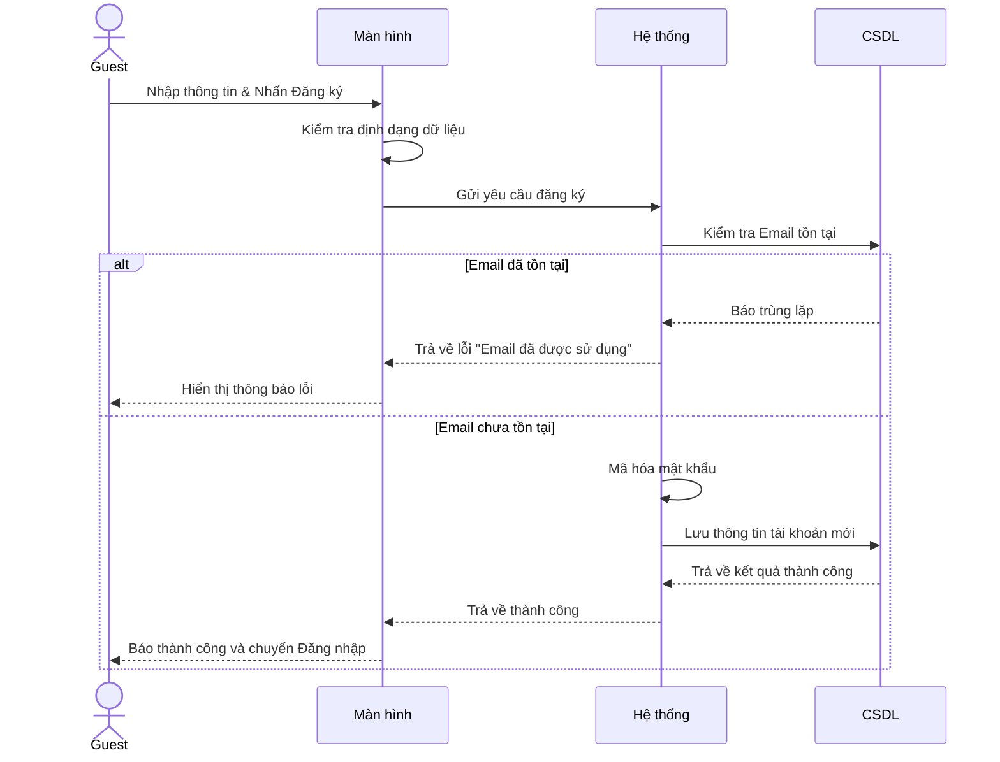
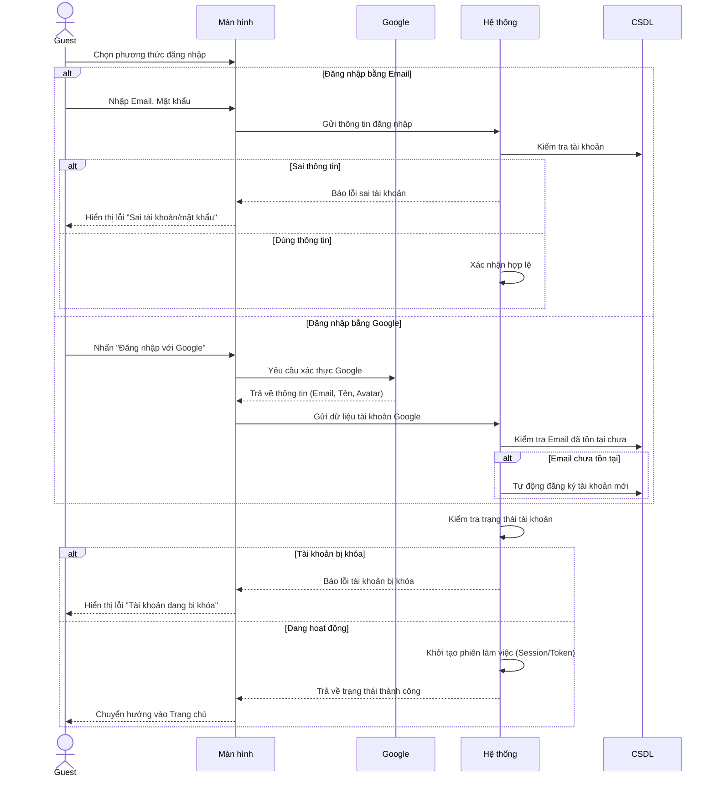
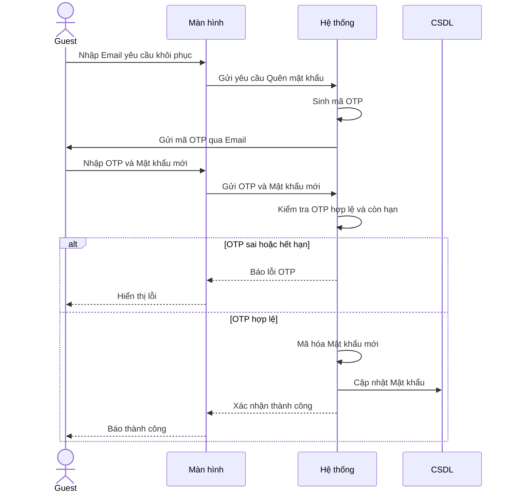
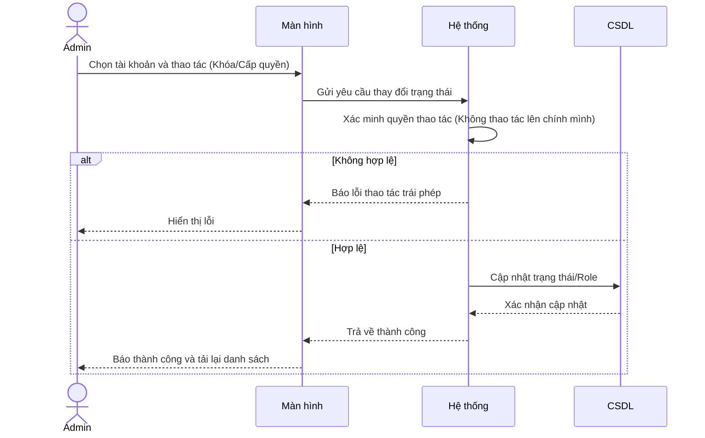

# BIỂU ĐỒ TUẦN TỰ - PHẦN A: NỀN TẢNG HỆ THỐNG (UC01 – UC08)

---

## UC01 – Đăng ký tài khoản



---

## UC02 – Đăng nhập hệ thống



---

## UC03 – Đăng xuất

```mermaid
sequenceDiagram
    actor Actor
    participant Màn hình
    participant Hệ thống

    Actor->>Màn hình: Nhấn nút Đăng xuất
    Màn hình->>Hệ thống: Yêu cầu xóa phiên làm việc
    Hệ thống->>Hệ thống: Hủy Session/Token hiện tại
    Hệ thống-->>Màn hình: Xác nhận thành công
    Màn hình->>Màn hình: Xóa Cookie trình duyệt
    Màn hình-->>Actor: Chuyển hướng về trang Đăng nhập
```

---

## UC04 – Quên mật khẩu



---

## UC05 – Đổi mật khẩu

```mermaid
sequenceDiagram
    actor Actor
    participant Màn hình
    participant Hệ thống
    participant CSDL

    Actor->>Màn hình: Nhập mật khẩu cũ & mới
    Màn hình->>Hệ thống: Yêu cầu đổi mật khẩu
    Hệ thống->>CSDL: Lấy mật khẩu cũ
    Hệ thống->>Hệ thống: Đối chiếu mật khẩu
    alt Mật khẩu cũ sai
        Hệ thống-->>Màn hình: Trả về lỗi sai mật khẩu
        Màn hình-->>Actor: Hiển thị lỗi
    else Mật khẩu cũ đúng
        Hệ thống->>Hệ thống: Mã hóa mật khẩu mới
        Hệ thống->>CSDL: Cập nhật mật khẩu mới
        Hệ thống-->>Màn hình: Trả về thành công
        Màn hình-->>Actor: Thông báo thành công
    end
```

---

## UC06 – Cập nhật hồ sơ cá nhân

```mermaid
sequenceDiagram
    actor Actor
    participant Màn hình
    participant Hệ thống
    participant Server_Ảnh
    participant CSDL

    Actor->>Màn hình: Nhập thông tin & Ảnh mới (Nếu có)
    Màn hình->>Hệ thống: Gửi yêu cầu cập nhật hồ sơ
    alt Có tải ảnh lên
        Hệ thống->>Server_Ảnh: Đẩy file ảnh lên máy chủ
        Server_Ảnh-->>Hệ thống: Trả về URL ảnh
    end
    Hệ thống->>CSDL: Lưu thông tin & URL ảnh mới
    CSDL-->>Hệ thống: Xác nhận lưu
    Hệ thống-->>Màn hình: Trả về dữ liệu mới
    Màn hình-->>Actor: Báo thành công và cập nhật giao diện
```

---

## UC07 – Quản lý tài khoản người dùng



---

## UC08 – Xem báo cáo thống kê tổng quan (Dashboard)

```mermaid
sequenceDiagram
    actor Actor
    participant Màn hình
    participant Hệ thống
    participant CSDL

    Actor->>Màn hình: Truy cập trang Dashboard
    Màn hình->>Hệ thống: Yêu cầu lấy dữ liệu thống kê
    Hệ thống->>Hệ thống: Xác minh Role (Admin hay Organizer)
    Hệ thống->>CSDL: Truy vấn số liệu nền tảng hoặc cá nhân
    CSDL-->>Hệ thống: Trả về các con số (User, Event, Doanh thu)
    Hệ thống-->>Màn hình: Gửi dữ liệu thống kê
    Màn hình-->>Actor: Vẽ biểu đồ trực quan
```
