# BIỂU ĐỒ TUẦN TỰ - PHẦN B: QUẢN TRỊ HỆ THỐNG & SỰ KIỆN (UC11 – UC19)

---

## UC11 – Xem danh sách người dùng (Admin)

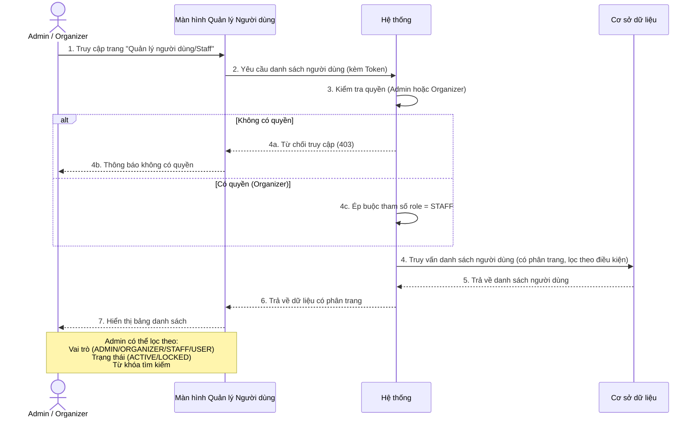

---

## UC12 – Khóa / Mở khóa tài khoản (Admin)

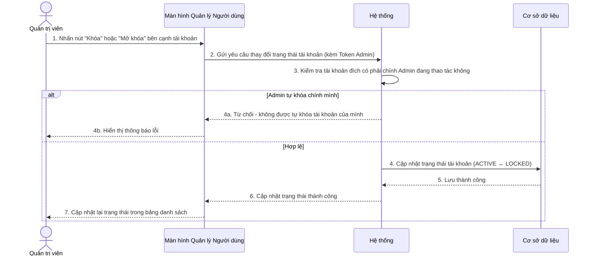

---

## UC12b – Xóa tài khoản vĩnh viễn (Admin)

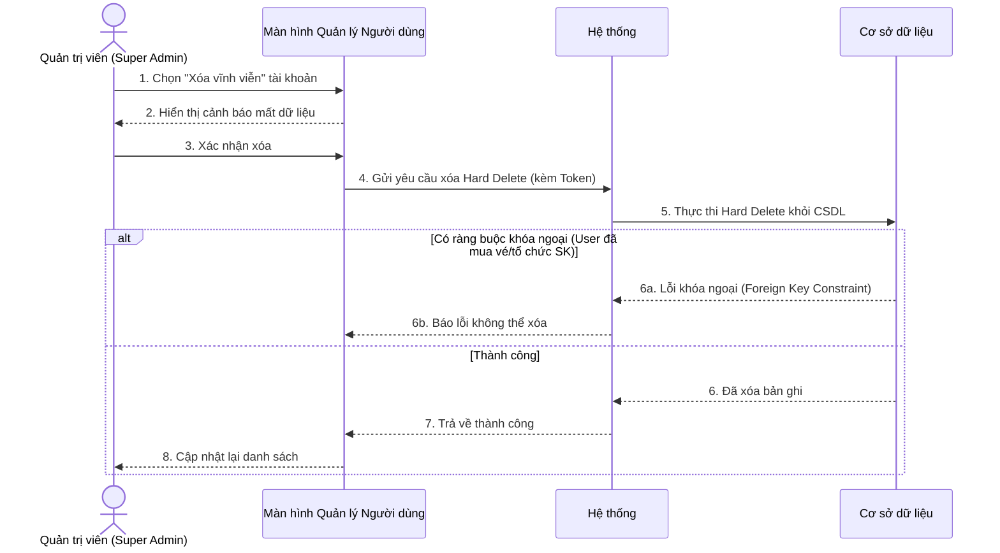

---

## UC13 – Phân quyền người dùng (Admin)

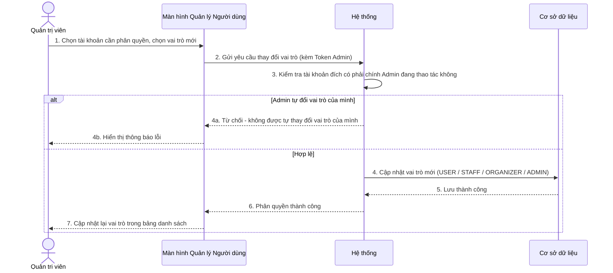

---

## UC13a – Xem Dashboard thống kê tổng quan (Admin)

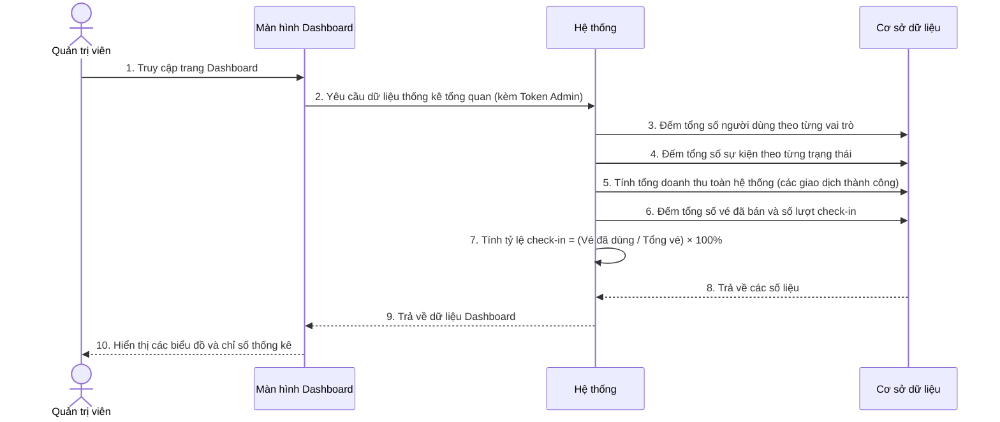

---

## UC13b – Xem thống kê chi tiết sự kiện (Admin / Organizer)

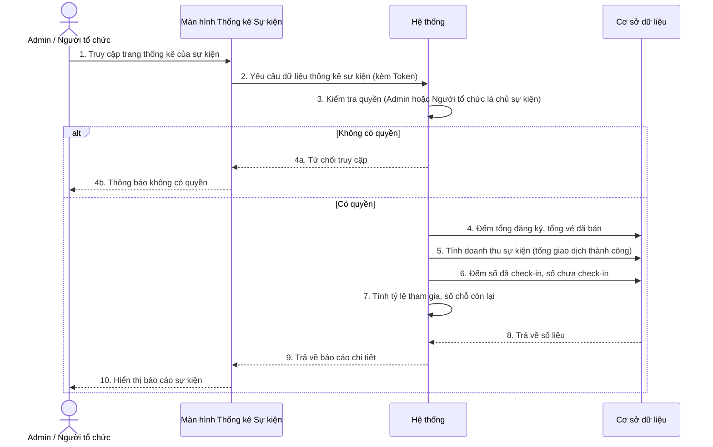

---

## UC14 – Xem danh sách sự kiện (Public)

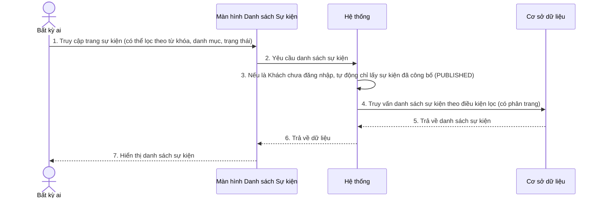

---

## UC15 – Xem chi tiết sự kiện

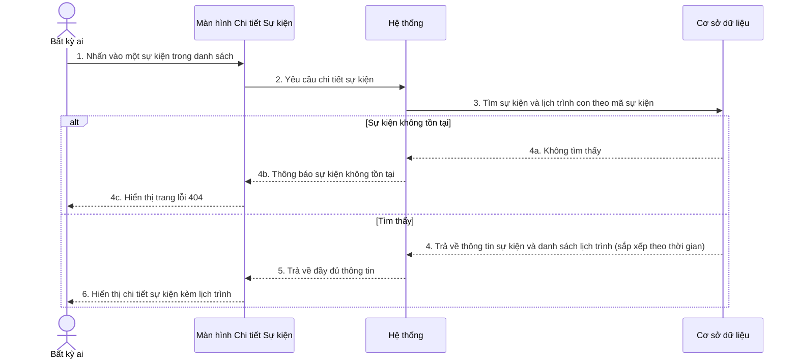

---

## UC16 – Tạo sự kiện mới (Organizer)

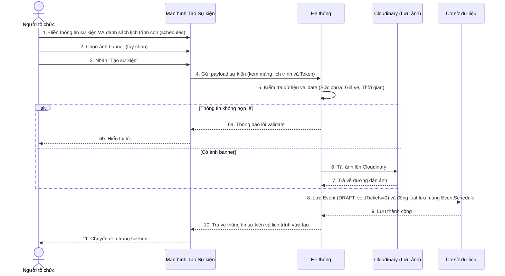

---

## UC17 – Cập nhật sự kiện (Organizer)

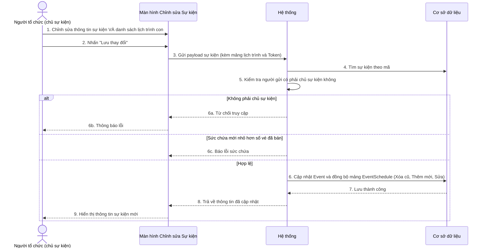

---

## UC18 – Đổi trạng thái sự kiện (Organizer / Admin)

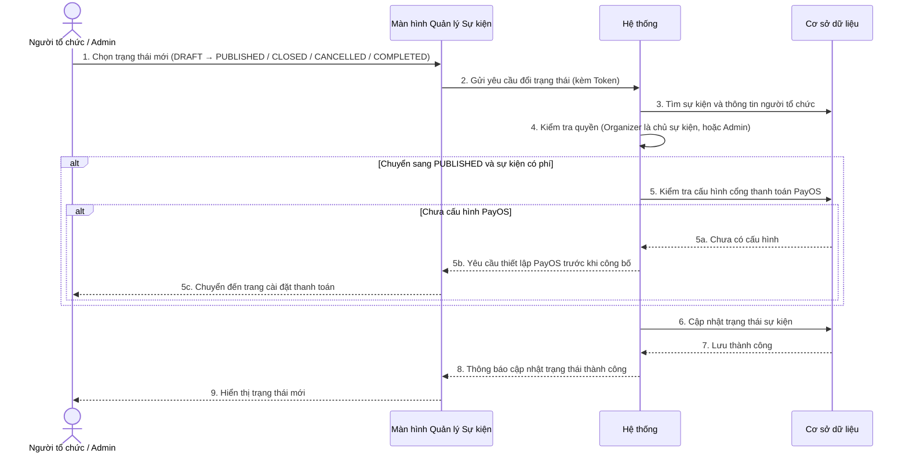

---

## UC19 – Xóa sự kiện (Organizer / Admin)

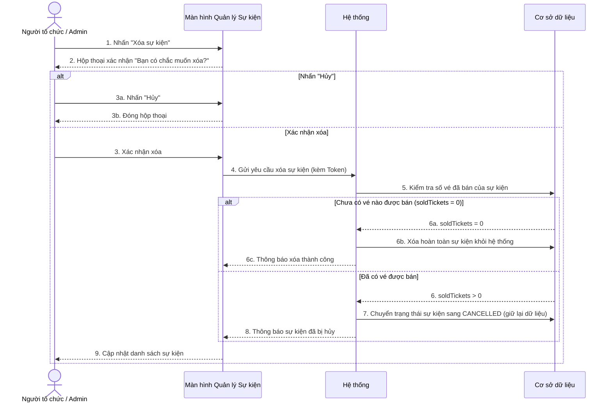
