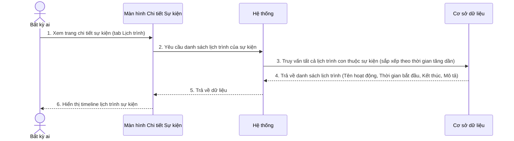
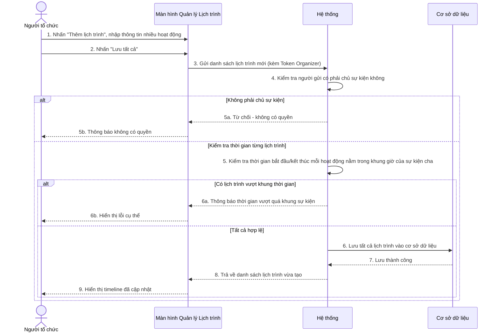
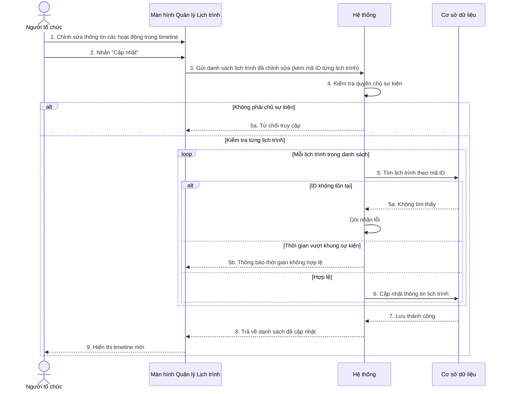
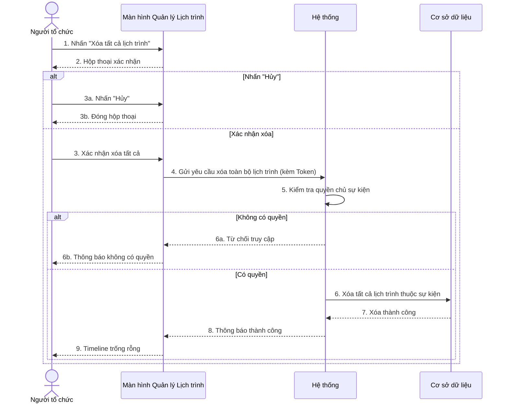
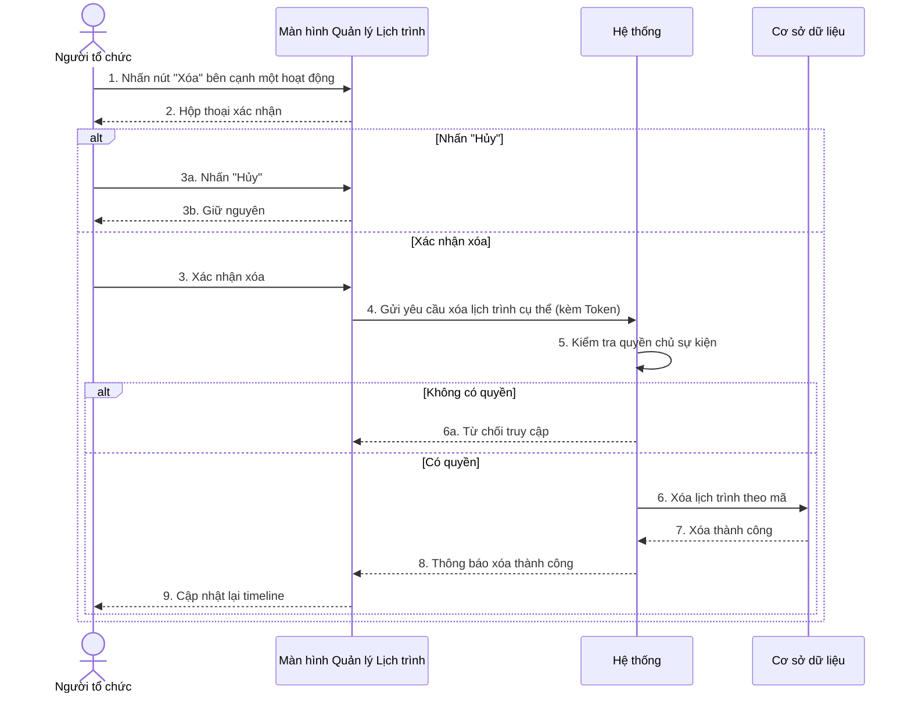
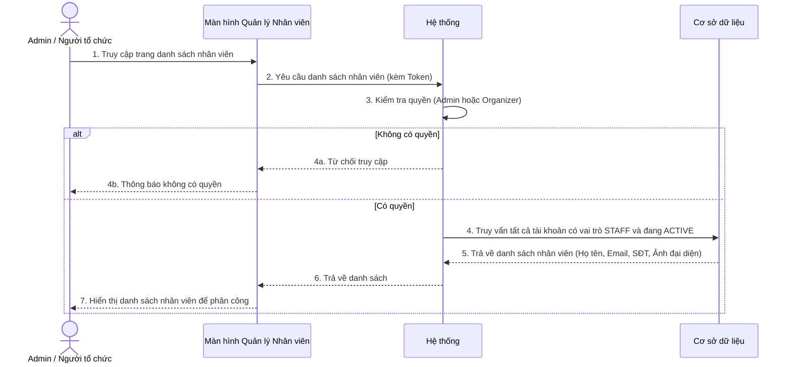
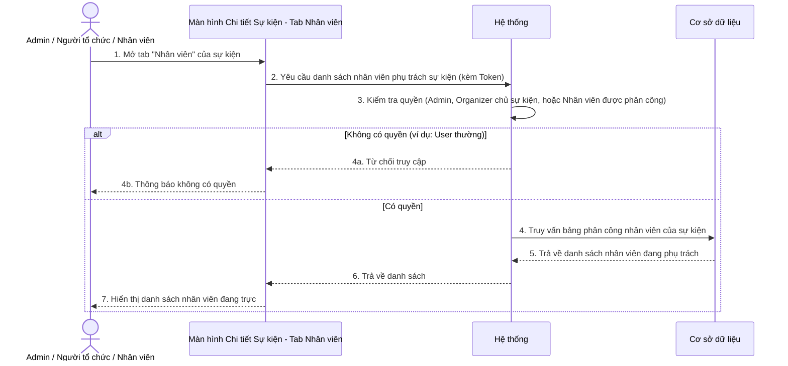
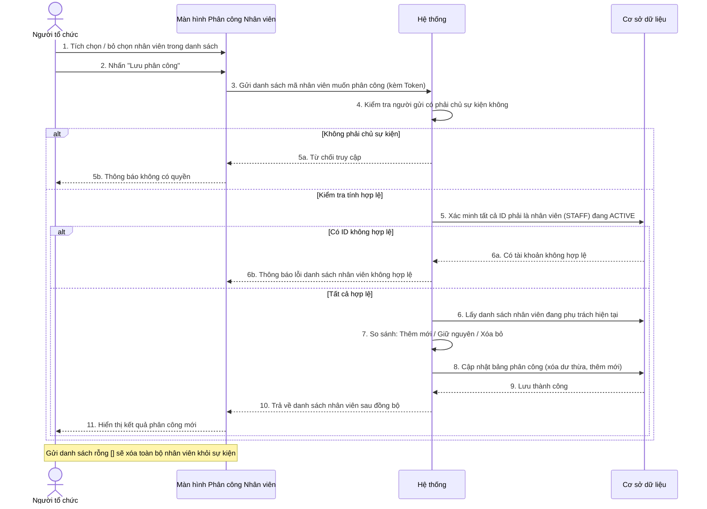
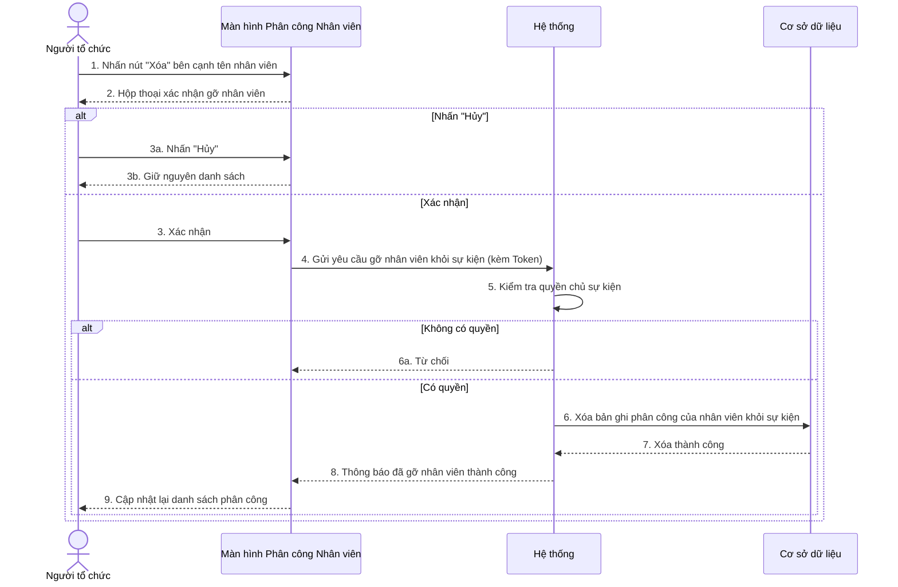

# BIỂU ĐỒ TUẦN TỰ - PHẦN C: LỊCH TRÌNH & PHÂN CÔNG NHÂN VIÊN (UC20 – UC28)

---

## UC20 – Xem lịch trình sự kiện

---

## UC21 – Tạo lịch trình con hàng loạt (Organizer)

---

## UC22 – Cập nhật lịch trình con hàng loạt (Organizer)

---

## UC23 – Xóa toàn bộ lịch trình (Organizer)

---

## UC24 – Xóa một lịch trình con (Organizer)

---

## UC25 – Xem danh sách Nhân viên toàn hệ thống (Admin / Organizer)

---

## UC26 – Xem Nhân viên được phân công vào sự kiện

---

## UC27 – Đồng bộ phân công Nhân viên (Organizer)

---

## UC28 – Xóa một Nhân viên khỏi sự kiện (Organizer)

