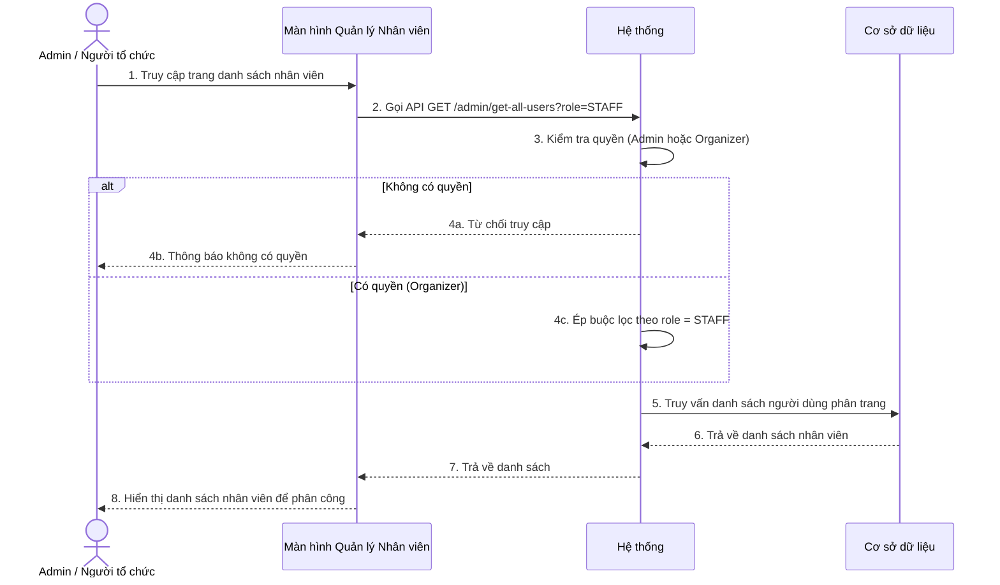
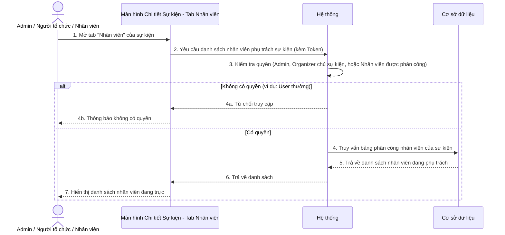
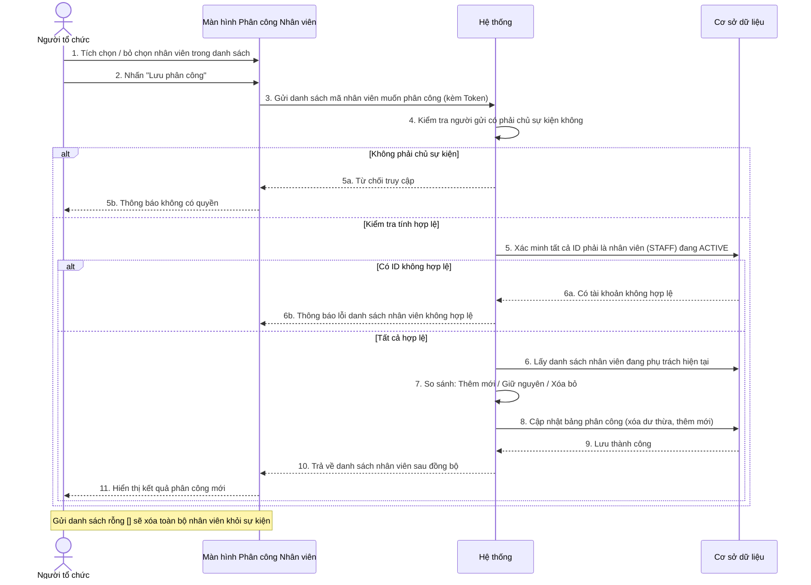
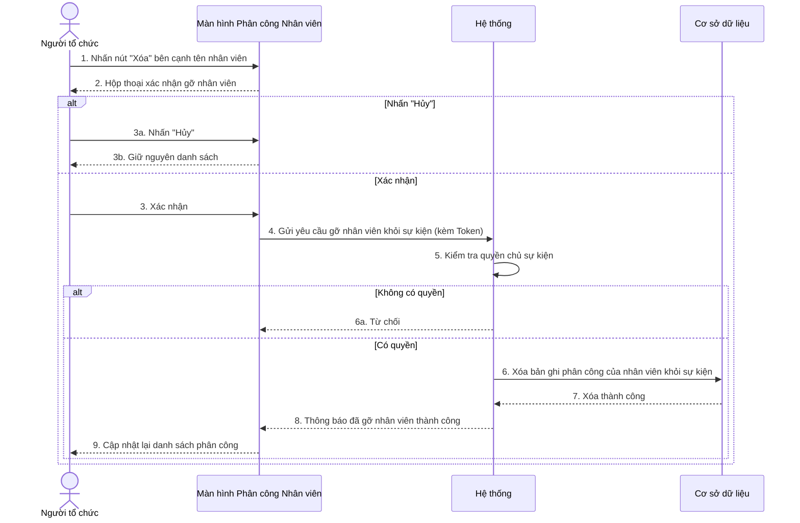

# BIỂU ĐỒ TUẦN TỰ - PHẦN D: LỊCH TRÌNH & PHÂN CÔNG NHÂN VIÊN (UC21 – UC24)

---

> **[LƯU Ý QUAN TRỌNG VỀ KIẾN TRÚC MỚI]**
> Kể từ phiên bản V2, các chức năng Tạo, Sửa, Xóa, Xem lịch trình con độc lập **đã bị loại bỏ**.
> Các thao tác này đã được tích hợp đồng bộ thành một mảng `schedules` và được xử lý chung trong luồng Tạo/Cập nhật/Xem Sự kiện (Xem phần B và C).

---

## UC21 – Xem danh sách Nhân viên toàn hệ thống (Admin / Organizer)

---

## UC22 – Xem danh sách staff được phân công vào sự kiện

---

## UC23 – Đồng bộ phân công Nhân viên (Organizer)

---

## UC24 – Xóa một Nhân viên khỏi sự kiện (Organizer)

