# BIỂU ĐỒ TUẦN TỰ - PHẦN D: THANH TOÁN, VÉ & CHECK-IN (UC29 – UC40)

---

## UC29 – Cấu hình cổng thanh toán PayOS (Organizer)

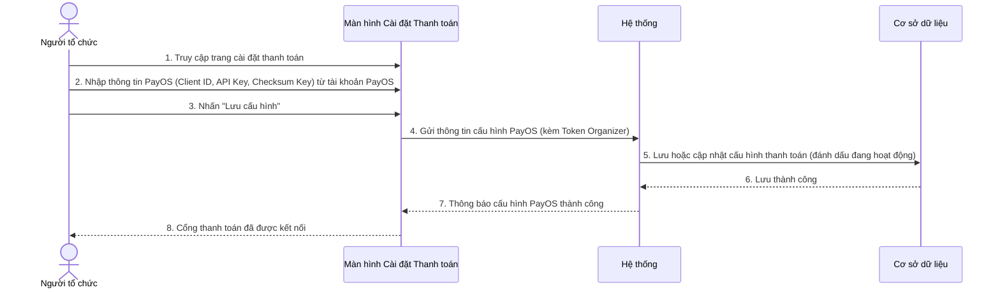

---

## UC30 – Xem cấu hình thanh toán PayOS (Organizer)

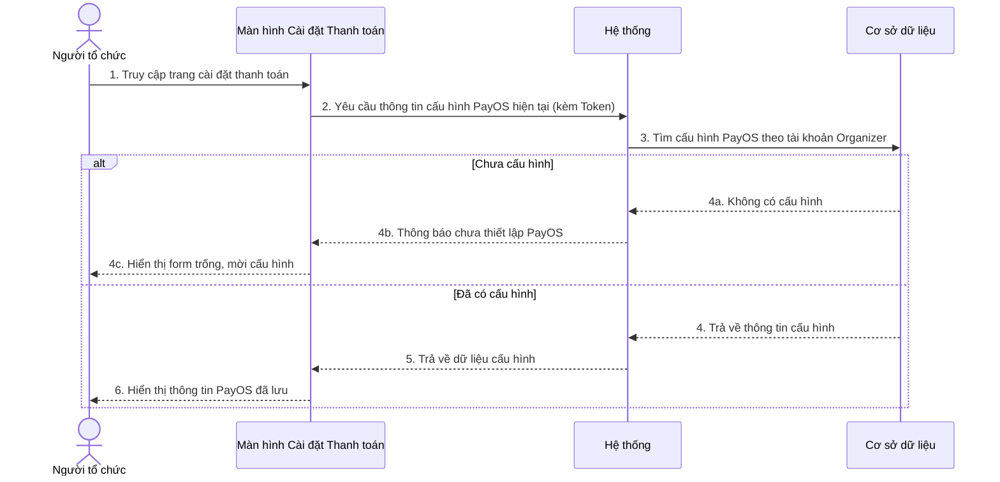

---

## UC31 – Đăng ký tham gia sự kiện (Mua vé)

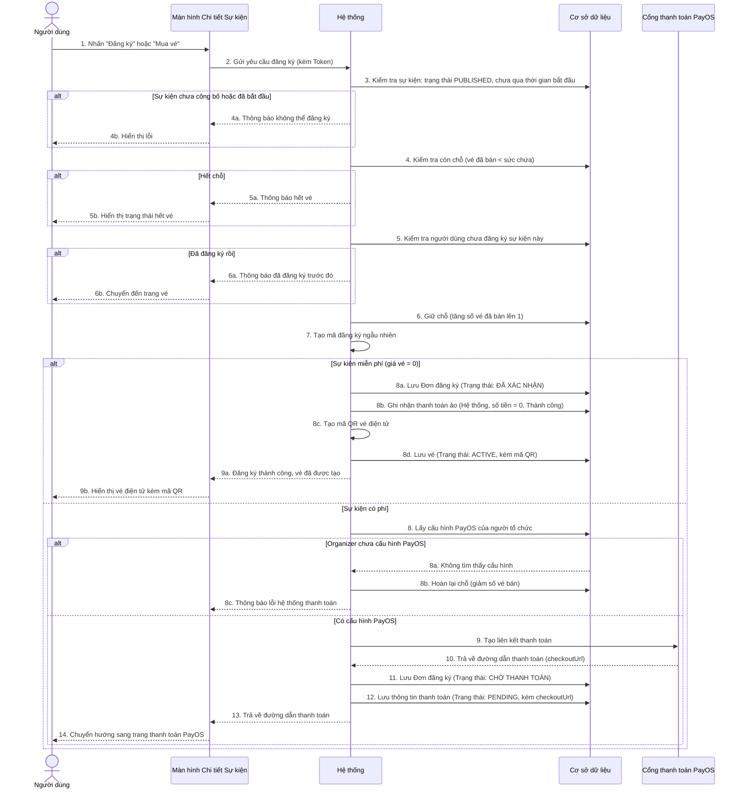

---

## UC32 – Hủy vé miễn phí

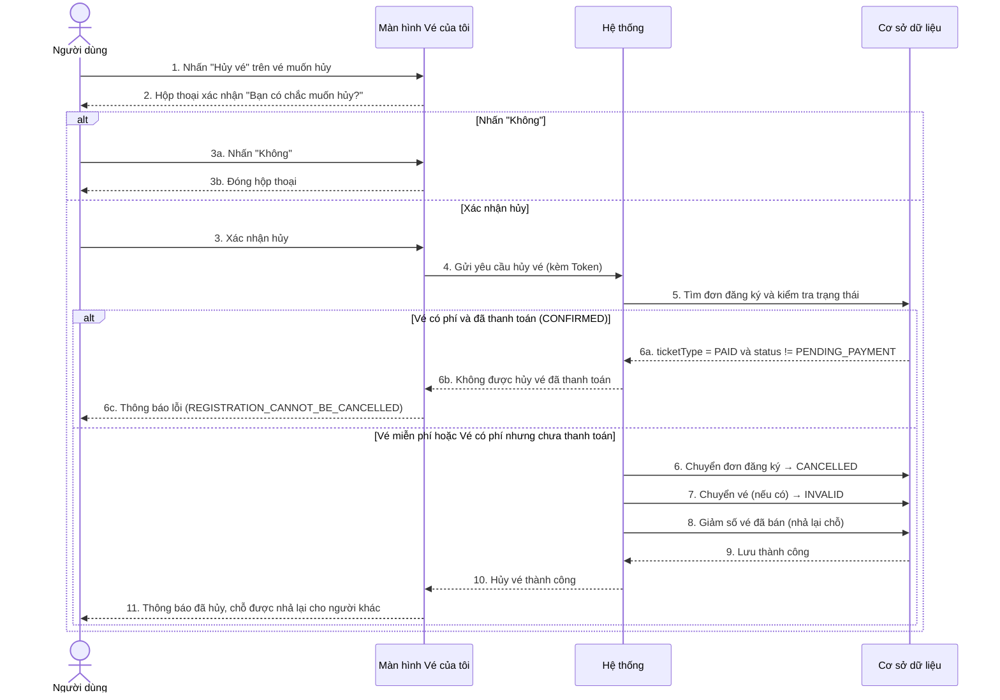

---

## UC33 – Xử lý kết quả thanh toán từ PayOS (Webhook)

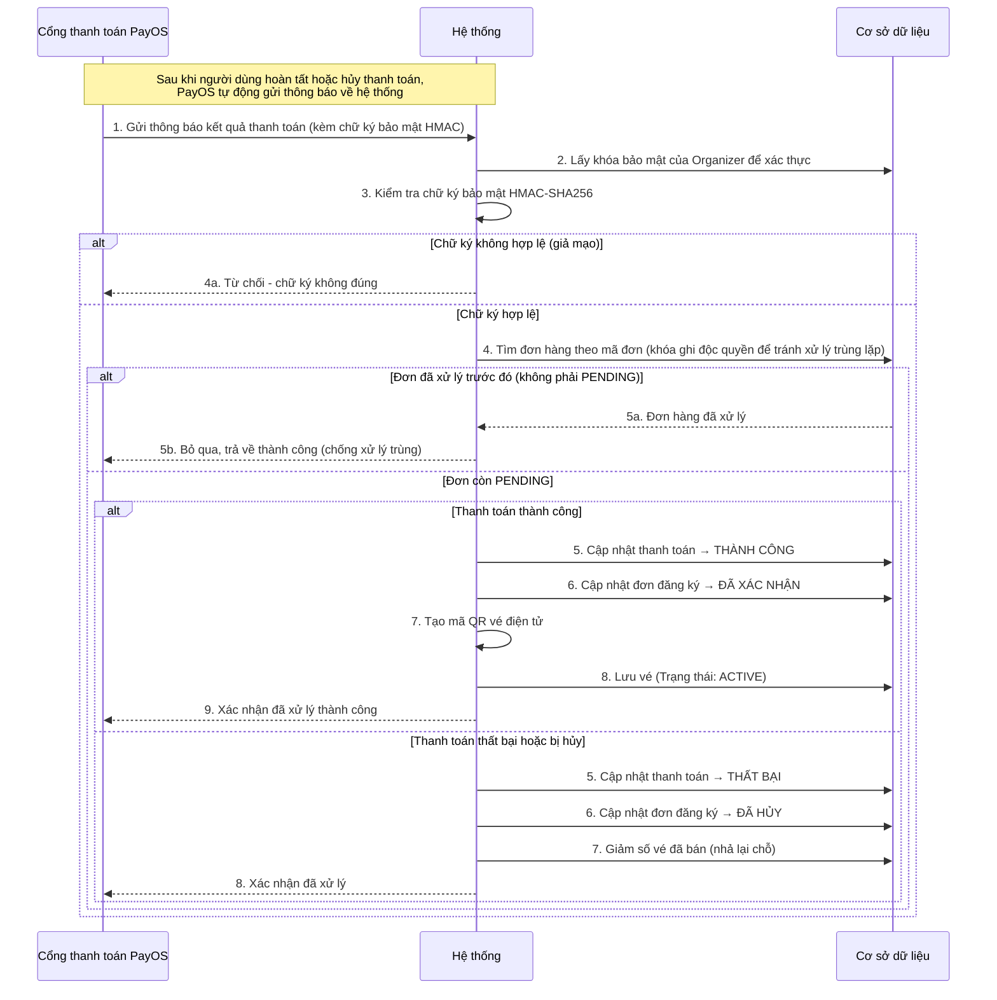

---

## UC34 – Đồng bộ trạng thái đơn hàng thủ công

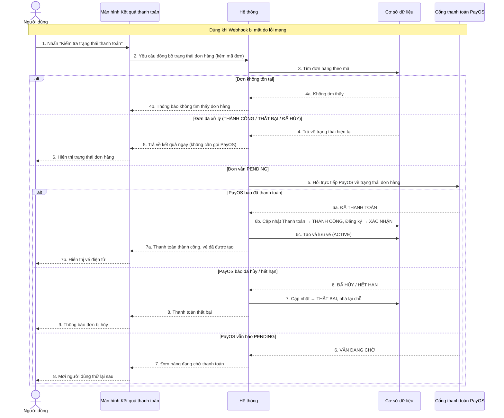

---

## UC35 – Xem danh sách đơn hàng đang chờ thanh toán

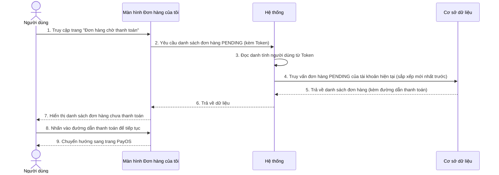

---

## UC36 – Xem vé cá nhân (My Tickets)

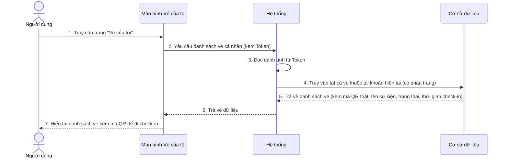

---

## UC37 – Xem danh sách vé của sự kiện (Admin / Organizer / Staff)

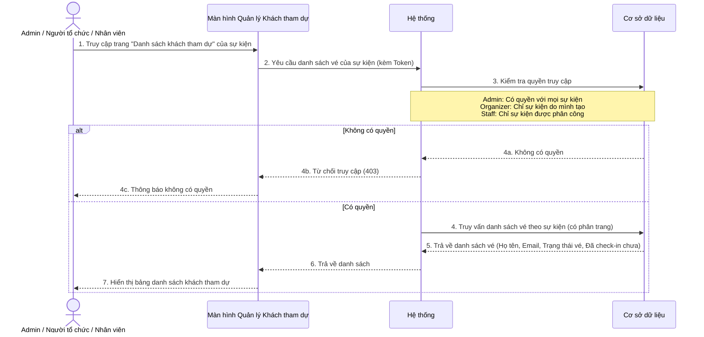

---

## UC38 – Quét mã QR Check-in

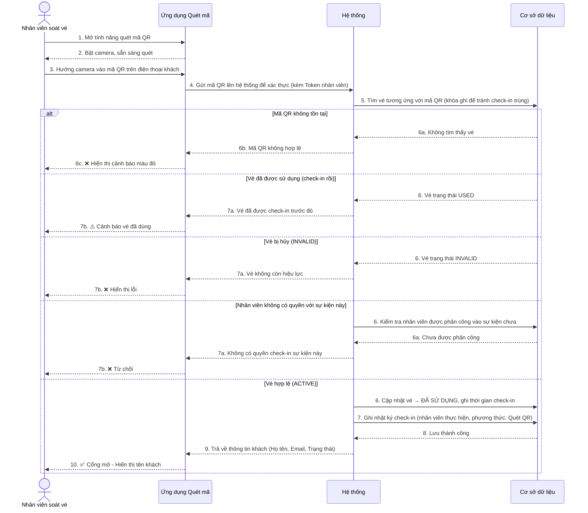

---

## UC39 – Đồng bộ Check-in hàng loạt khi Offline (Batch Sync)

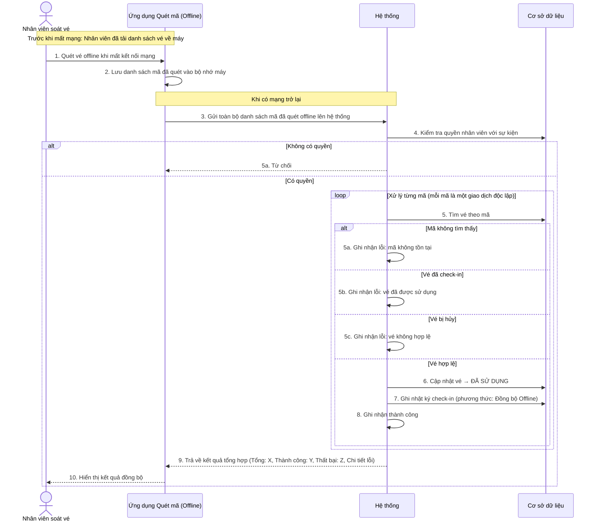

---

## UC40 – Tự động hủy đơn hàng quá hạn (Scheduler)

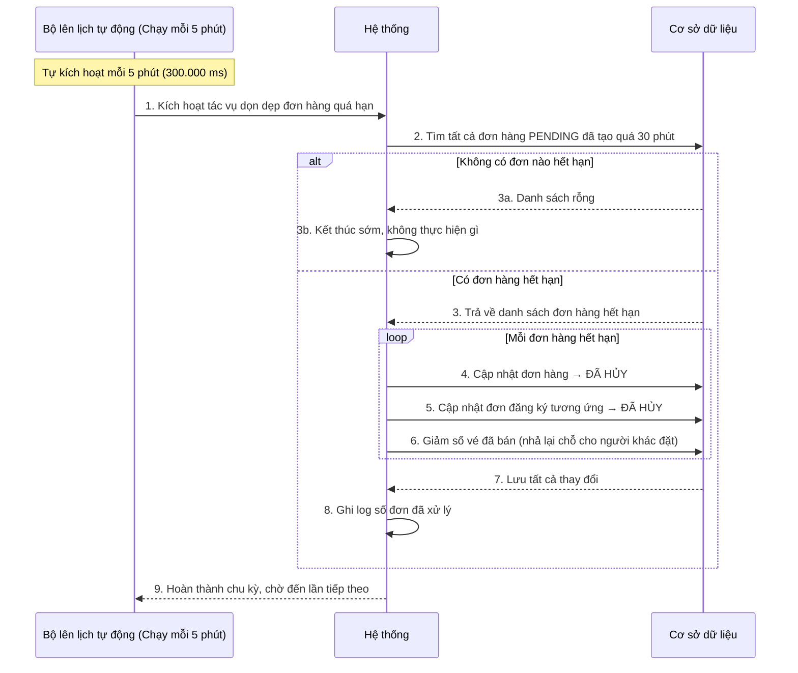
