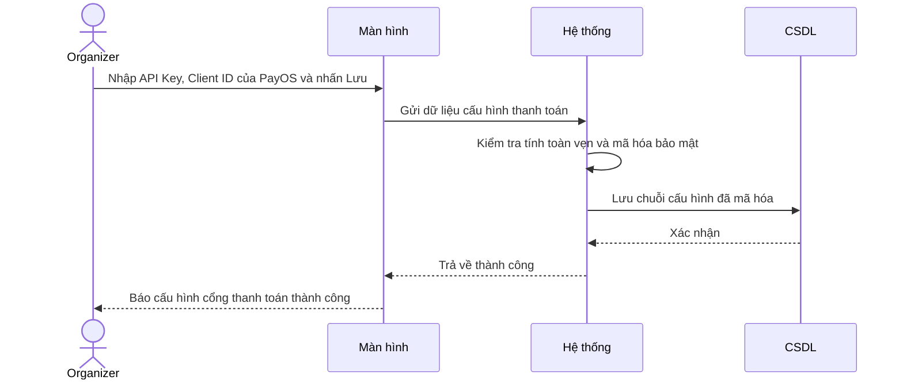
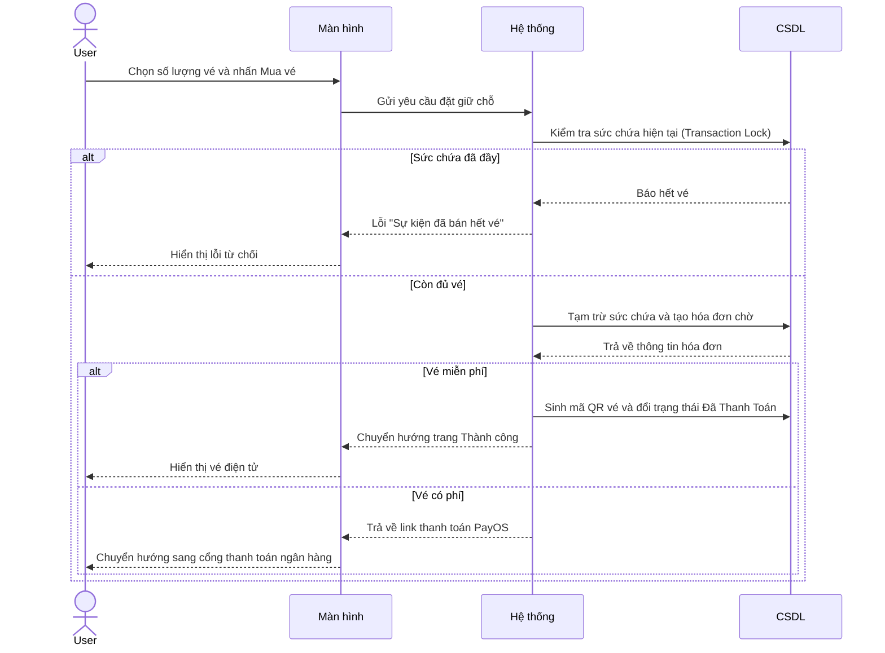
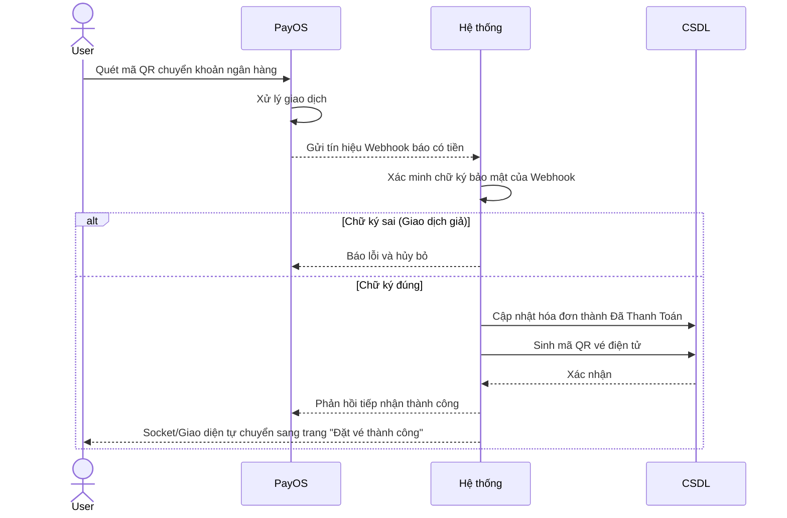
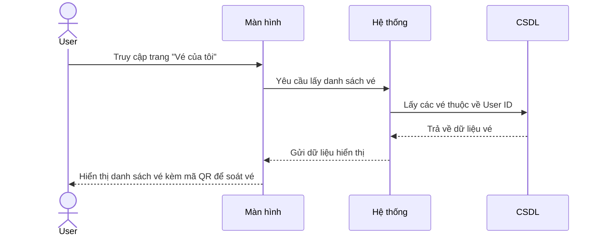
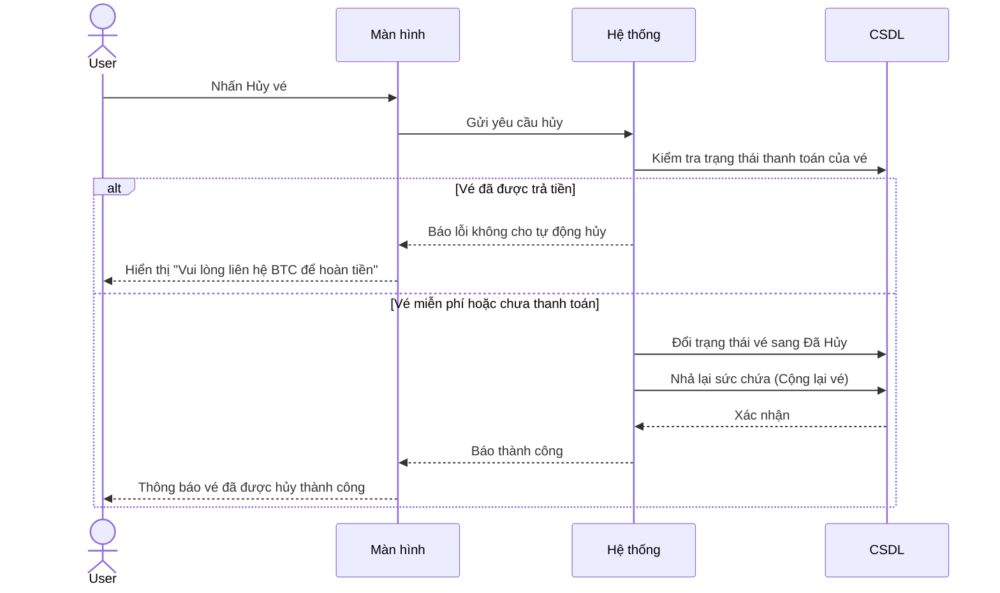
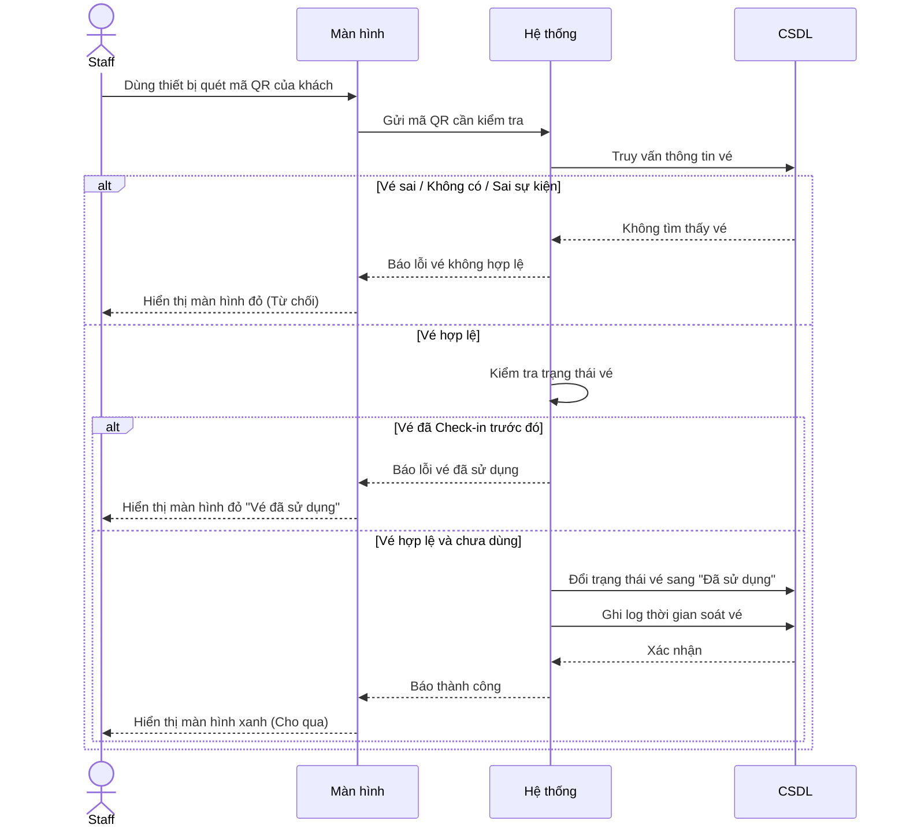
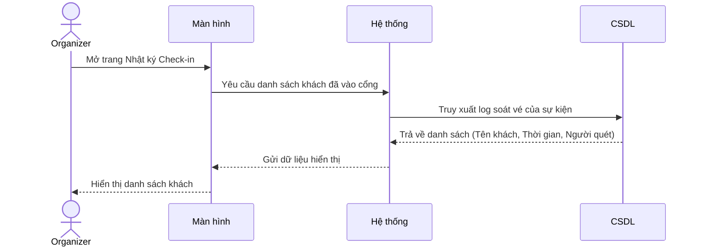

# BIỂU ĐỒ TUẦN TỰ - PHẦN D: BÁN VÉ, THANH TOÁN & CHECK-IN (UC16 – UC22)

---

## UC16 – Cấu hình cổng thanh toán (PayOS)

---

## UC17 – Đặt mua vé sự kiện

---

## UC18 – Thanh toán vé sự kiện

---

## UC19 – Xem danh sách vé cá nhân

---

## UC20 – Hủy vé đã đặt

---

## UC21 – Quét mã QR soát vé (Check-in)

---

## UC22 – Xem lịch sử Check-in

