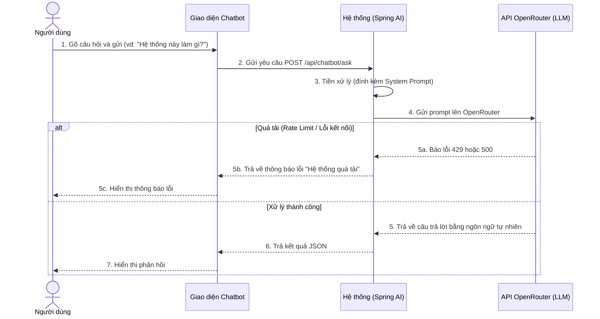
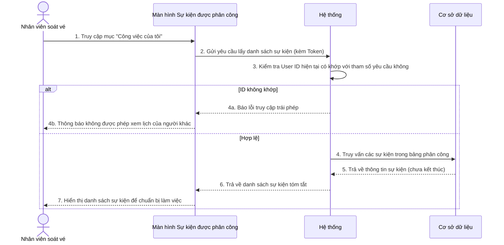
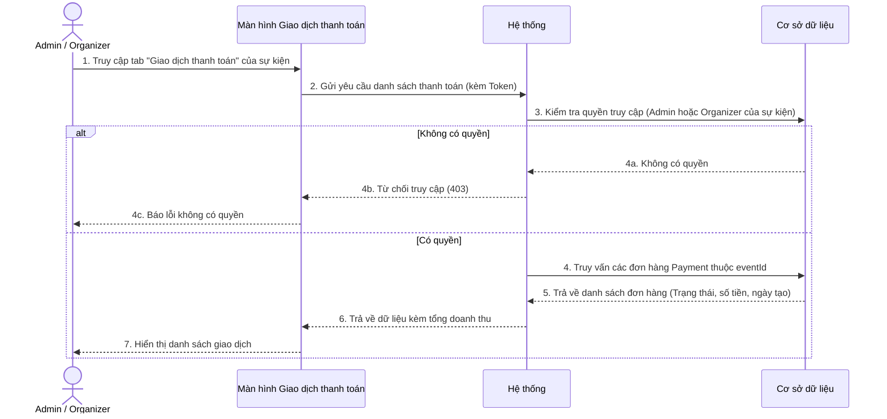
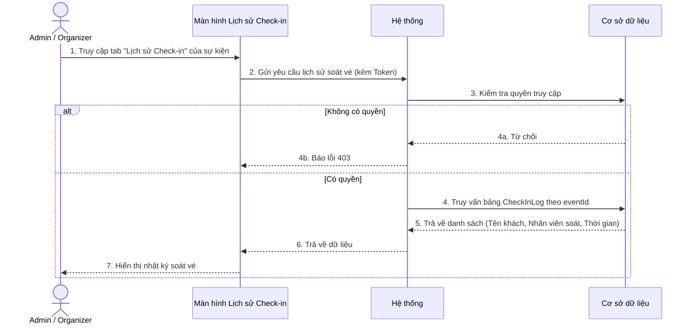

# BIỂU ĐỒ TUẦN TỰ - PHẦN F: TRỢ LÝ ẢO AI CHATBOT & BÁO CÁO (UC37 – UC40)

---

## UC38 – Trò chuyện và tư vấn chung (AI Chat)

---

## UC39 – Xem danh sách sự kiện được phân công (Dành cho Staff)

---

## UC40 – Xem danh sách giao dịch thanh toán của sự kiện

---

## UC41 – Xem lịch sử điểm danh (Check-in) của sự kiện

