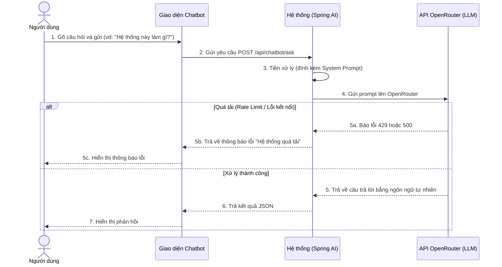
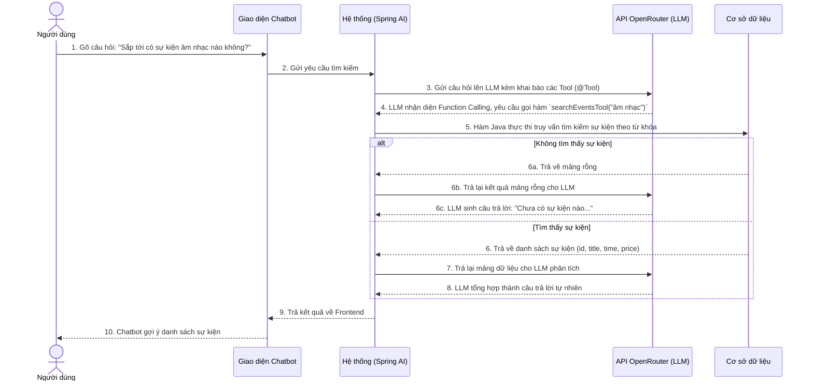
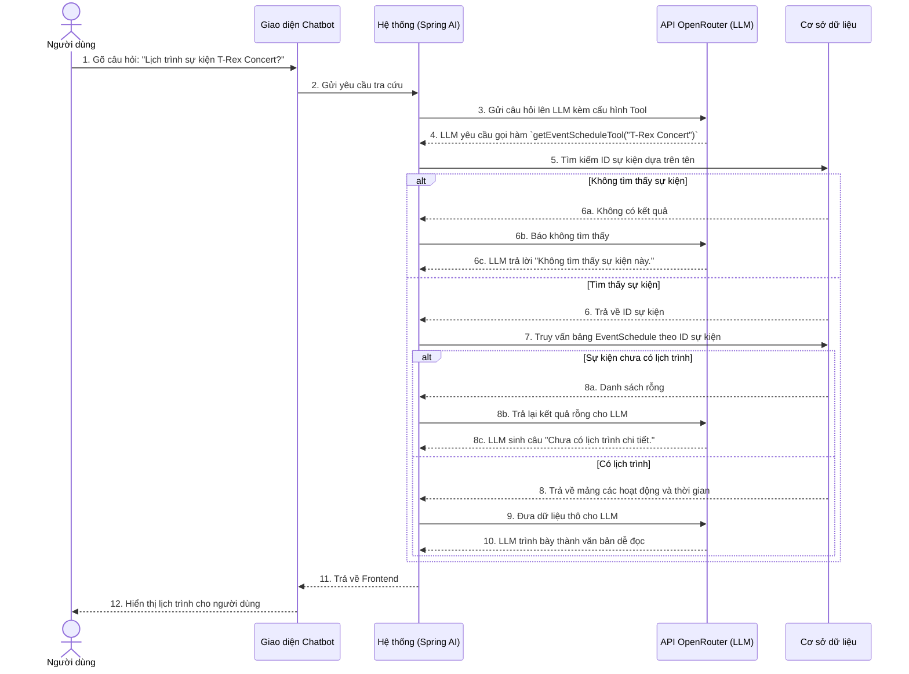

# BIỂU ĐỒ TUẦN TỰ - PHẦN E: TRỢ LÝ ẢO AI CHATBOT (UC41 – UC43)

---

## UC41 – Trò chuyện và tư vấn chung (AI Chat)

---

## UC42 – Tra cứu và gợi ý sự kiện tự động (Function Calling)

---

## UC43 – Tra cứu lịch trình chi tiết sự kiện (Function Calling)

